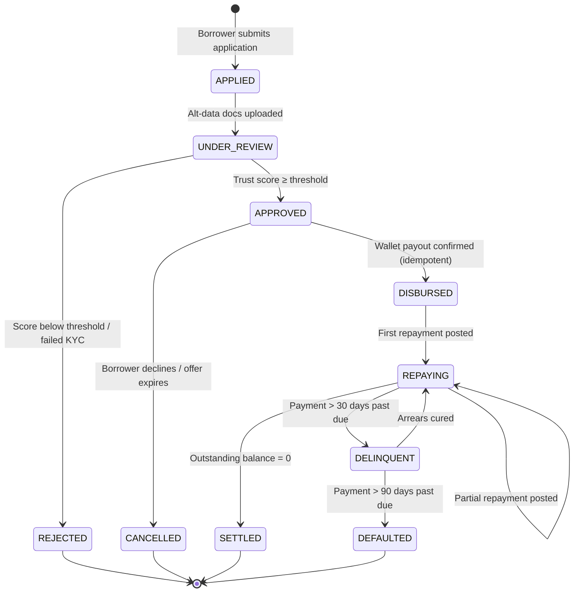

# MicroCredit API

> Alternative Credit Scoring & Micro-Lending Portal

## Problem Statement

Millions of Filipino micro-entrepreneurs — sari-sari store owners, market
vendors, tricycle operators — are "unbanked": they have no formal credit history,
so banks turn them away. Many end up borrowing from informal **"5-6" lenders**,
who charge roughly 20% interest per month (lend ₱5, collect ₱6) and often use
aggressive collection practices.

**MicroCredit API** helps these borrowers get fair credit by scoring them on
**alternative data** they already have — utility bills, supplier invoices, and
mobile load usage — and producing an explainable trust score that lenders can
act on.

## Planned Tech Stack

- React
- TypeScript (strict mode)
- Tailwind CSS
- Vite
- Node.js (LTS)

## Loan Lifecycle State Machine

Every loan is a finite state machine. Only the transitions below are legal; the
Lender Admin Dashboard renders actions **only** for the current state's allowed
transitions, and the API rejects anything else with `409 Conflict`.



| State          | Meaning                                          | Terminal |
| -------------- | ------------------------------------------------ | :------: |
| `APPLIED`      | Application created, awaiting documents          |          |
| `UNDER_REVIEW` | Alternative data being scored                    |          |
| `APPROVED`     | Offer issued; funds reserved, not yet sent       |          |
| `REJECTED`     | Application declined (reason codes shown)        |    ✅    |
| `CANCELLED`    | Approved offer declined or expired               |    ✅    |
| `DISBURSED`    | Funds sent to borrower's GCash/Maya wallet       |          |
| `REPAYING`     | At least one repayment posted, balance > 0       |          |
| `DELINQUENT`   | Past due > 30 days (counts toward PAR 30/60/90)  |          |
| `SETTLED`      | Fully repaid                                     |    ✅    |
| `DEFAULTED`    | Past due > 90 days; written off                  |    ✅    |

On the frontend, states are modelled as a TypeScript **discriminated union**,
and transitions go through a single pure `transition(loan, event)` function, so
illegal transitions fail at compile time where possible and at runtime otherwise.

## Double-Entry Ledger & Concurrency Architecture

### Ledger principles

1. **Every money movement is a balanced journal entry.** Each transaction posts
   at least one debit and one credit, and `Σ debits = Σ credits` must hold.
2. **Immutable, append-only.** Ledger rows are never updated or deleted. Errors
   are corrected by posting a *compensating (reversal) entry* that references
   the original.
3. **Integer centavos only.** All amounts are stored and computed as integer
   centavos (₱1.00 = `100`). Floating-point currency math is forbidden; pesos are
   formatted only at the display boundary via a shared `formatPHP()` utility.
4. **Balances are derived, not stored.** An account balance is the sum of its
   entries, so the ledger is the single source of truth.

### Example: ₱5,000.00 disbursement + ₱1,050.00 repayment

| Txn  | Account                        | Debit (centavos) | Credit (centavos) |
| ---- | ------------------------------ | ---------------: | ----------------: |
| T-01 | `loans_receivable:borrower-42` |        `500000`  |                   |
| T-01 | `wallet_clearing:gcash`        |                  |         `500000`  |
| T-02 | `wallet_clearing:gcash`        |        `105000`  |                   |
| T-02 | `loans_receivable:borrower-42` |                  |         `100000`  |
| T-02 | `interest_income`              |                  |           `5000`  |

### Concurrency & idempotency

| Risk                                   | Mitigation                                                                                     |
| -------------------------------------- | ---------------------------------------------------------------------------------------------- |
| Double disbursement on network retry   | Every disbursement/payment mutation carries an `Idempotency-Key` (UUID v4) generated once per user intent and reused on retries; the server replays the original response for duplicate keys. |
| Two admins acting on the same loan     | Optimistic concurrency: each loan has a `version`; mutations send `If-Match: <version>` and receive `409 Conflict` if it's stale. The UI then refetches and shows the new state. |
| Partial writes (ledger posted, state not updated) | State transition and its journal entries commit in **one ACID database transaction**: all or nothing. |
| Webhook replay from wallet provider    | Webhooks are verified by HMAC signature (secret from env vars) and de-duplicated by provider event ID. |
| Double-click on "Disburse" / "Pay"     | Submit buttons are disabled while a request is in flight, and the idempotency key covers anything that still gets through. |

## Getting Started

> 🚧 Setup instructions coming soon.

```bash
# git clone https://github.com/l3n8n-ocd/microcredit-api.git
# cd microcredit-api
# npm install
# npm run dev
```

## License

[MIT](./LICENSE) © 2026 Lenon D. Adriano
