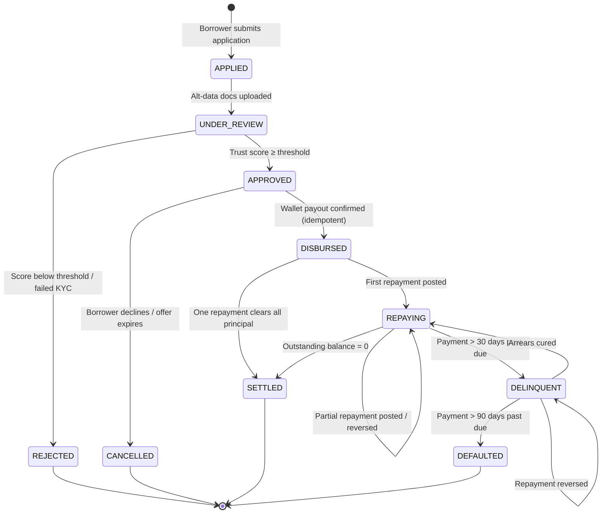
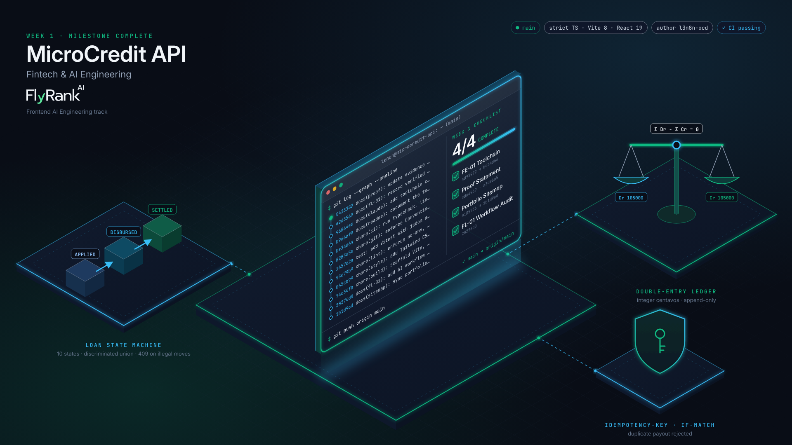

# MicroCredit API

[](https://github.com/l3n8n-ocd/microcredit-api/actions/workflows/ci.yml)

> Alternative Credit Scoring & Micro-Lending Portal

**Live demo: [microcredit-api-beta.vercel.app](https://microcredit-api-beta.vercel.app)**.
The demo opens on a pre-filled sample payout. Double-click **Disburse** and only one request is
sent. Then use **Simulate
double-click / network retry** to send the same request twice: the second one is
replayed (same `Idempotency-Key`) or rejected with `409` (stale `If-Match`), and the
ledger posts the payout once. The demo runs against an in-memory mock API, so
state resets when you reload the page.

## Problem Statement

Millions of Filipino micro-entrepreneurs — sari-sari store owners, market
vendors, tricycle operators — are "unbanked": they have no formal credit history,
so banks turn them away. Many end up borrowing from informal **"5-6" lenders**,
who charge roughly 20% interest per month (lend ₱5, collect ₱6) and often use
aggressive collection practices.

**MicroCredit API** helps these borrowers get fair credit by scoring them on
**alternative data** they already have — utility bills, supplier invoices, and
mobile load usage — and producing an explainable trust score that lenders can
act on.

## Tech Stack

| Layer      | Tool                                               |
| ---------- | -------------------------------------------------- |
| UI         | React 19 (functional components, named exports)    |
| Language   | TypeScript 7, `strict` plus the extra flags in [`CLAUDE.md`](./CLAUDE.md#2-tech-stack) |
| Build      | Vite 8                                             |
| Styling    | Tailwind CSS 4 (via `@tailwindcss/vite`)           |
| Lint       | oxlint: no `any`, no default exports, hooks rules  |
| Tests      | Vitest 5 + jsdom + Testing Library                 |
| Git hooks  | husky + lint-staged + commitlint (Conventional Commits) |
| CI         | GitHub Actions: typecheck → lint → test → build    |
| Runtime    | Node.js 22 LTS (pinned in `.nvmrc`)                |

## Project Status

| Area | Status |
| ---- | ------ |
| Toolchain, lint, tests, git hooks, CI | ✅ In place |
| Next.js App Router skeleton (5 routed screens) | ✅ Built: `/`, `/underwriting`, `/ledger`, `/advisories`, `/health` (see [`SPEC.md`](./SPEC.md)) |
| `Disburse` flow with `Idempotency-Key` + `If-Match` | ✅ Built and tested in [`src/features/disbursement/`](./src/features/disbursement/), against an in-memory mock API (no real backend or wallet yet) |
| Loan state machine | ✅ Built and tested: all 10 states below as one discriminated union in [`loanStateMachine.ts`](./src/features/disbursement/loanStateMachine.ts); 100 `(state, event)` pairs tested, 88 illegal ones rejected as a typed `409` |
| Double-entry ledger | ✅ Built and tested: disbursement, repayment (principal + interest) and compensating-reversal entries in [`ledger.ts`](./src/features/disbursement/ledger.ts), each checked for `Σ debits === Σ credits`; in-memory mock API |
| Credit scoring | ✅ Built and tested: 3-signal trust score (0–1000) with reason codes and a limit in `Centavos`, in [`src/features/scoring/`](./src/features/scoring/); demo profiles only, no real borrower data |
| AI Underwriting & Ledger Risk Copilot (FE-06) | ✅ Built and tested: streaming chat on [`/underwriting#copilot`](https://microcredit-api-beta.vercel.app/underwriting#copilot) over `POST /api/chat`, with Stop, smart auto-scroll and `localStorage` history. Hosted-model requests pass an in-memory rate limit (10 a minute, 100 a day per client). With no real API key active it answers from a local rule engine (labelled as such), not a language model; a hosted model on the live URL is a TODO ([`docs/FE-06_STREAMING_CHAT.md`](./docs/FE-06_STREAMING_CHAT.md) §1) |
| Deployed demo | ✅ [microcredit-api-beta.vercel.app](https://microcredit-api-beta.vercel.app) (Vercel, imported from `main`; mock API, no real wallet payouts) |

## Loan Lifecycle State Machine

Every loan is a finite state machine. Only the transitions below are legal; the
Lender Admin Dashboard renders actions **only** for the current state's allowed
transitions, and the API rejects anything else with `409 Conflict`.



| State          | Meaning                                          | Terminal |
| -------------- | ------------------------------------------------ | :------: |
| `APPLIED`      | Application created, awaiting documents          |          |
| `UNDER_REVIEW` | Alternative data being scored                    |          |
| `APPROVED`     | Offer issued; funds reserved, not yet sent       |          |
| `REJECTED`     | Application declined (reason codes shown)        |    ✅    |
| `CANCELLED`    | Approved offer declined or expired               |    ✅    |
| `DISBURSED`    | Funds sent to borrower's GCash/Maya wallet       |          |
| `REPAYING`     | At least one repayment posted, balance > 0       |          |
| `DELINQUENT`   | Past due > 30 days (counts toward PAR 30/60/90)  |          |
| `SETTLED`      | Fully repaid                                     |    ✅    |
| `DEFAULTED`    | Past due > 90 days; written off                  |    ✅    |

On the frontend, states are modelled as a TypeScript **discriminated union**,
and transitions go through a single pure `transition(loan, event)` function, so
illegal transitions fail at compile time where possible and at runtime otherwise.

## Double-Entry Ledger & Concurrency Architecture

### Ledger principles

1. **Every money movement is a balanced journal entry.** Each transaction posts
   at least one debit and one credit, and `Σ debits = Σ credits` must hold.
2. **Immutable, append-only.** Ledger rows are never updated or deleted. Errors
   are corrected by posting a *compensating (reversal) entry* that references
   the original.
3. **Integer centavos only.** All amounts are stored and computed as integer
   centavos (₱1.00 = `100`). Floating-point currency math is forbidden; pesos are
   formatted only at the display boundary via a shared `formatPHP()` utility.
4. **Balances are derived, not stored.** An account balance is the sum of its
   entries, so the ledger is the single source of truth.

### Example: ₱5,000.00 disbursement + ₱1,050.00 repayment

| Txn  | Account                        | Debit (centavos) | Credit (centavos) |
| ---- | ------------------------------ | ---------------: | ----------------: |
| T-01 | `loans_receivable:borrower-42` |        `500000`  |                   |
| T-01 | `wallet_clearing:gcash`        |                  |         `500000`  |
| T-02 | `wallet_clearing:gcash`        |        `105000`  |                   |
| T-02 | `loans_receivable:borrower-42` |                  |         `100000`  |
| T-02 | `interest_income`              |                  |           `5000`  |

### Concurrency & idempotency

| Risk                                   | Mitigation                                                                                     |
| -------------------------------------- | ---------------------------------------------------------------------------------------------- |
| Double disbursement on network retry   | Every disbursement/payment mutation carries an `Idempotency-Key` (UUID v4) generated once per user intent and reused on retries; the server replays the original response for duplicate keys. |
| Two admins acting on the same loan     | Optimistic concurrency: each loan has a `version`; mutations send `If-Match: <version>` and receive `409 Conflict` if it's stale. The UI then refetches and shows the new state. |
| Partial writes (ledger posted, state not updated) | State transition and its journal entries commit in **one ACID database transaction**: all or nothing. |
| Webhook replay from wallet provider    | Webhooks are verified by HMAC signature (secret from env vars) and de-duplicated by provider event ID. |
| Double-click on "Disburse" / "Pay"     | Submit buttons are disabled while a request is in flight, and the idempotency key covers anything that still gets through. |

## Getting Started

Requires Node.js 22 LTS (`nvm use` reads `.nvmrc`).

```bash
git clone https://github.com/l3n8n-ocd/microcredit-api.git
cd microcredit-api
npm install
cp .env.example .env
npm run dev
```

| Script              | What it does                                         |
| ------------------- | ---------------------------------------------------- |
| `npm run dev`       | Start the Next.js dev server (App Router)            |
| `npm run build`     | Production build (`next build`)                      |
| `npm run start`     | Serve the production build locally (`next start`)    |
| `npm run typecheck` | Run the TypeScript compiler in strict mode           |
| `npm run lint`      | Run oxlint; warnings fail the run                    |
| `npm test`          | Run the Vitest suite once (333 tests)                |
| `npm run test:e2e`  | After `build`: above-the-fold on `/`, all 5 routes at 375px/1280px with no overflow, and the AI Copilot streaming checks (Playwright) |

Every commit runs lint-staged and a typecheck, and commit messages must follow
Conventional Commits (`feat`, `fix`, `docs`, `chore`, `refactor`, `test`).

## Portfolio & AI Fluency Proof

This repository is the flagship proof in my portfolio. The proof statement,
lean portfolio sitemap, and the pressure-test critique with its revisions are
documented in [`docs/PORTFOLIO_PATH.md`](./docs/PORTFOLIO_PATH.md).

- **What this repo proves:** [`docs/WHAT_ARE_YOU_PROVING.md`](./docs/WHAT_ARE_YOU_PROVING.md)
  has the sharpened proof statement, the one-line why, and the narrowing log.

## 🎓 FlyRank Internship Deliverables



- **FL-01 · AI Workflow Audit and Tool Setup:** [`docs/FL-01_WORKFLOW_AUDIT.md`](./docs/FL-01_WORKFLOW_AUDIT.md)
  covers the 12-task weekly audit, the three target tasks for FL-02 → FL-04 with
  measurable "Done Well" criteria, and the Claude Project custom instructions.
- **FE-03 / FE-04 · AI-Assisted Workflow Drill:** [`WORKFLOW.md`](./WORKFLOW.md)
  compares a vague prompt against a precise spec for the same Disburse form.
  Both rounds are kept as branches:
  - Round 1 (vague): [`feat/disburse-form-vague`](https://github.com/l3n8n-ocd/microcredit-api/tree/feat/disburse-form-vague)
  - Round 2 (precise, merged to `main`): [`feat/disburse-form-precise`](https://github.com/l3n8n-ocd/microcredit-api/tree/feat/disburse-form-precise)

  The rules learned from the drill are in [`CLAUDE.md` §11](./CLAUDE.md#11-learned-rules-from-fe-03fe-04-workflow-drill).
- **The Prompt Ladder (Week 2 · General AI Fluency):** [`docs/PROMPT_LADDER.md`](./docs/PROMPT_LADDER.md)
  records 6 real runs (a baseline plus 5 single-layer versions) of the FL-01 T1 state-machine prompt,
  each type-checked and behavior-probed. It includes an honest regression (the JSON output format) and
  a reusable, placeholder-based prompt template. Raw outputs and the measurement harness are in
  [`docs/prompt-ladder/`](./docs/prompt-ladder/).
- **Frame It as Cases: Work That Speaks for Itself (Week 2 · General AI Fluency):**
  [`docs/FRAME_IT_AS_CASES.md`](./docs/FRAME_IT_AS_CASES.md) has the standing Voice Card, the interview
  log that came before any drafting, three framed cases (MicroCredit API, Node2Shell, RoadWatch), the
  sitemap copy, and a before/after edit table.
- **FL-02 · Prompting Fundamentals on Real Tasks v2:** [`docs/FL-02_PROMPTING_FUNDAMENTALS.md`](./docs/FL-02_PROMPTING_FUNDAMENTALS.md)
  turns synthetic security notes into an advisory across 6 prompt versions (naive, then Role, Context,
  Few-Shot, Output Structure, Step Decomposition). It covers 11 real runs on two Claude models, each
  measured for leaked secrets, sections and CVSS, plus a reusable template and 1 verification run of
  that template (0/8 leaks). Evidence is in [`docs/fl-02/`](./docs/fl-02/).
- **Week 3 · React App Development with AI:** [`docs/WEEK3_REACT_AI_DEVELOPMENT.md`](./docs/WEEK3_REACT_AI_DEVELOPMENT.md)
  - **Built:** an alt-data underwriting workbench (`UNDER_REVIEW → APPROVED` feeds the Disburse form), a
    repayment and compensating-reversal panel, and the full 10-state `LoanState` union. All of it sits
    under the Disburse demo in [`src/App.tsx`](./src/App.tsx).
  - **Prompts:** one brief, kept verbatim, plus the 5 steps it was worked in and a derived 5-prompt
    sequence (labelled "not run").
  - **AI assistance:** Claude Code wrote both commits. The doc lists 5 problems the brief did not
    predict, for example a live-sync that broke the stale-`If-Match` test.
  - **4 refactors**, each with a before/after diff and a mutation check that fails when it is undone:
    1. a centavo split that lost ₱0.01 on ₱1,000.00, now `principal + interest === total`;
    2. a pure `scoreEngine.ts` and a memoized `useUnderwritingQueue.ts`;
    3. a reversal guard with `Idempotency-Key` + `If-Match`;
    4. labelled controls, `aria-live` regions and focus moves.
  - **Commits:** AI first pass [`4d2e502`](https://github.com/l3n8n-ocd/microcredit-api/commit/4d2e502),
    code-review refactor [`f24c143`](https://github.com/l3n8n-ocd/microcredit-api/commit/f24c143).
    The first-pass flaws were seeded by the brief, and the doc says so.
- **Consistency, Not Talent (and Frame, Not Upstage) · Week 3 General AI Fluency:**
  [`docs/PORTFOLIO_DESIGN_SYSTEM.md`](./docs/PORTFOLIO_DESIGN_SYSTEM.md)
  - **3 rules:** Plus Jakarta Sans + Inter + JetBrains Mono; 9 colour tokens with one meaning each
    (`#10B981` only for a passed check such as `Σ debits === Σ credits`); a `max-w-4xl` column with no
    decoration.
  - **Framing:** the live Disburse/Simulate demo is the hero, not an image.
  - **Image log:** what was rejected, what was chosen, and the 16/16 commit hashes checked in the Week 1
    milestone card.
  - **Tailwind v4 `@theme` block:** compiled against this repo, with measured WCAG contrast ratios.
    The visual rule for AI-generated components is in [`CLAUDE.md` §12](./CLAUDE.md#12-visual-constraints-portfolio-design-system).
- **Decide Once: Build Your Identity Kit · Week 3 General AI Fluency:** [`docs/IDENTITY_KIT.md`](./docs/IDENTITY_KIT.md)
  - **2 fonts:** Plus Jakarta Sans and JetBrains Mono.
  - **4 colours:** `#F8FAFC`, `#0F172A`, `#1E293B` and `#059669`, with measured contrast ratios.
  - **Favicon:** the `LA.` monogram, outlined from Plus Jakarta Sans Bold, at [`public/favicon.svg`](./public/favicon.svg).
  - **Style note:** two lines, also in [`CLAUDE.md` §9.4](./CLAUDE.md#94-identity-kit-style-note).
- **Kill Your Darlings: Curate Your Images · Week 3 General AI Fluency:** [`docs/CURATE_YOUR_IMAGES.md`](./docs/CURATE_YOUR_IMAGES.md) · images in [`docs/assets/curated/`](./docs/assets/curated/)
  - **Real captures:** 4 Playwright captures of the real app and test run: the `Idempotency-Key` / `If-Match`
    preview, a `201 Idempotent replay` and a `409 VERSION_MISMATCH` over a balanced ledger, the trust score
    and repayment split, and `248 passed`.
  - **Generated connective tissue:** 4 line-art SVGs, held to one style by a checker script (Iteration 2
    drafts: 35 violations; keepers: 0).
  - **Killed darling:** the Week 1 neon isometric illustration. It inverts the light palette and fakes
    the evidence it decorates.
  - **Bio slot:** reserved for a real photo (TODO).
- **The Through-Line: Map Content & CTAs · Week 3 General AI Fluency:** [`docs/THE_THROUGH_LINE.md`](./docs/THE_THROUGH_LINE.md)
  - **One-line claim:** "I build loan disbursement flows that cannot pay a borrower twice" — the sharpened
    winner of 10 candidates; the brief's "frontend and full-stack" draft is shown being cut for the "and"
    trap and an unearned "full-stack".
  - **Content map:** 4 sections (Hero sandbox → flagship cases strongest-first → bio → act), each with a
    named CTA.
  - **CTA ladder:** every micro-CTA funnels to the One Action — test the live double-click sandbox, then
    book a 15-minute walkthrough.
  - **Honest gather list:** what is ready now vs. still needed, each with a build-week fallback.
- **FE-04 / FE-05 · Capstone Skeleton, Deployed (Week 3 Frontend AI Engineering):** [`SPEC.md`](./SPEC.md)
  - **Migrated to Next.js 16 (App Router)** — Server Components by default, `'use client'` only on the
    interactive Disbursement & Underwriting islands; the 248 Vitest tests it had at the time and the
    above-the-fold Playwright check still passed.
  - **5 routed screens:** [`/`](https://microcredit-api-beta.vercel.app/) (idempotent disburse sandbox),
    `/underwriting`, `/ledger`, `/advisories`, and `/health` (async Server Component + `/api/health`).
  - **Identity Kit design tokens** in `src/app/globals.css`, fonts self-hosted via `next/font/local`.
  - **Zero-secrets env structure:** [`.env.example`](./.env.example) with placeholders; `.env*`
    gitignored.
- **Empty but Live: Ship a Blank Page · Week 4 General AI Fluency:** [`docs/EMPTY_BUT_LIVE.md`](./docs/EMPTY_BUT_LIVE.md) · route [`/portfolio`](https://microcredit-api-beta.vercel.app/portfolio)
  - **Near-blank, live portfolio shell:** name, `LA.` monogram, the canonical one-line claim, and the 4
    content-map frames (hero → flagship-proof → about → act) as a Server Component in the Identity Kit theme.
  - **Verified** at 375×812 and 1280×800 with zero horizontal overflow; screenshots in `docs/assets/curated/`.
  - **Claude Project context pack:** Identity Kit + framed cases + content map consolidated into one
    Master Context Block, indexed in [`CLAUDE.md` §13](./CLAUDE.md#13-week-4-build-context-index).
- **Three Roads: Choose Your Stack with AI · Week 4 General AI Fluency:** [`docs/THREE_ROADS_STACK_RATIONALE.md`](./docs/THREE_ROADS_STACK_RATIONALE.md)
  - **4 real constraints** (free-only, honest skill level, the 4-section sitemap, display + backend needs)
    given to AI.
  - **3 genuine stacks, simplest to most powerful:** static HTML on GitHub Pages, Next.js on Vercel
    (chosen), full-stack + Postgres + CMS.
  - **Pressure-tested** against what breaks, what to maintain, two-week feasibility, and whether it shows
    the work — plus a first-person rationale and the honest "not yet" on a backend.
- **FL-04 · Ship an Automation Workflow v2 (Week 4 General AI Fluency):** [`docs/FL-04_AUTOMATION_WORKFLOW.md`](./docs/FL-04_AUTOMATION_WORKFLOW.md) · artifacts in [`workflows/fl-04-advisory-pipeline/`](./workflows/fl-04-advisory-pipeline/)
  - **4-step advisory pipeline** (Gather → Synthesize → Draft → Critic & Redaction Gate) with defined
    handoff schemas, an importable **n8n workflow JSON**, and a zero-dependency runner.
  - **5 documented runs** (Node2Shell, idempotency replay, centavo drift, stale If-Match, a brand-new
    webhook-HMAC-replay input) all pass the deterministic gate: `node workflows/fl-04-advisory-pipeline/run-pipeline-verify.mjs`.
  - **Honest time accounting** (break-even at Run #4) and 4 named failure points with the human-in-the-loop checklist.
- **FL-05 · Agent Concepts and MCP Basics (Week 4 General AI Fluency):** [`docs/FL-05_AGENTS_AND_MCP.md`](./docs/FL-05_AGENTS_AND_MCP.md) · [`.mcp.json`](./.mcp.json) · [`mcp/microcredit-mcp-server.mjs`](./mcp/microcredit-mcp-server.mjs)
  - **707-word explainer:** workflow vs. agent (FL-04 is a deterministic prompt-chain-with-gate, not an
    agent), MCP's three primitives (Tools/Resources/Prompts), and the one agent upgrade FL-04 would need.
  - **Working MCP server** (JSON-RPC 2.0 over stdio): 3 tools, 2 resources, 1 prompt, grounded in this repo.
  - **3 real tool calls** chat alone can't do — local file audit, live `/api/health` telemetry, and a
    cross-file redaction+CVSS audit that writes an artifact to disk — with screenshots in `docs/assets/curated/`.
- **FE-06 · Streaming AI Chat Interface (Week 4 Frontend AI Engineering):** [`docs/FE-06_STREAMING_CHAT.md`](./docs/FE-06_STREAMING_CHAT.md) · live at [`/underwriting#copilot`](https://microcredit-api-beta.vercel.app/underwriting#copilot)
  - **Route handler:** [`src/app/api/chat/route.ts`](./src/app/api/chat/route.ts) — SSE over `POST /api/chat`; the AI SDK's
    `streamText` when a server-only key is set, a local rule engine (one token every ~22 ms) otherwise;
    `req.signal` cancels either.
  - **Chat component:** [`src/features/ai-copilot/StreamingUnderwritingChat.tsx`](./src/features/ai-copilot/StreamingUnderwritingChat.tsx) —
    Stop as a 5-state reducer with one `AbortController` per request, auto-scroll pinned only within
    48 px of the bottom, thinking → first token in one DOM node, and a Markdown renderer that never shows
    an unclosed fence or a dangling `**`.
  - **Model config:** [`src/lib/ai/underwriting-model.ts`](./src/lib/ai/underwriting-model.ts) — `server-only`; system prompt
    generated from `scoreApplicant` and `transitionLoan`, guardrails (integer `Centavos`, 10 states,
    no invented borrowers), 4 starter prompts.
  - **Rate limit:** [`src/lib/ai/rate-limit.ts`](./src/lib/ai/rate-limit.ts) — in-memory sliding window, 10 a minute and
    100 a day per client, `429` + `Retry-After`, applied only when a paid model would be called.
  - **Evidence:** 85 new Vitest tests (333 total) and 13 Chromium checks per width against the real
    route. The browser run caught a scroll race that jsdom missed. **Not yet shown:** a hosted model
    answering on the live URL (no real key is active there), and a limit that holds across server
    instances (the limiter is per instance; the provider spend cap is the guarantee).

## License

[MIT](./LICENSE) © 2026 Lenon D. Adriano
