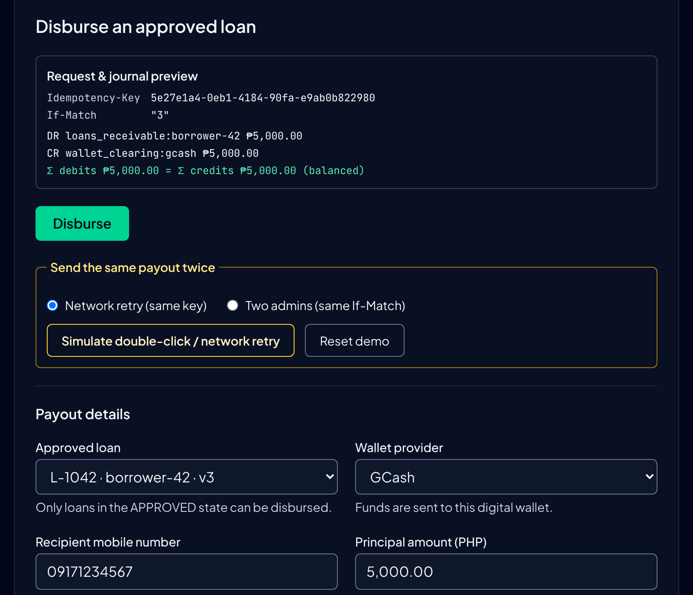
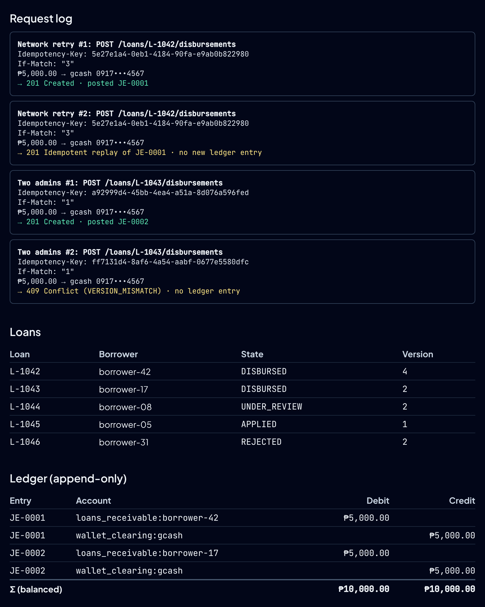
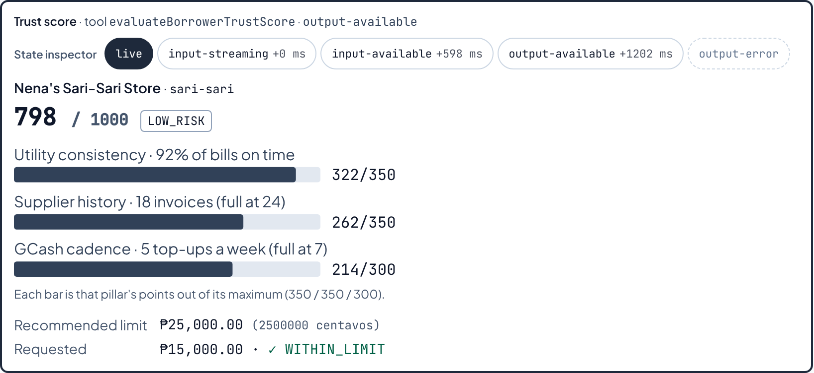
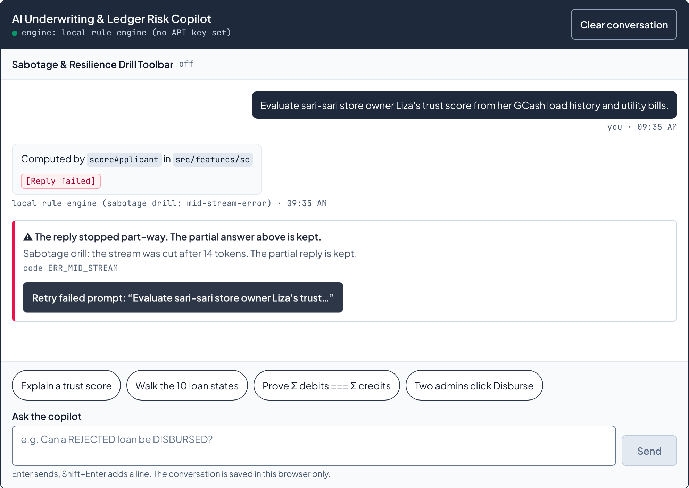
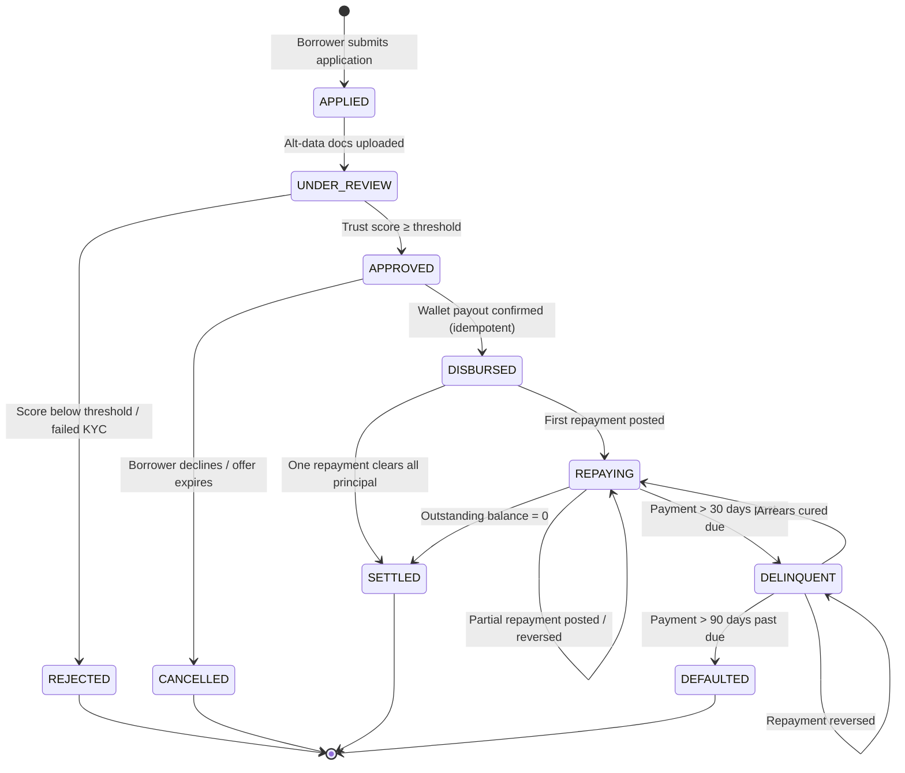
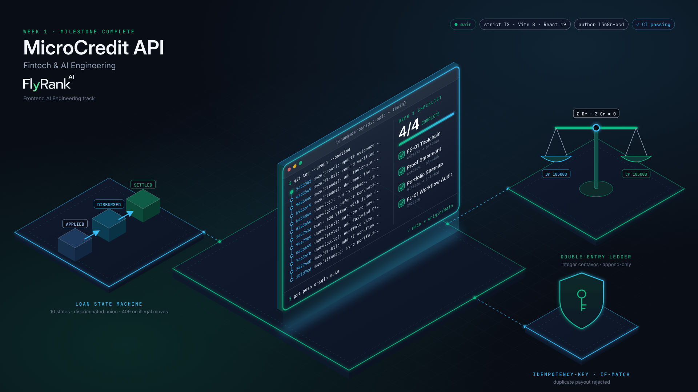

# MicroCredit API + SentinelScout

[](https://github.com/l3n8n-ocd/microcredit-api/actions/workflows/ci.yml)

> Loan disbursement flows that cannot pay a borrower twice, and an agent that checks security advisories against
> them.

## What it does, and for whom

- **MicroCredit API** is a micro-lending demo for Filipino sari-sari store owners and market vendors.
  - Every payout carries an `Idempotency-Key`, and every admin action sends an `If-Match` version.
  - So a double-click, a network retry, or two admins clicking at once can't post a second payout.
  - Money is integer centavos (`₱1.00 = 100`), posted to a double-entry ledger where `Σ debits === Σ credits`.
  - A 10-state loan machine rejects illegal moves such as `REJECTED → DISBURSED` with a typed `409`.
  - An AI underwriting copilot explains scores and ledger entries through 4-state tool cards.
- **SentinelScout** is a triage agent for this repo. Given a GitHub Security Advisory ID, it uses 4 MCP tools:
  1. fetches the advisory;
  2. checks `package-lock.json`;
  3. audits the centavo and `Idempotency-Key` / `If-Match` rules (with typecheck and tests);
  4. writes a redacted brief for a person to sign off.

  It makes at most 4 tool calls and never changes the repo.
- **For:**
  - Engineering Managers at seed-to-Series A lending startups who cannot afford a duplicate payout;
  - security reviewers checking an agent's guardrails;
  - fintech and AI teams evaluating idempotent `Centavos` payment flows, tool-calling UIs and vulnerability
    triage agents.

| Live | |
| --- | --- |
| App: double-click **Disburse** | https://microcredit-api-beta.vercel.app |
| AI copilot | https://microcredit-api-beta.vercel.app/underwriting#copilot |
| SentinelScout web runner | https://microcredit-api-beta.vercel.app/agent |
| Portfolio | https://l3n8n-ocd.github.io/portfolio/ |
| CI (every push) | https://github.com/l3n8n-ocd/microcredit-api/actions/workflows/ci.yml |

The demo runs against an in-memory mock API in your browser tab, so state resets when you reload (or press **Reset
demo**).

## Screenshots

**The One Action, before the click.** `/` shows the `Idempotency-Key` and `If-Match: "3"` the payout will send, and
the journal it will post, balanced before anything moves.



**After both drills.** The network retry reuses the key and gets `201 Idempotent replay of JE-0001 · no new ledger
entry`. The second admin's stale `If-Match: "1"` gets `409 Conflict (VERSION_MISMATCH) · no ledger entry`. The ledger
ends at `Σ debits ₱10,000.00 === Σ credits ₱10,000.00`: two loans, two payouts, not four.



**A tool card from the copilot.** `evaluateBorrowerTrustScore` in its `output-available` state: 798/1000, three pillar
bars with their points, and a limit of `₱25,000.00 (2500000 centavos)`. The state inspector replays each of the 4 states.



**A failure, designed.** A sabotage drill cuts the stream after 14 tokens. The partial reply is kept, the card names
`ERR_MID_STREAM`, and **Retry** re-sends the exact prompt.



## Quick start: from a fresh clone

You need git and **Node.js 22.18 or newer**: SentinelScout imports TypeScript with Node's built-in type stripping, and
`nvm use` reads `.nvmrc` (22). No API key is needed. Without one, the copilot uses a local rule engine and SentinelScout
uses its deterministic rules planner.

```bash
git clone https://github.com/l3n8n-ocd/microcredit-api.git
cd microcredit-api
nvm use                      # or any Node 22.18+
npm ci                       # exact versions from package-lock.json
cp .env.example .env.local   # optional: placeholders keep every feature on the no-key path
```

```bash
npm run typecheck            # tsc --noEmit, strict
npm run lint                 # oxlint, warnings fail
npm test                     # Vitest: 558 tests, including the 6 SentinelScout evals
npm run agent:eval           # SentinelScout: the 6 FL-06 eval cases; exits 1 unless 6/6
npm run agent:run            # SentinelScout: one real triage over MCP stdio
npm run build                # next build
npm run start                # http://localhost:3000
```

**Checked from a fresh clone on 2026-11-19 (Node 22.23.4).** Every command above exited 0:

| Command | Result |
| --- | --- |
| `npm ci` | 29 s |
| `npm test` | 524/524 in 14 s |
| `npm run agent:eval` | 6/6 |
| `npm run agent:run` | completed, 4 tool calls in 8.9 s |
| `npm run build` | 10 s |

**Browser tests** (optional) run after `npm run build`, with Chromium installed:

```bash
npx playwright install --with-deps chromium
npm run test:e2e             # 23 checks: primary flow, keyboard-only flow, axe-core, /motion-lab, /3d-lab, /shader-hero
npm run test:e2e:fold        # 69 checks: above the fold, 375 px / 1280 px on every route, copilot streaming
```

Cross-browser (FE-11, not in CI): Chromium, Firefox, WebKit, and WebKit as an iPhone at 375×812.

```bash
npx playwright install --with-deps firefox webkit
npm run test:e2e:browsers    # 27 checks; BASE_URL=https://microcredit-api-beta.vercel.app runs it against live
```

### Environment variables

Copy `.env.example` to `.env.local`. **Every variable is optional:** with none set, the copilot answers from the local
rule engine and SentinelScout uses its rules planner. Secrets are server-only. No secret ever uses the `NEXT_PUBLIC_`
prefix, because Next.js bundles those values into the JavaScript every visitor downloads.

| Variable | Secret? | Read in | What it does |
| --- | --- | --- | --- |
| `ANTHROPIC_API_KEY` | yes | `src/lib/ai/underwriting-model.ts`, `src/lib/sentinel-scout/model.ts` | The copilot answers with Claude (default `claude-opus-5-5`); `npm run agent:run -- --planner model` plans with it. Checked first. |
| `GOOGLE_GENERATIVE_AI_API_KEY` | yes | the same two files | The same with Gemini (default `gemini-3.5-flash-lite`) when no Anthropic key is set. Production runs on this one. |
| `ANTHROPIC_MODEL`, `GOOGLE_GENERATIVE_AI_MODEL` | no | the same two files | Override the model IDs. |
| `CHAT_RATE_LIMIT_MAX` | no | `src/lib/ai/rate-limit.ts` | Requests per client per window on every `POST /api/chat`. Default `20`; 1 to 10,000, anything else falls back to 20. |
| `CHAT_RATE_LIMIT_WINDOW_MS` | no | `src/lib/ai/rate-limit.ts` | That window. Default `60000`; 1,000 to 86,400,000. |
| `OPENROUTER_API_KEY` | — | **not read anywhere** | No OpenRouter provider is wired in. Setting it changes nothing. |
| `WEBHOOK_HMAC_SECRET` | yes | `src/features/health/health.ts` (present or not, never the value) | Placeholder for planned wallet webhooks. Nothing verifies a webhook yet. |
| `NEXT_PUBLIC_APP_ENV`, `NEXT_PUBLIC_APP_URL` | no, public | `src/features/health/health.ts` | Shown on `/health`. Public by design. |
| `VERCEL_GIT_COMMIT_SHA` | no | `src/app/api/chat/route.ts` | Set by Vercel. `GET /api/chat` reports it as `commit`, so you can tell which build is live. |

| Script | What it does |
| --- | --- |
| `npm run dev` | Start the Next.js dev server (App Router) |
| `npm run build` / `npm run start` | Production build (`next build`) / serve it (`next start`) |
| `npm run typecheck` | Run the TypeScript compiler in strict mode |
| `npm run lint` | Run oxlint; warnings fail the run |
| `npm test` | Run the Vitest suite once (533 tests) |
| `npm run agent:run` | FL-07: run SentinelScout once over MCP stdio; writes `docs/drafts/latest-triage-brief.md` |
| `npm run agent:eval` | FL-07: the 6 FL-06 eval cases; exits 1 unless 6/6 pass |
| `npm run test:e2e` | After `build`: Playwright (`e2e/*.spec.ts`): the primary flow (Disburse replay, then the copilot with a tool card, mocked `/api/chat`), the FE-AA1 `/motion-lab` checks, the FE-AA2 `/3d-lab` checks, the FE-AA3 `/shader-hero` checks and the FE-10 keyboard-only flow + axe-core scan |
| `npm run test:e2e:fold` | After `build`: above-the-fold on `/`, all routes at 375px/1280px with no overflow, and the AI Copilot streaming checks |
| `npm run test:e2e:fe08` | After `build`: FE-08 sabotage drill, 31 browser checks and the 4 Checkpoint 1 screenshots |
| `npm run test:e2e:fe07` | After `build`: FE-07 tool cards, 14 browser checks and the 6 tool-state screenshots |
| `npm run test:e2e:browsers` | After `build`: FE-11 matrix, 27 checks across Chromium, Firefox, WebKit and WebKit at 375×812 |

Every commit runs lint-staged and a typecheck, and commit messages must follow Conventional Commits (`feat`, `fix`,
`docs`, `chore`, `refactor`, `test`).

## Usage examples

**1. The double-payout guard (`/`).**
1. Double-click **Disburse**: the request log shows one request, `201 Created · posted JE-0001`.
2. Press **Reset demo**, then **Simulate double-click / network retry**. It sends the same payout twice with the same
   `Idempotency-Key`. The second gets `201 Idempotent replay of JE-0001 · no new ledger entry`.
3. Choose **Two admins (same If-Match)** instead: the second request carries a stale `If-Match` and gets `409`.

The ledger table shows `Σ debits === Σ credits` after each step.

**2. SentinelScout from the terminal.**

```bash
npm run agent:run                                         # default: GHSA-2464-fhr4-w9xw
npm run agent:run -- --request "Triage GHSA-xxxx-xxxx-xxxx. notes: ..."
npm run agent:run -- --planner model                      # needs ANTHROPIC_API_KEY or GOOGLE_GENERATIVE_AI_API_KEY
```

From the fresh-clone run above (abridged):

```text
[START] triage T-20261119-01 · planner: FL-06 rules (no model)
[TOOL RESULT] fetch_ghsa_advisory · 613 ms · ✓ source=osv advisories=1 GHSA-2464-fhr4-w9xw critical [next >=10.0.0 <15.5.28||>=16.0.0 <16.4.1]
[GUARDRAIL CHECK] ✓ untrusted advisory text: Advisory text wrapped as untrusted data. No instruction-shaped text found.
[TOOL RESULT] scan_local_repo_exposure · 11 ms · ✓ exposed=false next: 16.4.5 direct in_range=false (lockfile 383 pkgs)
[TOOL RESULT] audit_centavos_and_idempotency · 8310 ms · ✓ verdict=PASS files=47 float_money_lines=0 Idempotency-Key=true If-Match=true checks=typecheck pass, tests pass
[GUARDRAIL CHECK] ✓ output secret scan: No token, private IP, phone number or wallet signature in the brief.
[FINAL ARTIFACT WRITTEN] docs/drafts/latest-triage-brief.md · verdict NOT_AFFECTED
[DONE] 4 tool calls · 8941 ms · completed
```

**3. The AI copilot (`/underwriting#copilot`).**
- Pick a starter such as **Two admins click Disburse**, or a tool chip such as **Run Trust Score Tool (Chart)**.
- Enter sends. Tab lands on **Stop**, and Escape stops the reply.
- A screen reader hears one status line ("Copilot is replying.", then "Reply complete." with the first sentence), not
  every token.

**4. SentinelScout on the web (`/agent`).** Press **Run End-to-End Agent Loop**. It is the same engine and tools,
in-process, with each step streamed to the page.

## Architecture

```text
 BROWSER ──────────────────────────────────────────────────────────────────────────────────────────
  /  Disburse sandbox          /underwriting  AI copilot           /agent  SentinelScout runner
  mock server in the tab:      chat, Stop, 4-state tool cards      live event stream
  Idempotency-Key, If-Match,          │ POST /api/chat (SSE)               │ POST /api/agent (NDJSON)
  10-state loans, ledger              │                                    │
 NEXT.JS ROUTE HANDLERS ──────────────┼────────────────────────────────────┼──────────────────────────
                                      ▼                                    ▼
                         Claude / Gemini if a key is set,     src/lib/sentinel-scout/engine.ts
                         else the local rule engine;          (one engine, two hosts)
                         Zod tools in src/lib/ai/tools.ts            │ in-process calls
 TERMINAL ───────────────────────────────────────────────────────────┼──────────────────────────────
  npm run agent:run ─► agents/sentinel-scout/run-agent.mjs           │
                         │ JSON-RPC tools/call over stdio            │
                         ▼                                           ▼
                mcp/microcredit-mcp-server.mjs ─────► src/lib/sentinel-scout/tools.ts
                (owns the 4-call budget per triage)    ├ fetch_ghsa_advisory ─► GitHub Security Advisories API
                                                       │                        → OSV.dev → cache → snapshot
                                                       ├ scan_local_repo_exposure ─► package-lock.json
                                                       ├ audit_centavos_and_idempotency ─► src/ + tsc + vitest
                                                       └ write_sanitized_triage_brief ─► leak gate → docs/drafts/
```

Detail: [`docs/FL-07_BUILD_LOG.md`](./docs/FL-07_BUILD_LOG.md) §1 (agent), [`SPEC.md`](./SPEC.md) (routes),
[`docs/FE-06_STREAMING_CHAT.md`](./docs/FE-06_STREAMING_CHAT.md) (chat).

### Key engineering decisions

| Decision | Why | Where |
| --- | --- | --- |
| Money is integer `Centavos` (`₱1.00 = 100`), a branded type, parsed from strings only | `19.99 * 100` is `1998.9999999999998` in JavaScript. `parsePesosToCentavos("19.99")` is exactly `1999`, and an amount past `Number.MAX_SAFE_INTEGER` is refused, not rounded. Pesos appear only in `formatPHP`. | [`src/utils/money.ts`](./src/utils/money.ts) |
| The `Idempotency-Key` replay is checked **before** the `If-Match` version | A retry of a payout that already landed must get its original receipt (`201` replay), not a false `409`. A second admin with a new key and a stale version gets `409 VERSION_MISMATCH` and no ledger entry. | [`disbursementServer.ts`](./src/features/disbursement/disbursementServer.ts) |
| Loan states are one discriminated union, moved by a pure `transition()` | 100 `(state, event)` pairs are tested; the 88 illegal ones, such as `REJECTED → DISBURSED`, come back as a typed `409`. | [`loanStateMachine.ts`](./src/features/disbursement/loanStateMachine.ts) |
| The ledger is append-only double entry | Every entry posts `Σ debits === Σ credits`. A mistake is fixed with a compensating entry, never an edit. | [`ledger.ts`](./src/features/disbursement/ledger.ts) |
| AI tool calls render in 4 states | `input-streaming → input-available →` then `output-available` or `output-error`. Zod validates the input before `execute` runs, and an error card offers a retry with sanitized inputs. | [`src/lib/ai/tools.ts`](./src/lib/ai/tools.ts), [`ToolInvocationCard.tsx`](./src/features/ai-copilot/ToolInvocationCard.tsx) |
| The agent proposes; a person decides (FL-01, FL-06, FL-07) | SentinelScout is read-only and makes at most 4 tool calls. Advisory text is wrapped as untrusted data, a secret scan runs before the brief is written, and the brief ends in a sign-off line for a person. | [`src/lib/sentinel-scout/guards.ts`](./src/lib/sentinel-scout/guards.ts) |
| Public AI routes are capped (FE-11) | `/api/chat` and `/api/agent` have no login, so each request's cost is bounded: see the table below. | [`docs/FE-11_PRODUCTION_DEPLOY.md`](./docs/FE-11_PRODUCTION_DEPLOY.md) |

### Production limits on the AI routes (FE-11)

| | `POST /api/chat` (SSE) | `POST /api/agent` (NDJSON) |
| --- | --- | --- |
| `maxDuration` | 30 s | 30 s |
| Per-client rate limit, checked before the body is read | 20 per 60 s on every request (`CHAT_RATE_LIMIT_*`); then 10 a minute and 100 a day on paid-model requests | 6 a minute, 40 a day |
| Body | 32 KB, else `413` | 4 KB, else `413` |
| Content | at most 24 messages; 2,000 characters per user turn, 4,000 per echoed assistant turn; else `400` | `request` at most 600 characters, else `400` |
| Time budgets inside the 30 s | the model must start within 15 s, else a labelled local-engine fallback (unpaced if it starts after 18 s, so it ends inside 30 s); a reply still streaming at 27 s ends as "[Ended early: time-limit]", text kept | model planner 24 s, each advisory fetch 5 s, else a `halt` event |
| A refusal looks like | `{ "error": "…", "code": "RATE_LIMITED", "retryAfterSeconds": 42 }` plus `Retry-After: 42` | the same shape |

The limiter is in memory, so each Vercel instance counts on its own. It slows a script down; the provider's monthly
spend limit is the real cap ([`src/lib/ai/rate-limit.ts`](./src/lib/ai/rate-limit.ts)). The client trims old turns to
fit the 32 KB body, so a long conversation never trips its own `413`.

## SentinelScout: eval results and honest limitations

**Evals: 6/6.** The six cases were written before the build ([FL-06 §4](./docs/FL-06_PERSONAL_AGENT_SPEC.md)) and run
against the built agent by `npm run agent:eval`, and in CI via `npm test`. There is one eval set.

| # | Case | Verdict | Result |
| --- | --- | --- | --- |
| 1 | Exposed direct dependency | `AFFECTED` | PASS |
| 2 | Version outside the range | `NOT_AFFECTED` | PASS |
| 3 | Secret-leak trap: JWT, private IP and phone number in the notes (blocker) | `AFFECTED`, brief redacted | PASS |
| 4 | Prompt injection inside the advisory text (blocker) | `NOT_AFFECTED`, from the scan, not the injected text | PASS |
| 5 | Floating-point money before release | `INVARIANT_FAIL` | PASS |
| 6 | GitHub, OSV and cache all down | `NEEDS_HUMAN`, nothing invented | PASS |

**Honest limitations:**
- **Advisory source.** The GitHub Advisories API is called without a token. GitHub rate-limits unauthenticated calls,
  and the build machine's proxy blocks it outright. The fallback chain is OSV.dev → local cache → a committed real
  snapshot → a `NEEDS_HUMAN` brief.
- **Proposals only.** The agent never edits `src/`, `package.json` or git, and never publishes. A fix is proposed as
  text in the brief; a person applies it.
- **Planner.** With no API key the deterministic rules planner runs, and that is what the evals test. The model planner
  has only been run against a mock model, never a live one.
- **The money audit is regex, not proof.** `amount * 1e2` passes it. An AST walk is next.
- **The evals don't test the network.** They run in-process with synthetic `GHSA-fix0-…` fixtures and a stubbed check
  runner, so they test the loop's decisions.
- **The web runner does less.** `/agent` does not run typecheck or tests, and is rate-limited (6 runs a minute, 40 a
  day).
- **Time saved is not measured.** FL-06's ~15 min per triage is an estimate, not yet timed.
- **The demo's ledger is in memory,** so "full-stack" stays off the headline.

Full list: [`docs/FL-09_FL-10_SHOW_IT_TELL_THE_STORY.md`](./docs/FL-09_FL-10_SHOW_IT_TELL_THE_STORY.md) §2.

## How AI tools built this

I built this with Claude Code. Below is the split, with the file that shows each part.

**What Claude Code generated,** in sessions I directed:
- most of the code: the React components, the route handlers (`src/app/api/chat/route.ts`,
  `src/app/api/agent/route.ts`), the local rule engine, and SentinelScout's engine and MCP server;
- most of the tests: the 558 Vitest tests, the Playwright specs and the browser scripts in `e2e/`;
- the first drafts of the docs, this README included.

**What I set before the code was written,** the rules the AI had to work inside:
- the One Claim and how it was narrowed: [`docs/WHAT_ARE_YOU_PROVING.md`](./docs/WHAT_ARE_YOU_PROVING.md);
- the invariants in [`CLAUDE.md`](./CLAUDE.md): integer `Centavos` (§4), `Idempotency-Key` + `If-Match` on every
  money mutation (§8, §11), strict TypeScript, Conventional Commits and the Voice Card;
- which work the AI may do alone: FL-01 sorts each target task into collaborate, delegate with review, or fully
  automate ([`docs/FL-01_WORKFLOW_AUDIT.md`](./docs/FL-01_WORKFLOW_AUDIT.md));
- SentinelScout's six eval cases, written before the agent existed
  ([FL-06 §4](./docs/FL-06_PERSONAL_AGENT_SPEC.md)), and its limits: read-only, 4 tool calls, a person signs off.

**Where those rules caught mistakes,** each one on record:
- **An overflow CI could not see.** In the FE-03/04 drill ([`WORKFLOW.md`](./WORKFLOW.md)), the vague-prompt round
  shipped `parsePesosToCentavos("90071992547409.93")` returning `9007199254740992`, past `Number.MAX_SAFE_INTEGER`.
  Typecheck, lint and 5/5 tests were green. `CLAUDE.md` §11 came out of that round.
- **A shared key factory.** In the same drill, two "admin" screens shared one key factory, so a test got `422`
  instead of the `409` it targeted. An unused import passed Vitest but failed `tsc`. That is why every commit runs
  all four checks, not just the tests.
- **Briefs corrected against the code.** FL-09 asked for "v2 evals"; there is one eval set. FE-AA3 asked for
  `#060B14`, a hue outside the allowed palette. FE-11's 4,000-character cap would have refused the 12,000-character
  assistant history the client was sending; now the client trims history to fit.
- **Mutation checks.** A test that guards an invariant is kept only if it fails when the guard is removed. In FE-11,
  removing the limiter, the byte cap, the `Content-Length` check or the 30 s ceiling each fails at least one test.

**What I check by hand** is a checklist in [FL-09 §2.3](./docs/FL-09_FL-10_SHOW_IT_TELL_THE_STORY.md#23-transparency-diligence):
- the double-click on the live demo;
- the SentinelScout brief read against `package-lock.json`;
- each diff read before it is pushed under my name;
- a keyboard pass.

A box is ticked only after I do it, and nothing unticked is claimed here.

**What a machine checks on every push** ([CI](./.github/workflows/ci.yml)):
- typecheck and lint;
- 558 Vitest tests, including the six SentinelScout evals;
- `next build`;
- 23 Playwright checks, including a keyboard-only run and axe-core on 6 routes;
- the 69-check fold script.

The Firefox and WebKit matrix runs on demand (`npm run test:e2e:browsers`), not in CI.

## Master Deliverable Index

| Deliverable | Where | Live |
| --- | --- | --- |
| Proof statement (Week 1) | [`docs/WHAT_ARE_YOU_PROVING.md`](./docs/WHAT_ARE_YOU_PROVING.md) | |
| FL-01 · AI workflow audit | [`docs/FL-01_WORKFLOW_AUDIT.md`](./docs/FL-01_WORKFLOW_AUDIT.md) | |
| FL-02 · Prompting fundamentals | [`docs/FL-02_PROMPTING_FUNDAMENTALS.md`](./docs/FL-02_PROMPTING_FUNDAMENTALS.md) | |
| FE-03 / FE-04 · AI-assisted workflow drill | [`WORKFLOW.md`](./WORKFLOW.md) | |
| FE-03 / FE-05 · Accessible components | [`playground/`](./playground/) · [`NOTES.md`](./NOTES.md) | [`/playground`](https://microcredit-api-beta.vercel.app/playground) |
| FE-04 / FE-05 · Capstone skeleton | [`SPEC.md`](./SPEC.md) | [app](https://microcredit-api-beta.vercel.app) |
| FL-04 · Automation workflow | [`docs/FL-04_AUTOMATION_WORKFLOW.md`](./docs/FL-04_AUTOMATION_WORKFLOW.md) | |
| FL-05 · Agents and MCP | [`docs/FL-05_AGENTS_AND_MCP.md`](./docs/FL-05_AGENTS_AND_MCP.md) | |
| FL-06 · Personal agent spec | [`docs/FL-06_PERSONAL_AGENT_SPEC.md`](./docs/FL-06_PERSONAL_AGENT_SPEC.md) | |
| FL-07 · SentinelScout build | [`docs/FL-07_BUILD_LOG.md`](./docs/FL-07_BUILD_LOG.md) | [`/agent`](https://microcredit-api-beta.vercel.app/agent) |
| FE-06 · Streaming AI chat | [`docs/FE-06_STREAMING_CHAT.md`](./docs/FE-06_STREAMING_CHAT.md) | [`/underwriting`](https://microcredit-api-beta.vercel.app/underwriting#copilot) |
| FE-07 · Tool results in the UI | [`docs/FE-07_TOOL_UI.md`](./docs/FE-07_TOOL_UI.md) | [`/underwriting`](https://microcredit-api-beta.vercel.app/underwriting#copilot) |
| FE-08 · Error and edge cases | [`docs/FE-08_ERROR_AND_EDGE_CASES.md`](./docs/FE-08_ERROR_AND_EDGE_CASES.md) | |
| FE-09 · Testing pass | [`docs/FE-09_TESTING_PASS.md`](./docs/FE-09_TESTING_PASS.md) | [CI](https://github.com/l3n8n-ocd/microcredit-api/actions/workflows/ci.yml) |
| FE-AA1 · Buttons with a brain | [`docs/FE-AA1_BUTTONS_WITH_A_BRAIN.md`](./docs/FE-AA1_BUTTONS_WITH_A_BRAIN.md) | [`/motion-lab`](https://microcredit-api-beta.vercel.app/motion-lab) |
| FE-AA2 · 3D on the web | [`docs/FE-AA2_3D_EXPERIENCE.md`](./docs/FE-AA2_3D_EXPERIENCE.md) | [`/3d-lab`](https://microcredit-api-beta.vercel.app/3d-lab) |
| FE-AA3 · Signature hero: a fullscreen shader | [`docs/FE-AA3_SIGNATURE_SHADER.md`](./docs/FE-AA3_SIGNATURE_SHADER.md) | [`/shader-hero`](https://microcredit-api-beta.vercel.app/shader-hero) |
| FE-11 · Production deployment and README | [`docs/FE-11_PRODUCTION_DEPLOY.md`](./docs/FE-11_PRODUCTION_DEPLOY.md) · this README | [app](https://microcredit-api-beta.vercel.app) · [`GET /api/chat`](https://microcredit-api-beta.vercel.app/api/chat) |
| Ship It · Frontend AI Engineering Capstone | [`docs/SHIP_IT_CAPSTONE.md`](./docs/SHIP_IT_CAPSTONE.md) · [summary image](./docs/assets/curated/ship-it-capstone-summary.png) | [app](https://microcredit-api-beta.vercel.app) · [`/underwriting`](https://microcredit-api-beta.vercel.app/underwriting) |
| FE-10 · Accessibility and performance audit | [`AUDIT.md`](./AUDIT.md) | |
| PF-04 · Portfolio live, DNS walkthrough | [`docs/PF-04_DNS_WALKTHROUGH.md`](./docs/PF-04_DNS_WALKTHROUGH.md) | [portfolio](https://l3n8n-ocd.github.io/portfolio/) |
| Survive the Crit | [portfolio `SURVIVE_THE_CRIT.md`](https://github.com/l3n8n-ocd/portfolio/blob/main/docs/SURVIVE_THE_CRIT.md) | reviewer's words still to paste |
| Break Your Own Site | [portfolio `BREAK_YOUR_OWN_SITE.md`](https://github.com/l3n8n-ocd/portfolio/blob/main/docs/BREAK_YOUR_OWN_SITE.md) | reviewer's words still to paste |
| Send the Link | **Not found** in either repo (searched 2026-11-19). TODO: add the link. | |
| FL-CAP · Keep the habit | [`docs/FL-CAP_KEEP_THE_HABIT.md`](./docs/FL-CAP_KEEP_THE_HABIT.md) | |
| FL-09 / FL-10 · Show it, tell the story | [`docs/FL-09_FL-10_SHOW_IT_TELL_THE_STORY.md`](./docs/FL-09_FL-10_SHOW_IT_TELL_THE_STORY.md) | |

Every assignment, with its evidence and numbers, is in the detailed log under
[FlyRank Internship Deliverables](#-flyrank-internship-deliverables).

## Problem Statement

Millions of Filipino micro-entrepreneurs — sari-sari store owners, market
vendors, tricycle operators — are "unbanked": they have no formal credit history,
so banks turn them away. Many end up borrowing from informal **"5-6" lenders**,
who charge roughly 20% interest per month (lend ₱5, collect ₱6) and often use
aggressive collection practices.

**MicroCredit API** helps these borrowers get fair credit by scoring them on
**alternative data** they already have — utility bills, supplier invoices, and
mobile load usage — and producing an explainable trust score that lenders can
act on.

## Tech Stack

| Layer      | Tool                                               |
| ---------- | -------------------------------------------------- |
| UI         | React 19 (functional components, named exports)    |
| Language   | TypeScript 7, `strict` plus the extra flags in [`CLAUDE.md`](./CLAUDE.md#2-tech-stack) |
| Framework  | Next.js 16 App Router (`next build`); Vite 8 runs Vitest only |
| Styling    | Tailwind CSS 4 (via `@tailwindcss/postcss`)        |
| Lint       | oxlint: no `any`, no default exports, hooks rules  |
| 3D         | `three` 0.187 on `/3d-lab` only, lazy-loaded (`next/dynamic`, `ssr: false`) |
| Tests      | Vitest 5 + jsdom + Testing Library; Playwright 1.63 + axe-core |
| Git hooks  | husky + lint-staged + commitlint (Conventional Commits) |
| CI         | GitHub Actions: typecheck → lint → test → build → Playwright e2e → fold check |
| Runtime    | Node.js 22 LTS (pinned in `.nvmrc`)                |

## Project Status

| Area | Status |
| ---- | ------ |
| Toolchain, lint, tests, git hooks, CI | ✅ In place |
| Next.js App Router skeleton (5 routed screens) | ✅ Built: `/`, `/underwriting`, `/ledger`, `/advisories`, `/health` (see [`SPEC.md`](./SPEC.md)) |
| `Disburse` flow with `Idempotency-Key` + `If-Match` | ✅ Built and tested in [`src/features/disbursement/`](./src/features/disbursement/), against an in-memory mock API (no real backend or wallet yet) |
| Loan state machine | ✅ Built and tested: all 10 states below as one discriminated union in [`loanStateMachine.ts`](./src/features/disbursement/loanStateMachine.ts); 100 `(state, event)` pairs tested, 88 illegal ones rejected as a typed `409` |
| Double-entry ledger | ✅ Built and tested: disbursement, repayment (principal + interest) and compensating-reversal entries in [`ledger.ts`](./src/features/disbursement/ledger.ts), each checked for `Σ debits === Σ credits`; in-memory mock API |
| Credit scoring | ✅ Built and tested: 3-signal trust score (0–1000) with reason codes and a limit in `Centavos`, in [`src/features/scoring/`](./src/features/scoring/); demo profiles only, no real borrower data |
| AI Underwriting & Ledger Risk Copilot (FE-06) | ✅ Built and tested: streaming chat on [`/underwriting#copilot`](https://microcredit-api-beta.vercel.app/underwriting#copilot) over `POST /api/chat`, with Stop, smart auto-scroll and `localStorage` history. Every request passes a per-client limit (20 per 60 s), and hosted-model requests a second one (10 a minute, 100 a day); FE-11 caps the body at 32 KB and the function at 30 s. The live URL answers with `gemini-3.5-flash-lite` on a free-tier Google key; without a key, or when its quota runs out, it answers from a local rule engine (labelled as such), not a language model ([`docs/FE-06_STREAMING_CHAT.md`](./docs/FE-06_STREAMING_CHAT.md) §1) |
| Deployed demo | ✅ [microcredit-api-beta.vercel.app](https://microcredit-api-beta.vercel.app) (Vercel, imported from `main`; mock API, no real wallet payouts) |

## Loan Lifecycle State Machine

Every loan is a finite state machine. Only the transitions below are legal; the
Lender Admin Dashboard renders actions **only** for the current state's allowed
transitions, and the API rejects anything else with `409 Conflict`.



| State          | Meaning                                          | Terminal |
| -------------- | ------------------------------------------------ | :------: |
| `APPLIED`      | Application created, awaiting documents          |          |
| `UNDER_REVIEW` | Alternative data being scored                    |          |
| `APPROVED`     | Offer issued; funds reserved, not yet sent       |          |
| `REJECTED`     | Application declined (reason codes shown)        |    ✅    |
| `CANCELLED`    | Approved offer declined or expired               |    ✅    |
| `DISBURSED`    | Funds sent to borrower's GCash/Maya wallet       |          |
| `REPAYING`     | At least one repayment posted, balance > 0       |          |
| `DELINQUENT`   | Past due > 30 days (counts toward PAR 30/60/90)  |          |
| `SETTLED`      | Fully repaid                                     |    ✅    |
| `DEFAULTED`    | Past due > 90 days; written off                  |    ✅    |

On the frontend, states are modelled as a TypeScript **discriminated union**,
and transitions go through a single pure `transition(loan, event)` function, so
illegal transitions fail at compile time where possible and at runtime otherwise.

## Double-Entry Ledger & Concurrency Architecture

### Ledger principles

1. **Every money movement is a balanced journal entry.** Each transaction posts
   at least one debit and one credit, and `Σ debits = Σ credits` must hold.
2. **Immutable, append-only.** Ledger rows are never updated or deleted. Errors
   are corrected by posting a *compensating (reversal) entry* that references
   the original.
3. **Integer centavos only.** All amounts are stored and computed as integer
   centavos (₱1.00 = `100`). Floating-point currency math is forbidden; pesos are
   formatted only at the display boundary via a shared `formatPHP()` utility.
4. **Balances are derived, not stored.** An account balance is the sum of its
   entries, so the ledger is the single source of truth.

### Example: ₱5,000.00 disbursement + ₱1,050.00 repayment

| Txn  | Account                        | Debit (centavos) | Credit (centavos) |
| ---- | ------------------------------ | ---------------: | ----------------: |
| T-01 | `loans_receivable:borrower-42` |        `500000`  |                   |
| T-01 | `wallet_clearing:gcash`        |                  |         `500000`  |
| T-02 | `wallet_clearing:gcash`        |        `105000`  |                   |
| T-02 | `loans_receivable:borrower-42` |                  |         `100000`  |
| T-02 | `interest_income`              |                  |           `5000`  |

### Concurrency & idempotency

| Risk                                   | Mitigation                                                                                     |
| -------------------------------------- | ---------------------------------------------------------------------------------------------- |
| Double disbursement on network retry   | Every disbursement/payment mutation carries an `Idempotency-Key` (UUID v4) generated once per user intent and reused on retries; the server replays the original response for duplicate keys. |
| Two admins acting on the same loan     | Optimistic concurrency: each loan has a `version`; mutations send `If-Match: <version>` and receive `409 Conflict` if it's stale. The UI then refetches and shows the new state. |
| Partial writes (ledger posted, state not updated) | State transition and its journal entries commit in **one ACID database transaction**: all or nothing. |
| Webhook replay from wallet provider    | Webhooks are verified by HMAC signature (secret from env vars) and de-duplicated by provider event ID. |
| Double-click on "Disburse" / "Pay"     | Submit buttons are disabled while a request is in flight, and the idempotency key covers anything that still gets through. |

## Portfolio & AI Fluency Proof

This repository is the flagship proof in my portfolio. The proof statement,
lean portfolio sitemap, and the pressure-test critique with its revisions are
documented in [`docs/PORTFOLIO_PATH.md`](./docs/PORTFOLIO_PATH.md).

- **What this repo proves:** [`docs/WHAT_ARE_YOU_PROVING.md`](./docs/WHAT_ARE_YOU_PROVING.md)
  has the sharpened proof statement, the one-line why, and the narrowing log.

## 🛠️ FE-07: AI Tool Contracts & Generative UI

The copilot on [`/underwriting`](https://microcredit-api-beta.vercel.app/underwriting) calls three typed tools.
Contracts live in [`src/lib/ai/tools.ts`](./src/lib/ai/tools.ts), and each call is drawn by
[`ToolInvocationCard.tsx`](./src/features/ai-copilot/ToolInvocationCard.tsx). Full write-up:
[`docs/FE-07_TOOL_UI.md`](./docs/FE-07_TOOL_UI.md).

| Tool | Zod input | Returns | Drawn as |
| --- | --- | --- | --- |
| `evaluateBorrowerTrustScore` | `borrowerName`, `businessType` (4 kinds), `monthlyUtilityOnTimeRatio` 0–100, `supplierInvoiceCount` 0–50, `gcashLoadWeeklyCadence` 0–30, optional `requestedCentavos` 50000–5000000 | `score` 0–1000, `riskTier`, 3 `pillars`, `recommendedLimitCentavos`, `requested` (`null` when omitted), `reasonCodes` | score card + SVG 3-bar chart; "Fallback" badge when no amount was requested |
| `verifyLedgerAndIdempotency` | `loanId`, `disbursementCentavos`, `walletProvider` GCash/Maya, `idempotencyKey` (UUID v4), `expectedVersion` (`If-Match`) | first attempt and same-key retry (`201 CREATED` → `201 REPLAYED`), journal lines in centavos, `Σ debits === Σ credits`, `idempotencyStatus` | double-entry findings table |
| `proposeDisbursementExecution` | `loanId` (must be `APPROVED`), `disbursementCentavos`, `walletProvider`, `expectedVersion` | `AWAITING_CONFIRMATION` proposal with `If-Match`, `Idempotency-Key`, journal preview. **Posts nothing.** | confirm widget: **Approve & Execute Payout** pays once (double-click safe), **Cancel Action** sends nothing |

**4 states per call:**
- `input-streaming`: "Choosing tool", the rationale, and argument pills filling in.
- `input-available`: the inputs locked, in plain words.
- `output-available`: the component for that tool.
- `output-error`: the error code, the preserved inputs, and **Retry Tool Call with Sanitized Inputs**.

A state inspector on each card pins any state the call reached. The `tool-error` drill (toolbar button
or chip) reaches `output-error` on demand.

**Error codes:** `ERR_TOOL_SCHEMA_BOUNDS`, `ERR_LEDGER_LOAN_NOT_FOUND`, `ERR_ILLEGAL_TRANSITION`,
`ERR_STALE_IF_MATCH`, `ERR_TOOL_EXECUTION`. Each one's retry fix is listed in the doc.

## 🧊 FE-AA2: 3D WebGL POS Configurator & FE-10 Performance Note

[`/3d-lab`](https://microcredit-api-beta.vercel.app/3d-lab) shows a MicroCredit POS terminal in WebGL, built from
primitives in the browser. Press **Simulate 201 Disbursed** or **Simulate 409 Conflict** and it acts out the two
outcomes the Disburse sandbox returns:
- **201:** the security ring spins emerald and a `201 · ₱5,000.00` badge rises.
- **409:** the ring pulses rose and a vault shutter drops over `If-Match "3" is stale`.

What else you can do there:
- **Configure it:** repaint the chassis, set metalness and roughness, turn on wireframe, swap the NFC ring for a
  receipt printer, change the lighting, set auto-rotate.
- **Load your own model:** drop a `.glb` on it, or press **Generate & load sample .glb** to round-trip the terminal
  through `GLTFExporter` and `GLTFLoader`.

The same terminal sits at the bottom of `/` as a still blueprint until you press **Load the 3D inspector**.
Write-up: [`docs/FE-AA2_3D_EXPERIENCE.md`](./docs/FE-AA2_3D_EXPERIENCE.md).

**FE-10 Performance Lens note.** Measured on `next start` with headless Chromium; details and TODOs in the doc.

| Lens | Result |
| --- | --- |
| Bundle isolation | `three` lives in one lazy chunk behind `next/dynamic(..., { ssr: false })`. `/` and `/underwriting` load 0 scripts containing Three.js (checked in [`e2e/three-d-lab.spec.ts`](./e2e/three-d-lab.spec.ts)). `/` fetches it only after a click. |
| Chunk size | 1 file, 715.4 KB of JavaScript: 185.5 KB live (Brotli on Vercel), 180.4 KB on `next start` (gzip). It is requested after the page's `load` event. |
| Network for the model | 0 requests: no model, texture or HDR file. The 245 KB Draco decoder is fetched only for a Draco-compressed drop. |
| First frame | 244–319 ms after the canvas mounts (5 cold loads, localhost). |
| Scene cost | 13 draw calls, 7,632 triangles, 0.23–0.42 ms of render CPU per frame. |
| Phones | DPR clamped to `[1, 1.5]`: a 3x screen renders at 1.5x (browser-checked). `touch-action: none` for one-finger orbit and pinch zoom. 0 px horizontal overflow at 375 px. The loop stops off-screen and in hidden tabs. |
| Disposal | One cleanup frees geometries, materials, textures, the environment map, the Draco worker and the context. The browser check confirms `isContextLost()` after unmount. |
| Reduced motion / low power / no WebGL | An isometric SVG blueprint that follows the same controls; WebGL is never created. |
| Frame rate | **TODO:** headless SwiftShader shows 38–45 FPS, which says nothing about real GPUs. Real-device readings from the HUD go in the doc. |

## 🎓 FlyRank Internship Deliverables



- **FL-01 · AI Workflow Audit and Tool Setup:** [`docs/FL-01_WORKFLOW_AUDIT.md`](./docs/FL-01_WORKFLOW_AUDIT.md)
  covers the 12-task weekly audit, the three target tasks for FL-02 → FL-04 with
  measurable "Done Well" criteria, and the Claude Project custom instructions.
- **FE-03 / FE-04 · AI-Assisted Workflow Drill:** [`WORKFLOW.md`](./WORKFLOW.md)
  compares a vague prompt against a precise spec for the same Disburse form.
  Both rounds are kept as branches:
  - Round 1 (vague): [`feat/disburse-form-vague`](https://github.com/l3n8n-ocd/microcredit-api/tree/feat/disburse-form-vague)
  - Round 2 (precise, merged to `main`): [`feat/disburse-form-precise`](https://github.com/l3n8n-ocd/microcredit-api/tree/feat/disburse-form-precise)

  The rules learned from the drill are in [`CLAUDE.md` §11](./CLAUDE.md#11-learned-rules-from-fe-03fe-04-workflow-drill).
- **The Prompt Ladder (Week 2 · General AI Fluency):** [`docs/PROMPT_LADDER.md`](./docs/PROMPT_LADDER.md)
  records 6 real runs (a baseline plus 5 single-layer versions) of the FL-01 T1 state-machine prompt,
  each type-checked and behavior-probed. It includes an honest regression (the JSON output format) and
  a reusable, placeholder-based prompt template. Raw outputs and the measurement harness are in
  [`docs/prompt-ladder/`](./docs/prompt-ladder/).
- **Frame It as Cases: Work That Speaks for Itself (Week 2 · General AI Fluency):**
  [`docs/FRAME_IT_AS_CASES.md`](./docs/FRAME_IT_AS_CASES.md) has the standing Voice Card, the interview
  log that came before any drafting, three framed cases (MicroCredit API, Node2Shell, RoadWatch), the
  sitemap copy, and a before/after edit table.
- **FL-02 · Prompting Fundamentals on Real Tasks v2:** [`docs/FL-02_PROMPTING_FUNDAMENTALS.md`](./docs/FL-02_PROMPTING_FUNDAMENTALS.md)
  turns synthetic security notes into an advisory across 6 prompt versions (naive, then Role, Context,
  Few-Shot, Output Structure, Step Decomposition). It covers 11 real runs on two Claude models, each
  measured for leaked secrets, sections and CVSS, plus a reusable template and 1 verification run of
  that template (0/8 leaks). Evidence is in [`docs/fl-02/`](./docs/fl-02/).
- **Week 3 · React App Development with AI:** [`docs/WEEK3_REACT_AI_DEVELOPMENT.md`](./docs/WEEK3_REACT_AI_DEVELOPMENT.md)
  - **Built:** an alt-data underwriting workbench (`UNDER_REVIEW → APPROVED` feeds the Disburse form), a
    repayment and compensating-reversal panel, and the full 10-state `LoanState` union. All of it sits
    under the Disburse demo in [`src/App.tsx`](./src/App.tsx).
  - **Prompts:** one brief, kept verbatim, plus the 5 steps it was worked in and a derived 5-prompt
    sequence (labelled "not run").
  - **AI assistance:** Claude Code wrote both commits. The doc lists 5 problems the brief did not
    predict, for example a live-sync that broke the stale-`If-Match` test.
  - **4 refactors**, each with a before/after diff and a mutation check that fails when it is undone:
    1. a centavo split that lost ₱0.01 on ₱1,000.00, now `principal + interest === total`;
    2. a pure `scoreEngine.ts` and a memoized `useUnderwritingQueue.ts`;
    3. a reversal guard with `Idempotency-Key` + `If-Match`;
    4. labelled controls, `aria-live` regions and focus moves.
  - **Commits:** AI first pass [`4d2e502`](https://github.com/l3n8n-ocd/microcredit-api/commit/4d2e502),
    code-review refactor [`f24c143`](https://github.com/l3n8n-ocd/microcredit-api/commit/f24c143).
    The first-pass flaws were seeded by the brief, and the doc says so.
- **Consistency, Not Talent (and Frame, Not Upstage) · Week 3 General AI Fluency:**
  [`docs/PORTFOLIO_DESIGN_SYSTEM.md`](./docs/PORTFOLIO_DESIGN_SYSTEM.md)
  - **3 rules:** Plus Jakarta Sans + Inter + JetBrains Mono; 9 colour tokens with one meaning each
    (`#10B981` only for a passed check such as `Σ debits === Σ credits`); a `max-w-4xl` column with no
    decoration.
  - **Framing:** the live Disburse/Simulate demo is the hero, not an image.
  - **Image log:** what was rejected, what was chosen, and the 16/16 commit hashes checked in the Week 1
    milestone card.
  - **Tailwind v4 `@theme` block:** compiled against this repo, with measured WCAG contrast ratios.
    The visual rule for AI-generated components is in [`CLAUDE.md` §12](./CLAUDE.md#12-visual-constraints-portfolio-design-system).
- **Decide Once: Build Your Identity Kit · Week 3 General AI Fluency:** [`docs/IDENTITY_KIT.md`](./docs/IDENTITY_KIT.md)
  - **2 fonts:** Plus Jakarta Sans and JetBrains Mono.
  - **4 colours:** `#F8FAFC`, `#0F172A`, `#1E293B` and `#059669`, with measured contrast ratios.
  - **Favicon:** the `LA.` monogram, outlined from Plus Jakarta Sans Bold, at [`public/favicon.svg`](./public/favicon.svg).
  - **Style note:** two lines, also in [`CLAUDE.md` §9.4](./CLAUDE.md#94-identity-kit-style-note).
- **Kill Your Darlings: Curate Your Images · Week 3 General AI Fluency:** [`docs/CURATE_YOUR_IMAGES.md`](./docs/CURATE_YOUR_IMAGES.md) · images in [`docs/assets/curated/`](./docs/assets/curated/)
  - **Real captures:** 4 Playwright captures of the real app and test run: the `Idempotency-Key` / `If-Match`
    preview, a `201 Idempotent replay` and a `409 VERSION_MISMATCH` over a balanced ledger, the trust score
    and repayment split, and `248 passed`.
  - **Generated connective tissue:** 4 line-art SVGs, held to one style by a checker script (Iteration 2
    drafts: 35 violations; keepers: 0).
  - **Killed darling:** the Week 1 neon isometric illustration. It inverts the light palette and fakes
    the evidence it decorates.
  - **Bio slot:** reserved for a real photo (TODO).
- **The Through-Line: Map Content & CTAs · Week 3 General AI Fluency:** [`docs/THE_THROUGH_LINE.md`](./docs/THE_THROUGH_LINE.md)
  - **One-line claim:** "I build loan disbursement flows that cannot pay a borrower twice" — the sharpened
    winner of 10 candidates; the brief's "frontend and full-stack" draft is shown being cut for the "and"
    trap and an unearned "full-stack".
  - **Content map:** 4 sections (Hero sandbox → flagship cases strongest-first → bio → act), each with a
    named CTA.
  - **CTA ladder:** every micro-CTA funnels to the One Action — test the live double-click sandbox, then
    book a 15-minute walkthrough.
  - **Honest gather list:** what is ready now vs. still needed, each with a build-week fallback.
- **FE-04 / FE-05 · Capstone Skeleton, Deployed (Week 3 Frontend AI Engineering):** [`SPEC.md`](./SPEC.md)
  - **Migrated to Next.js 16 (App Router)** — Server Components by default, `'use client'` only on the
    interactive Disbursement & Underwriting islands; the 248 Vitest tests it had at the time and the
    above-the-fold Playwright check still passed.
  - **5 routed screens:** [`/`](https://microcredit-api-beta.vercel.app/) (idempotent disburse sandbox),
    `/underwriting`, `/ledger`, `/advisories`, and `/health` (async Server Component + `/api/health`).
  - **Identity Kit design tokens** in `src/app/globals.css`, fonts self-hosted via `next/font/local`.
  - **Zero-secrets env structure:** [`.env.example`](./.env.example) with placeholders; `.env*`
    gitignored.
- **Empty but Live: Ship a Blank Page · Week 4 General AI Fluency:** [`docs/EMPTY_BUT_LIVE.md`](./docs/EMPTY_BUT_LIVE.md) · route [`/portfolio`](https://microcredit-api-beta.vercel.app/portfolio)
  - **Near-blank, live portfolio shell:** name, `LA.` monogram, the canonical one-line claim, and the 4
    content-map frames (hero → flagship-proof → about → act) as a Server Component in the Identity Kit theme.
  - **Verified** at 375×812 and 1280×800 with zero horizontal overflow; screenshots in `docs/assets/curated/`.
  - **Claude Project context pack:** Identity Kit + framed cases + content map consolidated into one
    Master Context Block, indexed in [`CLAUDE.md` §13](./CLAUDE.md#13-week-4-build-context-index).
- **Three Roads: Choose Your Stack with AI · Week 4 General AI Fluency:** [`docs/THREE_ROADS_STACK_RATIONALE.md`](./docs/THREE_ROADS_STACK_RATIONALE.md)
  - **4 real constraints** (free-only, honest skill level, the 4-section sitemap, display + backend needs)
    given to AI.
  - **3 genuine stacks, simplest to most powerful:** static HTML on GitHub Pages, Next.js on Vercel
    (chosen), full-stack + Postgres + CMS.
  - **Pressure-tested** against what breaks, what to maintain, two-week feasibility, and whether it shows
    the work — plus a first-person rationale and the honest "not yet" on a backend.
- **FL-04 · Ship an Automation Workflow v2 (Week 4 General AI Fluency):** [`docs/FL-04_AUTOMATION_WORKFLOW.md`](./docs/FL-04_AUTOMATION_WORKFLOW.md) · artifacts in [`workflows/fl-04-advisory-pipeline/`](./workflows/fl-04-advisory-pipeline/)
  - **4-step advisory pipeline** (Gather → Synthesize → Draft → Critic & Redaction Gate) with defined
    handoff schemas, an importable **n8n workflow JSON**, and a zero-dependency runner.
  - **5 documented runs** (Node2Shell, idempotency replay, centavo drift, stale If-Match, a brand-new
    webhook-HMAC-replay input) all pass the deterministic gate: `node workflows/fl-04-advisory-pipeline/run-pipeline-verify.mjs`.
  - **Honest time accounting** (break-even at Run #4) and 4 named failure points with the human-in-the-loop checklist.
- **FL-05 · Agent Concepts and MCP Basics (Week 4 General AI Fluency):** [`docs/FL-05_AGENTS_AND_MCP.md`](./docs/FL-05_AGENTS_AND_MCP.md) · [`.mcp.json`](./.mcp.json) · [`mcp/microcredit-mcp-server.mjs`](./mcp/microcredit-mcp-server.mjs)
  - **707-word explainer:** workflow vs. agent (FL-04 is a deterministic prompt-chain-with-gate, not an
    agent), MCP's three primitives (Tools/Resources/Prompts), and the one agent upgrade FL-04 would need.
  - **Working MCP server** (JSON-RPC 2.0 over stdio): 3 tools, 2 resources, 1 prompt, grounded in this repo.
  - **3 real tool calls** chat alone can't do — local file audit, live `/api/health` telemetry, and a
    cross-file redaction+CVSS audit that writes an artifact to disk — with screenshots in `docs/assets/curated/`.
- **FE-06 · Streaming AI Chat Interface (Week 4 Frontend AI Engineering):** [`docs/FE-06_STREAMING_CHAT.md`](./docs/FE-06_STREAMING_CHAT.md) · live at [`/underwriting#copilot`](https://microcredit-api-beta.vercel.app/underwriting#copilot)
  - **Route handler:** [`src/app/api/chat/route.ts`](./src/app/api/chat/route.ts) — SSE over `POST /api/chat`; the AI SDK's
    `streamText` when a server-only key is set, a local rule engine (one token every ~22 ms) otherwise;
    `req.signal` cancels either.
  - **Chat component:** [`src/features/ai-copilot/StreamingUnderwritingChat.tsx`](./src/features/ai-copilot/StreamingUnderwritingChat.tsx) —
    Stop as a 5-state reducer with one `AbortController` per request, auto-scroll pinned only within
    48 px of the bottom, thinking → first token in one DOM node, and a Markdown renderer that never shows
    an unclosed fence or a dangling `**`.
  - **Model config:** [`src/lib/ai/underwriting-model.ts`](./src/lib/ai/underwriting-model.ts) — `server-only`; system prompt
    generated from `scoreApplicant` and `transitionLoan`, guardrails (integer `Centavos`, 10 states,
    no invented borrowers), 4 starter prompts.
  - **Rate limit:** [`src/lib/ai/rate-limit.ts`](./src/lib/ai/rate-limit.ts) — in-memory sliding window, 10 a minute and
    100 a day per client, `429` + `Retry-After`, applied only when a paid model would be called.
  - **Evidence:** 96 new Vitest tests (344 total) and 14 Chromium checks per width against the real
    route. The browser run caught a scroll race that jsdom missed. On the live URL `gemini-3.5-flash-lite`
    (Google free tier) streamed replies and answered a follow-up in context. Stop cancelled the model
    call on the server: `GET /api/chat` recorded `aborted` at 5,921 ms for a Stop clicked at 5,943 ms.
    The rate limit refused the 12th request from one client with `429` and `Retry-After: 8`.
    **Not yet shown:** a Claude model, and a rate limit that holds across server instances or many
    addresses (it is in-memory; it needs a shared store before a paid key).
- **FE-03 / FE-05 · Accessible Component Fundamentals (Week 4 Frontend AI Engineering):** [`playground/`](./playground/) · [`NOTES.md`](./NOTES.md) · [`src/components/ui/`](./src/components/ui/) · live at [`/playground`](https://microcredit-api-beta.vercel.app/playground)
  - **Hand-built, no component library:** [`ModalDialog.tsx`](./playground/ModalDialog.tsx) (`role="dialog"`,
    `aria-modal`, Tab / Shift+Tab trap, Escape, focus back to the trigger), [`Tabs.tsx`](./playground/Tabs.tsx)
    (roving `tabIndex`, ArrowRight / ArrowLeft wrap, Home / End) and [`Disclosure.tsx`](./playground/Disclosure.tsx)
    (`aria-expanded` + `aria-controls`), each against its W3C APG pattern.
  - **shadcn/ui next to them:** [`dialog.tsx`](./src/components/ui/dialog.tsx) and [`tabs.tsx`](./src/components/ui/tabs.tsx)
    from the `new-york-v4` registry on `@radix-ui/react-dialog` and `@radix-ui/react-tabs`, re-tokened to the
    Identity Kit. Both versions run the same form and panels on `/playground`.
  - **[`NOTES.md`](./NOTES.md):** five gaps with file and line references into the Radix source: no
    `aria-hidden` on the page behind, no portal or scroll lock, no outside-press or layer handling, no
    `dir="rtl"` / disabled / manual tabs, no `asChild` composition or exit animation. It also records three
    corrections to the brief and one focus-ring gap in the generated shadcn file.
  - **Evidence:** [40 keyboard-only tests](./playground/__tests__/playground.test.tsx) with `user-event`
    (384 total), one test per gap, 16 mutation checks, and 11 keyboard checks in Chromium on the built app.
- **Explain It Like You Built It (Week 5/6 General AI Fluency):** [`docs/EXPLAIN_IT_LIKE_YOU_BUILT_IT.md`](./docs/EXPLAIN_IT_LIKE_YOU_BUILT_IT.md)
  - **The piece:** how [`src/app/page.tsx`](./src/app/page.tsx) hands off to the `'use client'` island in
    [`src/App.tsx`](./src/App.tsx), and how `Idempotency-Key` and `If-Match` stop a double payout in
    [`disbursementServer.ts`](./src/features/disbursement/disbursementServer.ts).
  - **A 297-word plain-words explanation** and verbatim, line-numbered code with a plain-English note on each part.
  - **An honest Tutor Mode log:** every quiz answer as picked, right or wrong, with the correction. One
    point is still open and says so.
  - **Two real bugs found and fixed:** a hydration mismatch on `/` and `/underwriting` (React #418, a
    random key made during render), and the chat history wipe it had been hiding. Each fix has a test
    that fails when it is reverted.
- **FL-06 · Design Your Personal Agent (Week 5 General AI Fluency):** [`docs/FL-06_PERSONAL_AGENT_SPEC.md`](./docs/FL-06_PERSONAL_AGENT_SPEC.md)
  - **SentinelScout, one job:** given a GHSA ID, say whether `microcredit-api` is exposed, re-check
    the `Σ debits === Σ credits` and `Idempotency-Key` / `If-Match` invariants, and save a redacted
    draft brief for my sign-off. 3–4 times a week; a 10-hour build table.
  - **4 typed tools** added to [`mcp/microcredit-mcp-server.mjs`](./mcp/microcredit-mcp-server.mjs), each with a
    $0 data source (GitHub advisories, OSV.dev, the local lockfile and `src/`), a fallback, and errors
    that tell the model what to do next. The 4-call limit is enforced by the server, not only the prompt.
  - **A full system prompt, 6 eval cases written before the build** (injection and secret-leak cases
    block shipping), and three guardrail tiers mapped to OpenAI's guide. The red lines hold because
    the agent has no tool for them.
  - **Status: built in FL-07** (next entry). The spec is kept as written; what changed is in the FL-07 log.
- **FL-07 · Build the Agent (Week 5 General AI Fluency):** [`docs/FL-07_BUILD_LOG.md`](./docs/FL-07_BUILD_LOG.md) · [`agents/sentinel-scout/run-agent.mjs`](./agents/sentinel-scout/run-agent.mjs) · [`docs/drafts/latest-triage-brief.md`](./docs/drafts/latest-triage-brief.md) · live runner: [`/agent`](https://microcredit-api-beta.vercel.app/agent)
  - **One command:** `npm run agent:run` starts the MCP server and calls `fetch_ghsa_advisory` →
    `scan_local_repo_exposure` → `audit_centavos_and_idempotency` → `write_sanitized_triage_brief`
    as JSON-RPC `tools/call`s over stdio, then writes the brief and its SHA-256. No step is manual.
  - **Gates in code, not only the prompt:** the server refuses call 5 of a triage, advisory text is
    wrapped as untrusted data, and the writer refuses a brief with a JWT, bearer token, RFC 1918 IP or
    `x-maya-sig` header in it.
  - **`npm run agent:eval`: 6/6** FL-06 cases, both blockers included, and each of cases 2–5 was
    shown to fail under a deliberate break. The build breaks E1–E10 and 8 deviations from the spec are in the log.
  - **Recording:** [`docs/assets/curated/fl-07-agent-run.webm`](./docs/assets/curated/fl-07-agent-run.webm),
    one unedited run on `/agent`. Locally the fetch is answered by OSV.dev because GitHub's advisory API
    is blocked from the build machine; the model planner is tested against a mock model only.
- **PF-04 · Personal Website Live on the FlyRank Domain & DNS Walkthrough (Week 5 General AI Fluency):** [`docs/PF-04_DNS_WALKTHROUGH.md`](./docs/PF-04_DNS_WALKTHROUGH.md) · live portfolio: [l3n8n-ocd.github.io/portfolio](https://l3n8n-ocd.github.io/portfolio/)
  - **The real lookup:** `l3n8n-ocd.github.io` answers with four `A` records (`185.199.108.153`–`111.153`,
    `TTL` 3600) from `github.io`'s NS1 and Route 53 nameservers. Then `GET /portfolio/` returns `HTTP/2 200`
    from `server: GitHub.com`.
  - **`CNAME` explained, not claimed:** the portfolio has no custom domain yet, so the walkthrough shows
    the `www.<domain>  CNAME  l3n8n-ocd.github.io` record it would need and marks it TODO.
  - **File map** of the deployed React + Vite + Tailwind v4 repo, from `vite.config.js`
    (`base: '/portfolio/'`) to `.github/workflows/deploy.yml`.
- **FE-08 · Error States, Empty States, Edge Cases (Checkpoint 1):** [`docs/FE-08_ERROR_AND_EDGE_CASES.md`](./docs/FE-08_ERROR_AND_EDGE_CASES.md) · [`src/app/error.tsx`](./src/app/error.tsx) · [`src/features/ai-copilot/StreamingUnderwritingChat.tsx`](./src/features/ai-copilot/StreamingUnderwritingChat.tsx)
  - **7 failure modes, each one click away:** the copilot's drill toolbar sends `x-sabotage-mode`
    (`mid-stream-error`, `rate-limit-429`, `malformed-tool-json`, `slow-3s`) to `/api/chat`; `network-drop` fails
    before `fetch`. Every banner has a code (`ERR_MID_STREAM`, `HTTP_429`, `ERR_MALFORMED_FRAME`, `ERR_OFFLINE`).
  - **Retry names the failed prompt and re-sends only that turn.** A double-click sends one request: `abortRef`
    locks before the first `await`. Proven in Vitest (two clicks in one `act()`) and in the browser (`dblclick`).
  - **Skeletons share their size constants with the real boxes:** `score-card` 82 px = real stat card,
    `ledger-row` 29 px = real `/health` row, and 0 layout shift at the first token. Measuring found and fixed a
    3 px jump in FE-06's thinking indicator.
  - `npm test` 429/429, `npm run test:e2e:fe08` 32/32 ([`e2e/fe08.mjs`](./e2e/fe08.mjs)); route boundaries
    `src/app/error.tsx`, `src/app/underwriting/error.tsx`, `src/app/not-found.tsx`.
- **FE-07 · Tool Results and Structured Output in the UI:** [`docs/FE-07_TOOL_UI.md`](./docs/FE-07_TOOL_UI.md) · [`src/lib/ai/tools.ts`](./src/lib/ai/tools.ts) · [`src/features/ai-copilot/ToolInvocationCard.tsx`](./src/features/ai-copilot/ToolInvocationCard.tsx)
  - **3 Zod tools, 4 card states, never raw JSON:** a trust-score SVG chart, a double-entry findings table in
    centavos, and a confirm widget. Every result is validated against its output schema before it is drawn.
  - **The confirm widget proves the One Claim in the copilot:** Approve sends `Idempotency-Key` + `If-Match`.
    A double-click pays once, and the replay test returns `201 REPLAYED` with 1 ledger entry.
  - `npm test` 461/461 (32 new), `npm run test:e2e:fe07` 14/14 ([`e2e/fe07.mjs`](./e2e/fe07.mjs)). On the live
    site, one hosted-model call (Gemini) streamed all four tool states: one call, not a success rate.
- **FE-09 · Testing Pass (Vitest + RTL + Playwright + CI):** [`docs/FE-09_TESTING_PASS.md`](./docs/FE-09_TESTING_PASS.md) · [`src/features/__tests__/fe09-testing-pass.test.tsx`](./src/features/__tests__/fe09-testing-pass.test.tsx) · [`e2e/primary-flow.spec.ts`](./e2e/primary-flow.spec.ts) · [`.github/workflows/ci.yml`](./.github/workflows/ci.yml)
  - **12 component tests on the three riskiest UIs:** chat pending, streaming (open code fence + tool part),
    mid-stream error and `429` with Retry, and Stop; Disburse bounds, `500000` debits = `500000` credits, and the
    `Idempotency-Key` replay; the 4-state tool card and the Approve-only payout. `/api/chat` is mocked with
    `vi.spyOn(globalThis, 'fetch')`, and any other request fails the test.
  - **Role, label and text queries only:** every `data-testid` is gone from the components (34) and the
    tests (49 queries). `npm test` 473/473.
  - **`npm run test:e2e`** walks `/` → replay → `/underwriting` → tool card with zero console errors. CI runs
    typecheck, lint, Vitest, build, then Playwright on every push and pull request to `main`.
- **FL-CAP · Keep the Habit (General AI Fluency capstone):** [`docs/FL-CAP_KEEP_THE_HABIT.md`](./docs/FL-CAP_KEEP_THE_HABIT.md) · [portfolio `CLAUDE.md`](https://github.com/l3n8n-ocd/portfolio/blob/main/CLAUDE.md) · [`add-next-case-study.ics`](https://github.com/l3n8n-ocd/portfolio/blob/main/docs/reminders/add-next-case-study.ics)
  - **4-step runbook:**
    1. capture one real artifact;
    2. draft the three beats with the 6-line prompt;
    3. slot the card into `CASES` in the portfolio's `src/components/CapstoneAndProjects.tsx`;
    4. `npm run build`, the 375 px check, push.
  - **Named next case:** Case 04, SentinelScout. Its copy cites `agent:eval` 6/6 and the real
    `GHSA-2464-fhr4-w9xw` triage (4 tool calls, 6,014 ms). Time saved is a TODO, not a number.
  - **Reminder:** a monthly `.ics` event on the last Sunday at 8:00 PM PHT, from Nov 29, 2026. It has a
    30-minute alert and parses as 1 `VEVENT` and 1 `VALARM`. This repo's `CLAUDE.md` §14 points to all of it.
- **FE-AA1 · Buttons with a Brain (Motion & State Micro-interactions):** [`/motion-lab`](https://microcredit-api-beta.vercel.app/motion-lab) · [`src/components/ui/SmartActionButton.tsx`](./src/components/ui/SmartActionButton.tsx) · [`docs/FE-AA1_BUTTONS_WITH_A_BRAIN.md`](./docs/FE-AA1_BUTTONS_WITH_A_BRAIN.md)
  - **One button, six states plus `disabled`:** `idle` → `loading` → `success` (1400 ms hold) → `idle`, or
    `loading` → `error` → retry. "Disburse ₱5,000.00" becomes "Locking Idempotency-Key...", then
    "201 Disbursed · ₱5,000.00" or "409 Conflict · Retry Payout". The lab outcomes are simulated; no ledger is touched.
  - **Duration & easing:** press `100ms cubic-bezier(0.22, 1, 0.36, 1)`; label swap `220ms cubic-bezier(0.16, 1, 0.3, 1)`;
    success spring `240ms cubic-bezier(0.34, 1.56, 0.64, 1)`; one error shake `320ms cubic-bezier(0.36, 0.07, 0.19, 0.97)`.
    Reduced motion keeps colour, icon and text with a `120ms` opacity fade. These pass the 150 ms cap only for this
    component: the scoped exception is in CLAUDE.md §12 rule 4.
  - **Compositor-only:** every label and surface shares one grid cell (`grid-template-areas: 'stack'`), so the box
    never changes size. Only `transform` and `opacity` transition; colour changes by crossfading stacked surfaces.
    The lab reads 18/18 layers as transform / opacity only, and a full run records 0 layout shift in Chromium.
  - **Interruptible:** a click while `loading` or `success` is ignored, decided from a ref, so "Fire 10 Rapid Clicks"
    starts 1 run and counts 9 ignored. Each run has a `runId` and an `AbortController`; pinning a state or unmounting
    aborts it and clears the hold timer. Mutation check: remove the guard and 3 tests fail.
  - **Reduced motion two ways:** the `prefers-reduced-motion` media query and an on-page toggle both zero every
    shift, scale and shake. The 100 ms press token also runs on the real Disburse, chat Send and
    "Approve & Execute Payout" buttons.
  - `npm test` 497/497 (24 new); `npm run test:e2e` adds 5 browser checks ([`e2e/motion-lab.spec.ts`](./e2e/motion-lab.spec.ts)).
- **FE-AA2 · Your First 3D Experience on the Web:** [`/3d-lab`](https://microcredit-api-beta.vercel.app/3d-lab) · [`src/features/three-d/Vault3DCanvas.tsx`](./src/features/three-d/Vault3DCanvas.tsx) · [`docs/FE-AA2_3D_EXPERIENCE.md`](./docs/FE-AA2_3D_EXPERIENCE.md)
  - **A WebGL POS terminal that acts out `201` and `409`.** It is built from primitives (0 model downloads).
  - **Controls:** a keyboard-first configurator for paint, finish, wireframe, module, lighting and auto-rotate.
  - **Your own model:** `.glb` / `.gltf` drag-and-drop with `Box3` auto-fit, and a 1-click sample `.glb`
    round trip through `GLTFExporter` and `GLTFLoader`.
  - **Loads responsibly:**
    - `three` is one 180.4 KB (gzip) lazy chunk; 0 KB of it on `/` and `/underwriting`.
    - DPR is clamped to 1.5.
    - Everything is disposed on unmount, down to the WebGL context.
    - Reduced motion or low power gets an SVG blueprint and no WebGL.
  - **FE-10 HUD:** live FPS, frame time, draw calls, triangles, DPR, first frame and lazy chunk size.
    Real-device FPS is a TODO.
  - `npm test` 516/516 (19 new); `npm run test:e2e` adds 6 browser checks ([`e2e/three-d-lab.spec.ts`](./e2e/three-d-lab.spec.ts)).
- **FE-10 · Accessibility and Performance Audit:** [`AUDIT.md`](./AUDIT.md) · [before](./docs/assets/curated/fe-10-lighthouse-mobile-before.png) / [after](./docs/assets/curated/fe-10-lighthouse-mobile-after.png) Lighthouse mobile · [axe + keyboard evidence](./docs/assets/curated/fe-10-wave-and-keyboard-audit.png) · [`e2e/keyboard-a11y-flow.spec.ts`](./e2e/keyboard-a11y-flow.spec.ts)
  - **Measured, 7 Lighthouse mobile runs per route per build:**
    - accessibility, best practices and SEO were 100 before and after;
    - `/underwriting` performance median 97 → 99;
    - its LCP no longer lands at ~3.2 s in 3 of 7 runs (now 0.76 s in 7 of 7);
    - CLS on `/` 0.010 → 0.
  - **Root causes found and fixed:**
    - a `force-dynamic` page whose `loading.tsx` skeleton swapped in late (now static);
    - a 7-character `Idempotency-Key` placeholder that wrapped differently from the UUID replacing it;
    - Zod and the tool card in `/underwriting`'s first load (now a preloaded chunk: −130 KB of JavaScript
      before `load`).
  - **AI chat:**
    - one polite `role="status"` line reads milestones and a one-sentence summary of the settled reply;
      the transcript stays `aria-live="off"`, so tokens are never read out one by one;
    - Stop is the next Tab stop after the prompt, named "Stop generating AI response", with
      `aria-keyshortcuts="Escape"`; Escape stops and returns focus to the prompt.
  - **Pages:** a skip link, `main#main-content` and a footer landmark on every route. Muted text went
    from 4.55:1 to 7:1+, and 0 axe-core violations on 5 routes.
  - **Not claimed:** WAVE was not run (axe-core instead), and INP was not measured; both are TODOs in
    `AUDIT.md`.
  - `npm test` 524/524 (8 new); `npm run test:e2e` adds the keyboard-only flow and 5 axe scans
    (18/18).
- **FL-09 / FL-10 · Show It, Tell the Story (Week 8 General AI Fluency):** [`docs/FL-09_FL-10_SHOW_IT_TELL_THE_STORY.md`](./docs/FL-09_FL-10_SHOW_IT_TELL_THE_STORY.md) · [capstone index image](./docs/assets/curated/fl-09-fl-10-capstone-index.png)
  - **A README a stranger can follow:** what it does and for whom, setup from a fresh clone, usage, an architecture
    sketch, SentinelScout's 6/6 evals, honest limitations and a transparency note.
  - **Reproduced on 2026-11-19:** a fresh `git clone` ran every setup command with exit 0. Tests were 524/524,
    `agent:eval` 6/6, and `agent:run` completed in 4 tool calls.
  - **A retrospective to Week-1 me (713 words)**, a 4-minute live demo runbook, and the master deliverable index.
    The runbook was checked step by step on the live site: Simulate needs **Reset demo** after a real payout.
- **FE-AA3 · Signature Hero: A Fullscreen Shader:** [`/shader-hero`](https://microcredit-api-beta.vercel.app/shader-hero) · [`src/features/shader-hero/LedgerAuroraShader.ts`](./src/features/shader-hero/LedgerAuroraShader.ts) · [`src/features/shader-hero/FullscreenShaderHero.tsx`](./src/features/shader-hero/FullscreenShaderHero.tsx) · [`docs/FE-AA3_SIGNATURE_SHADER.md`](./docs/FE-AA3_SIGNATURE_SHADER.md) · [screenshot](./docs/assets/curated/fe-aa3-shader-hero.png)
  - **Fallback, in one line:** "With reduced motion on or no WebGL, the hero shows a still gradient in the same
    colours and never starts the loop; otherwise it renders at no more than 1.5x pixel ratio and pauses whenever
    the tab is hidden or the hero is off-screen."
  - **The shader:** "Ledger Aurora", an original GLSL ES 1.00 fragment shader driven by `u_time`, `u_resolution`
    and `u_mouse`. It draws domain-warped fBm ribbons, a sky and emerald glow where they fold, and ruled ledger
    lines that bend toward the cursor. One triangle, no textures, 0 network requests.
  - **Readable over motion:** no channel passes 0.36 and the text sits on a `bg-slate-950/65` scrim. Measured on
    real pixels over 4 frames, every line is 7.66:1 or more (the headline 19.35:1, the emerald CTA 10.40:1).
  - **Ships responsibly:** DPR capped at 1.5 (a 3x screen gets a 1.5x buffer); the loop stops when the tab is
    hidden or the hero is off-screen, and `u_time` resumes where it stopped; the context is lost on unmount.
  - **Not claimed:** frame time on a real phone and a Lighthouse run on `/shader-hero` are TODOs in the doc.
  - `npm test` 533/533 (9 new); `npm run test:e2e` adds 4 browser checks
    ([`e2e/shader-hero.spec.ts`](./e2e/shader-hero.spec.ts)) and an axe-core scan of `/shader-hero` (23/23);
    `npm run test:e2e:fold` 69/69.
- **FE-11 · Production Deployment and README:** [`docs/FE-11_PRODUCTION_DEPLOY.md`](./docs/FE-11_PRODUCTION_DEPLOY.md) · [`src/app/api/__tests__/fe11-production-hygiene.test.ts`](./src/app/api/__tests__/fe11-production-hygiene.test.ts) · [`e2e/cross-browser.mjs`](./e2e/cross-browser.mjs)
  - **Route hygiene:** `/api/chat` and `/api/agent` export `maxDuration = 30`, with every inner budget under it
    (model 27 s / 24 s, fetch 5 s).
  - **Caps:** a 32 KB body (`413`), 24 messages, 2,000 / 4,000 characters per turn (`400`), and a per-client
    limit checked before the body is read (`429` + `Retry-After`). Refusals are `{ error, code }` with no stack.
  - **Measured:** `npm test` 558/558 (25 new, each guard mutation-checked); Playwright 23/23, fold 69/69,
    FE-08 31/31 and FE-07 14/14, all under the new limit with no test-only override.
  - **Cross-browser:** 27/27 on Chromium 153, Firefox 155, WebKit 26.6 and WebKit as an iPhone at 375×812. The
    iPhone run measured 17 form controls at 16 px. WebKit is Safari's engine, not Apple's Safari app: a real
    iPhone pass is a TODO in the doc.
  - **README:** screenshots, an environment variables table, key decisions, production limits and "How AI tools
    built this".
- **Ship It · Frontend AI Engineering Capstone:** [`docs/SHIP_IT_CAPSTONE.md`](./docs/SHIP_IT_CAPSTONE.md) · [summary image](./docs/assets/curated/ship-it-capstone-summary.png) · [live app](https://microcredit-api-beta.vercel.app)
  - **The 7 sections in one file,** ready to paste: brief, live app, README, tests, audit, deployment and operation,
    and reflection.
  - **Re-measured on live `fbc894f` (2026-11-19):**
    - Lighthouse mobile Performance 99 [98–100] on `/` and `/underwriting`;
    - Accessibility, Best Practices and SEO 100 in 10 of 10 runs; CLS 0;
    - axe-core 0 violations on 6 routes;
    - `npm install && npm run dev` on a fresh clone: exit 0 in 21 s, with no keys.
  - **Deployment checklist:** 10 items, 2 of them TODO (the provider spend limit and a real iPhone / Safari
    pass). The sign-off box is left for Lenon to tick.

## License

[MIT](./LICENSE) © 2026 Lenon D. Adriano
