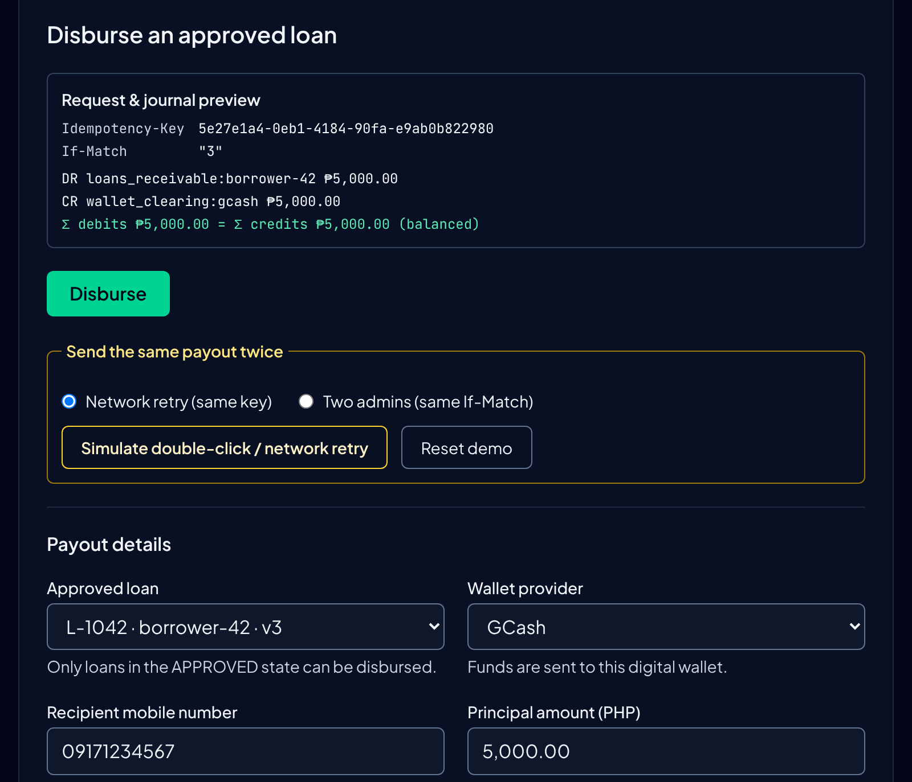
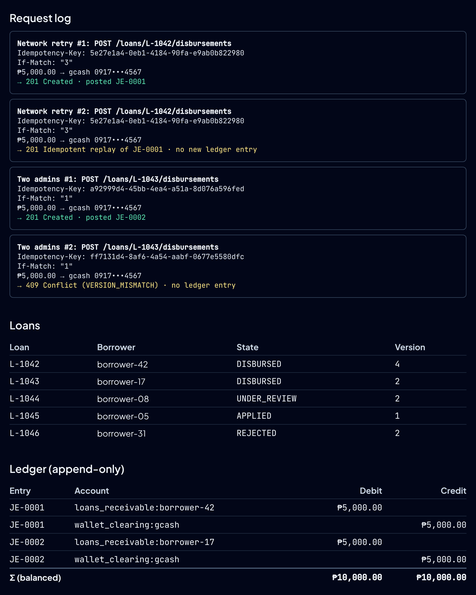
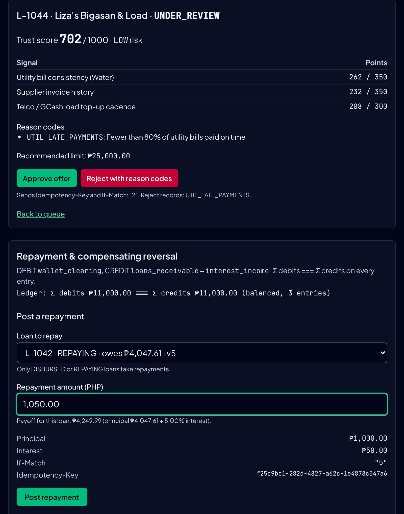
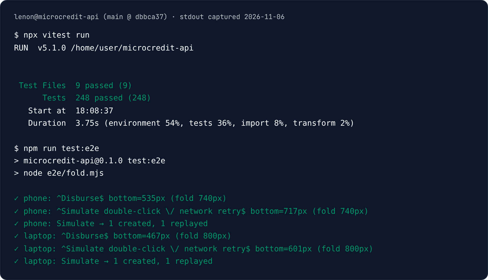
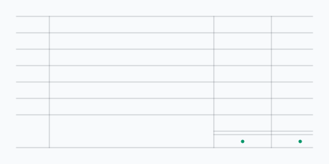
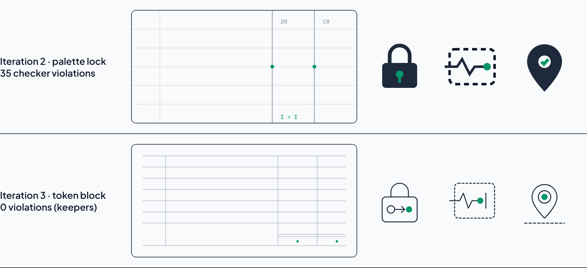
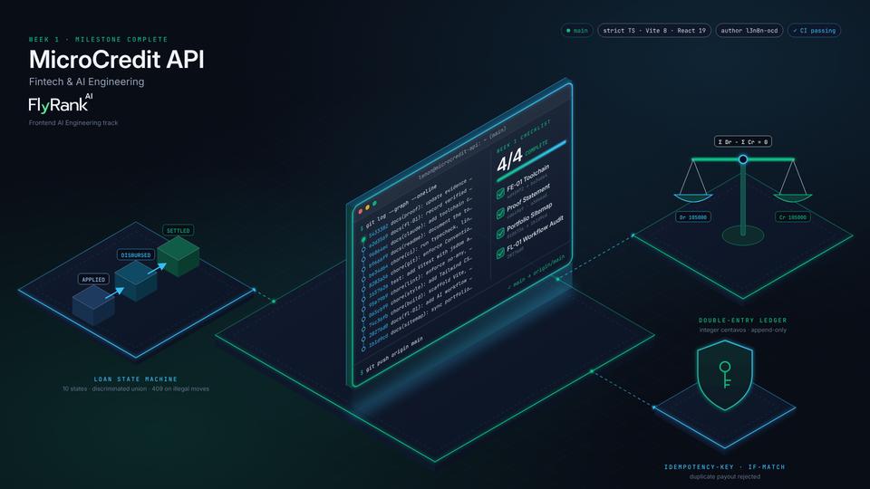

# Kill Your Darlings: Curate Your Images

> Week 3 · General AI Fluency · Lenon D. Adriano · 2026-11-06
> Sitemap: [`PORTFOLIO_PATH.md` v2](./PORTFOLIO_PATH.md#revised-sitemap-v2--3-sections) · Palette and
> fonts: [`IDENTITY_KIT.md`](./IDENTITY_KIT.md) (`#F8FAFC`, `#0F172A`, `#1E293B`, `#059669`; Plus Jakarta
> Sans + JetBrains Mono) · Files: [`assets/curated/`](./assets/curated/)

**The rule used for every slot:** if the image is evidence, it must be a real capture of the real
thing. AI only draws connective tissue: a texture or an icon that proves nothing and claims nothing.

---

## Section 1 · Sitemap-to-Image Inventory & "Real vs. AI" Decision Matrix

PORTFOLIO_PATH v1 had four sections. v2 folded `/about` into the flagship as "Why I build this way"
notes. The bio slot below lives inside `/#flagship-proof`.

| Sitemap Section | Asset File / Slot | Source Call | Purpose on Page | Why Real Beat AI (or Vice Versa) |
| --- | --- | --- | --- | --- |
| `/` Hero | [`real-01-disbursement-sandbox.png`](./assets/curated/real-01-disbursement-sandbox.png) (fallback still for the embedded demo) | **Real Capture** | Shows Disburse with the `Idempotency-Key` and `If-Match: "3"` preview and a balanced `Σ debits = Σ credits` line | The hero *is* the proof. A generated "fintech UI" would show headers that never ran. |
| `/` Hero background | [`kit-01-hero-ledger-grid.svg`](./assets/curated/kit-01-hero-ledger-grid.svg) | **Generated Connective Tissue** | Faint ledger rules behind the claim, at 18% stroke opacity | It claims nothing, so AI is fine. A photo or a capture here would compete with the demo. |
| `/#flagship-proof` Case 1 · MicroCredit API | [`real-02-idempotent-replay-conflict.png`](./assets/curated/real-02-idempotent-replay-conflict.png) | **Real Capture** | `201 Idempotent replay` and `409 Conflict (VERSION_MISMATCH)`, both with "no ledger entry", above a ledger at `Σ (balanced) ₱10,000.00` | An Engineering Manager will read the headers. Only a real request log survives that read. |
| Case 1 (continued) | [`real-03-scoring-and-repayment-ledger.png`](./assets/curated/real-03-scoring-and-repayment-ledger.png) | **Real Capture** | Trust score 702/1000 with its 3 signals and reason code; a repayment split `₱1,000.00 + ₱50.00` with `If-Match: "5"` | The numbers come from `scoreEngine.ts` and are checked by tests. Invented numbers would be unearned claims. |
| Case 1 (continued) | [`real-04-terminal-test-suite.png`](./assets/curated/real-04-terminal-test-suite.png) | **Real Capture** (stdout rendered as a panel) | `248 passed (248)` and the 6/6 fold check | A test count is a claim. This shows the run, at commit `dbbca37`. |
| Case 1 icon | [`kit-02-icon-idempotency-lock.svg`](./assets/curated/kit-02-icon-idempotency-lock.svg) | **Generated Connective Tissue** | Section marker: a lock holding one `APPROVED → DISBURSED` step | A 48 px marker. It labels the case and proves nothing. |
| "Also shipped" · Node2Shell | [`kit-03-icon-sandbox-trace.svg`](./assets/curated/kit-03-icon-sandbox-trace.svg) + link to the [advisory](https://docs.google.com/document/d/1tzEqUoyXrR5_RpeszSFKZX4LhVh_PnoSsjsf9wpNtJo/view) | **Generated Connective Tissue** | One-line strip marker: a trace stopped inside an isolated container | The advisory is the evidence and it's linked. **TODO:** a real capture of the `node:24.22.0` vs `24.22.1` PoC output (`HTTP 400`) from the lab. |
| "Also shipped" · RoadWatch | [`kit-04-icon-geotag-dispatch.svg`](./assets/curated/kit-04-icon-geotag-dispatch.svg) + link to the [repo](https://github.com/l3n8n-ocd/roadwatch) | **Generated Connective Tissue** | One-line strip marker: a verified pin on a road | **TODO:** a real Flutter app screenshot from the RoadWatch repo. |
| Bio · "Why I build this way" (former `/about`) | `real-photo-lenon.jpg` (**you supply it; it is not in the repo yet**) | **Real Photo** | Puts a face next to the three first-person notes in `FRAME_IT_AS_CASES.md` §4 | See "The Real Photo call" below |
| `/#act` Contact CTA | No image. The `LA.` monogram ([`public/favicon.svg`](../public/favicon.svg)) sits in the header only. | **None, on purpose** | One emerald "Book a 15-min code walkthrough" button and a `mailto:` fallback | Any image here pulls the eye away from the one action. |

**Count:**
- **Real:** 4 captures, plus the photo once you add it, so 5.
- **Generated:** 4 small connective assets, none of which is evidence.
- **To add:** 2 more real captures (Node2Shell and RoadWatch) would replace "TODO" with evidence.

### The Real Photo call (bio slot)

The subject of this slot is Lenon. Only a real photo can show a real person.

- **Hiring is a bet on a person.** The Engineering Manager is deciding whether to spend 15 minutes with an
  engineer they would work with. A real photo answers "is this a real, specific person?" An AI avatar
  raises that question.
- **Generated faces read as fake.** Small uncanny details set off distrust. On a page whose whole claim is
  "my numbers are real", one generated face makes every other image look suspect.
- **The best choice is a working photo.** For example, you leading or presenting at an AWS Student
  Builder Group or BulSU MSC session, if such a photo exists. It shows the team communication that the
  RoadWatch case claims. A plain, well-lit headshot is the fallback.
- **TODO (Lenon):** add the photo as `docs/assets/curated/real-photo-lenon.jpg`: cropped to the face and
  shoulders, at least 800 px, with no filters. Nothing was generated for this slot.

---

## Section 2 · The Final Image Set ("The Keepers")

### Part A · Real captures of the work

How they were made, by [`capture.mjs`](./assets/curated/iterations/capture.mjs):
- **App state:** Playwright drove the production build (`npm run build`, then `vite preview`) of `main`.
  Nothing was edited after capture.
- **Viewport and sharpness:** 1280×800 at `deviceScaleFactor: 2`, so text stays sharp at 100% zoom.
- **Fonts:** this container cannot reach Google Fonts, so the script served the same Plus Jakarta Sans and
  JetBrains Mono files from the `@fontsource` npm packages. The captures match what visitors see.
- **Crops:** each crop is computed from page elements (heading to last field), plus 16 px of padding, and
  cut to the content column, so no empty margins and no half-lines.

**real-01 · Disburse card, untouched sample payout.** Title to the amount field. The `Idempotency-Key`,
`If-Match: "3"`, the `DR` / `CR` lines and the balanced sum are all in the top third. The `L-1042 ·
borrower-42 · v3` select and the `5,000.00` amount sit at the bottom.



**real-02 · After two simulations.** First "Network retry" on `L-1042`, then "Two admins" on `L-1043`. The
crop runs from "Request log" to the ledger total. It holds all four requests with their keys and
`If-Match` values:
- `201 Created`;
- `201 Idempotent replay of JE-0001 · no new ledger entry`;
- `201 Created`;
- `409 Conflict (VERSION_MISMATCH) · no ledger entry`.

Below them, the loans table shows both loans `DISBURSED`, and the ledger ends at `Σ (balanced) ₱10,000.00
₱10,000.00`.



**real-03 · Workbench.** The L-1044 detail shows:
- `702 / 1000 · LOW risk`, with the three signals as `262 / 350`, `232 / 350` and `208 / 300`;
- `UTIL_LATE_PAYMENTS`, the `₱25,000.00` limit, and Approve / Reject.

Under it, the repayment panel shows:
- the ledger line after a posted `₱1,000.00` repayment;
- a second `₱1,050.00` split previewed as `₱1,000.00 + ₱50.00`, with `If-Match: "5"`.

*Flaw kept, not hidden:* JetBrains Mono's ligatures draw `===` as one long bar in the ledger line. The fix
is `font-variant-ligatures: none` on monospace text (TODO).



**real-04 · Test suite.** The stdout of `npx vitest run` and `npm run test:e2e` at commit `dbbca37`, drawn
as a terminal panel in kit colours. The text is exactly what the commands printed, with two cuts: ANSI
colour codes removed, and Vitest's three-line jsdom performance hint dropped. It's labelled as rendered
output, because it is not a photo of a terminal window.



### Part B · Connective-tissue set

All four pass [`check-style-lock.py`](./assets/curated/iterations/check-style-lock.py), which enforces:
- every line is `#1E293B` at `stroke-width="1.5"` with `fill="none"`;
- `vector-effect="non-scaling-stroke"` is on each element, so the 1.5 px line holds at any display size;
- emerald `#059669` appears only as 1–3 nodes of `r="2.5"`;
- no text, gradients, filters or other colours.

| Hero texture | Case 1 | Node2Shell | RoadWatch |
| --- | --- | --- | --- |
|  |  |  |  |
| Ruled rows, a `DR \| CR` column pair, a double rule at the total, and an emerald node under each column: the entry balances. 18% opacity. | A lock holding one transition: an open state, an arrow, then the single accepted request (emerald). | A trace enters a dashed, isolated container and stops at the emerald node before a barrier. | A pin on a dashed road, with the emerald node at the verified centre. |

```bash
python3 -I docs/assets/curated/iterations/check-style-lock.py docs/assets/curated/kit-*.svg   # 4 × PASS
```

---

## Section 3 · Style-Lock Prompt Iteration Log



| Iteration | Prompt | Output | Measured result |
| --- | --- | --- | --- |
| **1 · Drift** | The real Week 1 illustration prompt (verbatim below) | [`week1-milestone.png`](./assets/week-01/week1-milestone.png), the darling in Section 4 | Mean luminance **27/255**: a dark scene, the inverse of a Crisp Paper page. Two accents (emerald plus cyan rim light). 3D glass with text set at an angle. |
| **2 · Palette lock** | [`prompt-2-palette-lock.txt`](./assets/curated/iterations/prompt-2-palette-lock.txt): the 4 hex codes plus "calm, technical, no gradients, no neon, no 3D" | 4 drafts in [`iterations/`](./assets/curated/iterations/), drawn by Claude Code from that prompt alone | Colours held. **Style did not: 35 checker violations** (breakdown below). |
| **3 · Stroke & grid token block** | [`prompt-3-token-block.txt`](./assets/curated/iterations/prompt-3-token-block.txt): exact stroke, fill, node, opacity and grid tokens, plus a list of banned elements | The 4 keepers | **0 violations.** The checker turns the prompt into a test. |

**Iteration 1 prompt (verbatim, Week 1):**

> A sleek, dark-mode isometric 3D technical illustration representing a completed Week 1 Fintech & AI Engineering milestone. In the center, a glowing glassmorphic developer terminal displays a clean Git commit graph and a 4/4 completed checklist with emerald green checkmarks ("FE-01 Toolchain", "Proof Statement", "Portfolio Sitemap", "FL-01 Workflow Audit"). Surrounding the terminal are subtle fintech architectural nodes: a deterministic state-machine flowchart ("APPLIED -> DISBURSED -> SETTLED"), a double-entry centavo ledger balance scale, and a shield icon representing idempotency protection. Deep obsidian slate background (#090D16) with emerald green (#10B981) and electric cyan (#38BDF8) neon rim lighting, crisp vector-style UI telemetry, minimal clutter, executive engineering aesthetic, 16:9 aspect ratio, and with FlyRank AI logo.

**Why it drifted:** "dark-mode", "isometric 3D", "glowing glassmorphic" and "neon rim lighting" are mood
words. The model followed them over "minimal clutter".

**What Iteration 2 got wrong (35 violations):**

| Count | Problem |
| ---: | --- |
| 7 | Stroke widths other than 1.5 (1, 2, 2.5, 3) |
| 7 | Elements with no 1.5 width |
| 7 | Elements without `vector-effect` |
| 5 | Solid-filled shapes: the lock body and the pin. Two icons became glyphs, two stayed outlines, so the set stopped matching. |
| 3 | Opacity on a group or on text instead of the hero's stroke opacity |
| 3 | Emerald nodes off-size (`r` 3 and 4) |
| 1 | Pin with no emerald node: its check mark was a stroke |
| 1 | `<text>` element (`DR` / `CR` / `Σ = Σ`) |
| 1 | `#0F172A` outline, which is the text colour |

**The lesson:** naming the palette locks colour, not style. Style held only when every visual property
became a token that a script could check.

---

## Section 4 · "Kill Your Darlings": The Rejection Notes

> **2-line primary rejection note (copy-paste ready):**
> I killed our own AI-generated Week 1 hero (`rejected-01-week1-neon-isometric.png`): it is a dark neon isometric scene (mean luminance 27/255) that inverts our Crisp Paper `#F8FAFC` kit, adds a second cyan accent, and would compete with the live Disburse demo for the one dark, loud slot on the page.
> Worse, it fakes the evidence it decorates: its tilted "git log" is hard to read (2 of its 16 hashes were misread on the first check), and it labelled "10 states" when 5 were built, so real Playwright captures of the request log, ledger and test run replaced it.

### Rejection 1 · The neon isometric hero (the primary darling)

| Rejected: `rejected-01-week1-neon-isometric.png` | Keeper: `kit-01-hero-ledger-grid.svg` (+ `real-01` as the hero visual) |
| --- | --- |
|  |  |
| **Mood:** dark, glowing glass, 3D isometric | **Mood:** ledger paper, flat, 18% lines |
| **Palette:** dark canvas (mean luminance 27/255); emerald **plus** cyan rim light, two accents | **Palette:** Crisp Paper canvas, Deep Ledger Slate lines, emerald only on the two balanced nodes |
| **Role on page:** a second dark, loud block that fights the live demo | **Role on page:** it sits behind the claim and stays quiet |
| **Truth:** tilted terminal text and an unearned "10 states" label at the time | **Truth:** it claims nothing. The proof is `real-01`. |

It is the most polished image in the repo, and that is what makes it a darling. It stays in the README
as the Week 1 milestone record, which is a fair place for it. It is cut from the portfolio. A 960 px copy
is kept here for comparison. The original 1920×1080 file is
[`assets/week-01/week1-milestone.png`](./assets/week-01/week1-milestone.png).

**Correcting the brief:** this assignment's brief described the darling as a "cyber-vault" with
cyan/purple gradients and a floating `$104.293`. **No such image was generated**, and the real darling
has no decimal currency in it: its ledger scale reads `Dr 105000` / `Cr 105000`, in integer centavos. The
note above describes the image that actually exists. A pixel check also showed cyan is only 0.15% of it,
so "glowing gradients" would have overstated the palette problem. The darkness is the real problem.

### Rejection 2 · An AI stand-in for Case 1 evidence

**Rejected:** an AI-drawn picture of the work. The darling's floating "git log" terminal and its
`APPLIED → DISBURSED → SETTLED` cubes are exactly that: illustrations of a request log and a state
machine. No separate AI "dashboard mockup" was generated for this assignment. The rule was decided
before one could be made.

**Keepers:** `real-02` and `real-04`. An Engineering Manager will try to read the `Idempotency-Key`, check
that `If-Match: "1"` really produced `409 VERSION_MISMATCH`, and add up the ledger column. A mockup fails
that at the first check: the headers never ran, and the numbers come from no test. One fake screen makes
every real screen on the page suspect.

### Rejection 3 · An AI avatar or stylized portrait for the bio slot

**Rejected by rule; none was generated.** The subject is Lenon, so the slot takes a real photo
(Section 1). A stylized AI portrait would be the one invented face on a page whose claim is "nothing here
is invented". It also risks the uncanny-valley distrust a fintech reviewer is trained to act on. **TODO:**
the real photo.

---

## Where Real Beat AI (summary)

> Real captures won every slot that carries a claim: the hero demo, the replay and 409 log, the trust
> score and repayment split, and the test run. AI kept only connective tissue that claims nothing: one
> ledger-grid texture and three 48 px icons, all locked by `check-style-lock.py`. The bio needs a real
> photo of Lenon, and `/act` gets no image at all.

## Verification

| Check | Result |
| --- | --- |
| Real captures | Taken by Playwright from the production build at commit `dbbca37` with real fonts. Each was checked by eye for legibility and clean crop edges. One crop bug, viewport vs page coordinates after scrolling, was found and fixed before keeping `real-03`. |
| Style lock | Keepers 4/4 PASS. Iteration 2 drafts: 35 violations. |
| Darling pixel check (Pillow, 480×270 sample) | 92.3% of pixels within 24 RGB units of a kit colour (dark ink and slate); mean luminance 27/255; cyan 0.15%. |
| Palette in `real-04` | Only `#0F172A`, `#1E293B`, `#F8FAFC` and `#059669`. A first render used off-kit `#34D399` and `#94A3B8` and was redone. |
