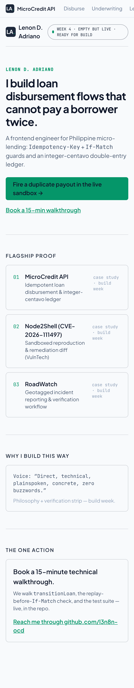
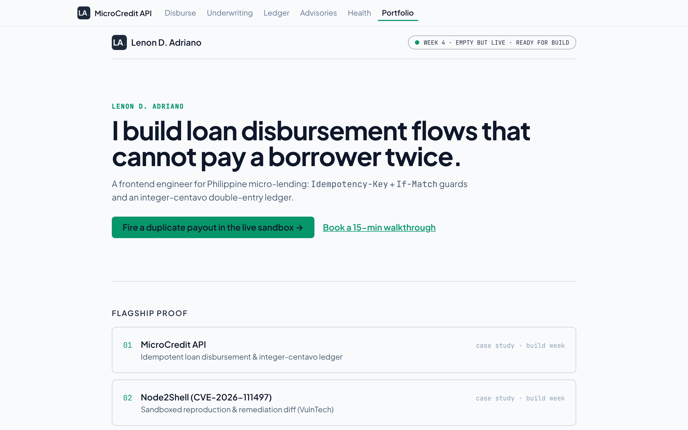

# Empty but Live: Ship a Blank Page

> Week 4 · General AI Fluency · Lenon D. Adriano · 2026-11-09
> A near-blank portfolio route that is real and reachable, with the 4 content-map frames ready for build
> week. Route: [`src/app/portfolio/page.tsx`](../src/app/portfolio/page.tsx).

## Section 1 · Live URL & stack verification

| Item | Value |
| --- | --- |
| Portfolio shell | https://microcredit-api-beta.vercel.app/portfolio |
| Live capstone demo (`/`) | https://microcredit-api-beta.vercel.app |
| Stack | **Next.js 16 (App Router) · TypeScript 7 (strict) · Tailwind CSS v4 · Vercel** |
| Rendering | Server Component; no `'use client'` on this route |
| Repo | https://github.com/l3n8n-ocd/microcredit-api |

**Verification**
- The Next app is live on Vercel: `GET /health` returns `200` and the home page serves `_next/static`
  assets (checked 2026-11-09).
- `/portfolio` is **live, verified 2026-11-09**: `GET /portfolio` returns `200` and serves the canonical
  claim, the `EMPTY BUT LIVE` status pill, and the 3 case frames from `_next/static`. Open it on a
  **second device (phone)** — it is a static page, so it loads with no interaction.
- Local production parity: `next build` + `next start`, then Playwright at **375×812** (iPhone) and
  **1280×800**. Zero horizontal overflow at both widths (enforced by `e2e/fold.mjs`).




**Two corrections to the Week 4 brief, per the repo's own locked decisions:**
- **Claim:** the brief's draft "frontend **and** full-stack payment flows" is rejected by
  [`CLAUDE.md` §9.5](../CLAUDE.md#95-one-line-claim-portfolio-headline) (the "and" trap; "full-stack" is
  unearned on a frontend + mock server). The page uses the canonical winner: *"I build loan disbursement
  flows that cannot pay a borrower twice."*
- **Contact:** `#act` links the **GitHub profile only, no email** — the decision recorded in
  [`THE_THROUGH_LINE.md`](./THE_THROUGH_LINE.md) §4.

## Section 2 · Unified Claude Project Knowledge Pack

Copy-paste this Master Context Block into the Claude Project so the Identity Kit, the framed cases, and
the content map load in one place for build week.

```text
=== MASTER CONTEXT: MicroCredit API portfolio (build week) ===

ONE-LINE CLAIM
"I build loan disbursement flows that cannot pay a borrower twice."
One Person: an Engineering Manager at a seed-to-Series A lending startup.
One Action: test the live double-click disburse sandbox, then book a 15-minute walkthrough.

--- 1. IDENTITY KIT (docs/IDENTITY_KIT.md) ---
Fonts: Plus Jakarta Sans (600/700 headings & UI), JetBrains Mono (400/500 code, headers, amounts, paths).
Palette (4 colours, one meaning each):
  #F8FAFC Crisp Paper      — the only page background
  #0F172A Obsidian Ink     — all text; also text ON an emerald button (4.74:1)
  #1E293B Deep Ledger Slate — borders, nav, card headers, the monogram badge
  #059669 Verification Emerald — CTA fill, verified badges, focus rings; never text on paper (3.60:1 fails)
Two-line style note:
  L1: Heading/UI in Plus Jakarta Sans; technical/ledger data in JetBrains Mono; palette F8FAFC / 0F172A / 1E293B / 059669.
  L2: A calm, high-contrast ledger-sheet aesthetic with generous whitespace and zero decorative gradients,
      so the state machines, centavo invariants, and security diffs stay the loudest things on the page.

--- 2. FRAMED CASE STUDIES (docs/FRAME_IT_AS_CASES.md), strongest first ---
Voice Card: "Direct, technical, plainspoken, concrete, zero buzzwords."

01. MicroCredit API — idempotent disbursement & integer-centavo ledger
  Problem: a double-clicked Disburse or a retried POST can pay a GCash/Maya payout twice; float money
    math (19.99*100 = 1998.999...) loses a centavo.
  Did: 10-state LoanState discriminated union with a typed 409 for illegal transitions; branded integer
    Centavos entering only through parsePesosToCentavos; balanced debit/credit journals; every mutation
    carries Idempotency-Key + If-Match, and the server replays a known key BEFORE comparing version
    (mutation check: delete the replay lookup, 4 tests fail); a "Simulate double-click / network retry"
    control; the test sits on the first screen.
  Outcome: live at microcredit-api-beta.vercel.app; a double-click sends one request, a same-key retry
    gets the original receipt, a stale If-Match gets 409; 328-test Vitest suite + a Playwright
    above-the-fold check in CI.

02. Node2Shell (CVE-2026-111497) — sandboxed reproduction & remediation (VulnTech)
  Problem: an out-of-bounds write in the Brotli decoder compiled into Node.js; br request bodies and
    fetch() responses expose an unpatched service, and npm update can't fix a non-npm decoder.
  Did: traced DecodeBlockTypeAndLength() in deps/brotli; read the upstream fix (in Node 22.23.4 /
    24.22.1 / 26.12.1); built an internal-only Docker lab and a sanitized, differential PoC
    (node:24.22.0 vs 24.22.1, no shellcode); remediation in priority order (upgrade runtime first).
  Outcome: public advisory under the pen name Exemprium; the patched runtime answers the PoC with
    HTTP 400 instead of corrupting memory. Discovery credit is other researchers'; this is the analysis.

03. RoadWatch — geotagged incident reporting & verification workflow (BSIT capstone)
  Problem: an accident report needs an exact location, a verification step, and an accountable authority.
  Did: project lead on a 4-person team; built the Flutter Android app and run the repo/CI; a report moves
    Submitted → Under Review → Verified → Assigned → In Progress → Resolved/Closed; pushed "role and
    platform lockdown" (ROLE_PLATFORMS): sign-up only creates a Reporter; Reporters mobile-only, Admins
    web-only. The Express API + MySQL are a teammate's, so not claimed.
  Outcome: deployed (roadwatch-ph.me, API on Render, APK on GitHub Releases); API 39/39, flutter analyze
    clean, 58 widget tests. Next: Play Store + landing-page QR.

--- 3. CONTENT MAP & CTA LADDER (docs/THE_THROUGH_LINE.md) ---
4 ordered sections, each with a named CTA that ladders to the One Action:
  / Hero        — live disburse sandbox + claim above the fold → "Fire a duplicate payout → book 15 min"
  /#flagship-proof — 01 MicroCredit (lead), 02 Node2Shell, 03 RoadWatch → "Inspect the diffs → book 15 min"
  /#about       — "Why I build this way" + verifiable credentials → "Skip the resume — pick a slot"
  /#act         — THE ONE ACTION: "Book a 15-minute technical walkthrough" (GitHub-only contact, no email)
Every micro-CTA funnels to one terminal action; no dead ends.
=== END MASTER CONTEXT ===
```

## Section 3 · What is intentionally still blank

The page is a shell by design (the assignment is "empty but live"). Build week fills:
- the 3 case frames with the real 3-beat write-ups and the `real-01/02/03` captures;
- the About section with the 4-sentence philosophy and the verification strip;
- the Act section with the booking link.

It does not touch the `/` capstone demo or its routes — `/portfolio` is an additive static route.
