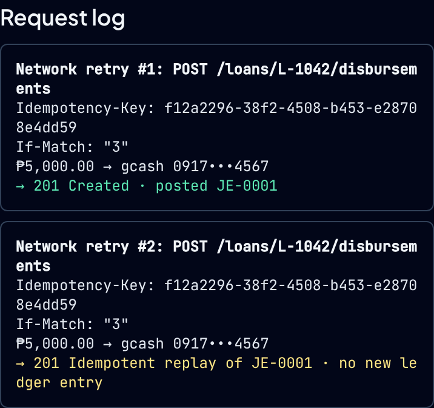
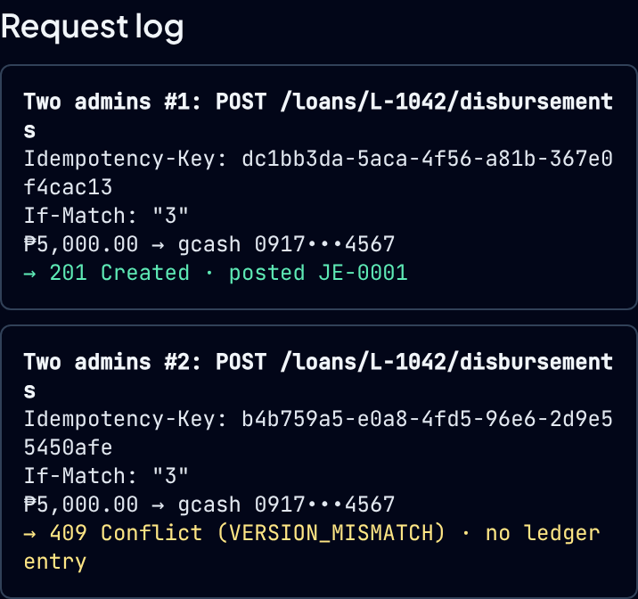

# Explain It Like You Built It

> General AI Fluency · Lenon D. Adriano · 2026-11-12
> The piece: how `/` hands its interactive part to the browser, and how that part stops a double payout.
> Live: <https://microcredit-api-beta.vercel.app/>

## Section 1 · The plain-words explanation

> **Word count: 297** (target 220–300), measured with `wc -w` on the text between the two rules below.
>
> **How it was written.** The tutor drafted it from my corrected answers in Section 3, and every fact
> was checked against the files in Section 2. Before I submit, I read it aloud and rewrite any
> sentence that isn't how I'd say it.

---

Here's how my demo's home page works, and how it stops a borrower being paid twice.

The page comes in two parts. `src/app/page.tsx` is a Server Component. Vercel builds it into finished HTML once, like a printed menu. It shows up on a phone right away. `/portfolio` is all printed menu.

The part you can click is `src/App.tsx`, which starts with `'use client'`. That ships its code to the browser too. It still runs once on Vercel to make the HTML, then again in your browser to wire up the buttons. Both runs must print the same text.

That one bit me. My form made its random `Idempotency-Key` while drawing itself. Vercel and your browser each made a different one, and React threw an error on every visit. Now the server prints "pending", and your browser makes the key.

Think of that key as a numbered claim stub. Next to it goes `If-Match`, the loan's edition stamp. Loan L-1042 is on version 3.

Press Disburse for ₱5,000.00 to GCash. The amount becomes `500000` centavos by joining digits, not multiplying, because `19.99 * 100` gives `1998.9999999999998` in JavaScript. The mock server in `disbursementServer.ts` runs inside the page. It posts one balanced entry: borrower-42 owes `500000`, GCash pays out `500000`. It files the receipt under the stub and moves the loan to version 4.

If my phone's network retries, the same stub arrives again. The server checks stubs first, finds it, and hands back the first receipt: `201` replay, no second entry.

If a second admin clicks in another tab, that's a new stub with the old stamp, `"3"`. The loan is on 4 now, so it bounces with `409 Conflict`.

A disabled button only stops a second click in one tab. The two headers stop the other two.

---

## Section 2 · The code under the microscope

Every line below is copied from the repository at commit `a66be0b`, with its real line number. `…`
marks lines left out.

### Where the page splits

`src/app/page.tsx`

```tsx
   2  import { App } from '../App.tsx'
     …
  12  export default function HomePage() {
  13    return (
  14      <>
  15        <App />
```

`src/App.tsx`

```tsx
   1  'use client'
```

| Line | In plain words |
| --- | --- |
| `page.tsx` 2, 15 | The home page is a Server Component. It is built into HTML once (`next build` lists `/` as static, `○`). All it does is place `<App />`. |
| `App.tsx` 1 | `'use client'` marks where the browser takes over. Everything `App` imports, including `DisbursementForm.tsx`, ships to the browser. It still runs once at build time to produce the HTML. |

`src/app/portfolio/page.tsx` has no `'use client'` anywhere below it: it is HTML only.

### The claim stub, made in the browser

`src/features/disbursement/DisbursementForm.tsx`

```tsx
 141    // Created in the browser only, so the server HTML and the hydrated page match.
 142    const [idempotencyKey, renewIdempotencyKey] = useIdempotencyKey(createKey)
```

`src/hooks/useIdempotencyKey.ts`

```tsx
  38    const [key, setKey] = useState(() => (inBrowser ? createKey() : PENDING_IDEMPOTENCY_KEY))
     …
  43    if (inBrowser && key === PENDING_IDEMPOTENCY_KEY) setKey(createKey())
```

| Line | In plain words |
| --- | --- |
| Form 142 | The form asks the hook for a key. Until today this line was `useState(createKey)`, which made a random key during both renders. That was the bug in Section 3. |
| Hook 38 | On the server and during hydration, `inBrowser` is `false`, so both renders print `pending` and match. |
| Hook 43 | Once the page is running in the browser, the real UUID is made, before anything is painted. |

### The stub and the stamp on every request

`src/features/disbursement/DisbursementForm.tsx`

```tsx
 115  function buildRequest(value: ValidDisbursement, idempotencyKey: string): DisbursementRequest {
 116    return {
 117      headers: { 'Idempotency-Key': idempotencyKey, 'If-Match': formatIfMatch(value.loan.version) },
```

| Line | In plain words |
| --- | --- |
| 117 | Every payout carries both headers: the stub (`Idempotency-Key`) and the edition stamp (`If-Match`, the loan version, `"3"` for L-1042). |

### Money as whole centavos

`src/utils/money.ts`

```ts
  76    // Concatenate digits instead of multiplying: "19" + "99" → 1999 centavos.
  77    const centavoDigits = wholeDigits + (fractionPart ?? '').padEnd(2, '0')
  78    return { ok: true, value: toCentavos(Number.parseInt(centavoDigits, 10)) }
```

`src/features/disbursement/ledger.ts`

```ts
  35      { account: `loans_receivable:${input.loan.borrowerId}`, side: 'DEBIT', amount: input.amount },
  36      { account: `wallet_clearing:${input.provider}`, side: 'CREDIT', amount: input.amount },
```

| Line | In plain words |
| --- | --- |
| money 76–78 | `"5,000.00"` becomes `500000` by joining the digit strings. No `* 100`, so no float drift. |
| ledger 35–36 | One payout is one balanced entry: `DEBIT loans_receivable:borrower-42` and `CREDIT wallet_clearing:gcash`, the same `500000` on each side. |

### What Simulate sends

`src/features/disbursement/DisbursementForm.tsx`

```tsx
 240      const first = buildRequest(value, idempotencyKey)
 241      // Retry: byte-identical request. Second admin: fresh intent (new key) but the same stale If-Match.
 242      const second = mode === 'retry' ? first : buildRequest(value, createKey())
```

| Line | In plain words |
| --- | --- |
| 242, retry mode | The second request is the first one again: same stub, same stamp. That is what a flaky network does. |
| 242, two-admins mode | The second request gets a new stub (`createKey()`) but the same old stamp. That is what a second admin with a stale screen does. |

### The guard, in the mock server

`src/features/disbursement/disbursementServer.ts`

```ts
 107      // 1. Idempotent replay.
 108      const stored = results.get(key)
 109      if (stored !== undefined) {
     …
 118        return { kind: 'REPLAYED', status: 201, loan: stored.loan, journalEntry: stored.journalEntry }
     …
 141      // 3. Optimistic concurrency.
 142      if (Number(etag[1]) !== loan.version) {
     …
 145          status: 409,
 146          code: 'VERSION_MISMATCH',
```

| Line | In plain words |
| --- | --- |
| 107–109, 118 | Step 1 looks the stub up. Seen before with the same payload: return the stored receipt, `201 REPLAYED`. Nothing new is posted. |
| 141–146 | Step 3, only for a new stub: if the stamp is older than the loan, return `409 VERSION_MISMATCH`. |

The order is the point. A real retry arrives after the loan has already moved to version 4. If the
stamp were checked first, the retry would get a `409` for a payout that worked.

This guard lives in `disbursementServer.ts`, an in-memory mock that runs in the page. It is not in
`ledger.ts` and not in `transitionLoan`; those build the entry and the state change once the guard
has let a request through.

## Section 3 · The Tutor Mode log

### The prompt

The FlyRank Tutor Mode prompt, as quoted in my brief (the brief elides parts of it with `...`):

> Teach me this one piece of my own build... Use my actual code... Then ask me two questions to check
> I understood, and correct me

The piece was `src/app/page.tsx` → `src/App.tsx` → `DisbursementForm.tsx` → `disbursementServer.ts`,
as in Section 2. I asked for the questions as multiple choice. Below are the options I picked, as I
picked them.

### What was unclear to me first

Asked to pick only what was true, I picked all four:

- why the request needs both `Idempotency-Key` and `If-Match` when Disburse is already disabled while a request is in flight;
- that a `'use client'` component still runs once on the server to make HTML;
- that the key lookup and the version check live in `disbursementServer.ts`, not in the form or `ledger.ts`;
- that a retry gets its receipt back (`201` replay) while a second admin gets `409`.

### Something the tutor found while preparing the lesson

The brief for this assignment assumed our code made the key safely. It didn't. The static HTML for
`/` carried one key, `664a5056-79f3-4156-99d4-b3d3970df3a2`, for every visitor. After the page loaded,
a different key was on screen, and the browser logged React error #418, a hydration mismatch. The
repayment panel on `/underwriting` had the same problem. So Question 1 is about a real bug.

### Question 1 · Hydration and `'use client'`

**1a.** Why are there two different keys?

| | |
| --- | --- |
| I picked | "A stale cached page": Vercel's CDN served an older copy. |
| Correction | No. The component ran twice: once on Vercel to build the HTML, once in my browser. Each run called the random generator, so the two texts could never match. |

**1b.** What change would stop the mismatch and still give each payout its own key?

| | |
| --- | --- |
| I picked | "Create it in the browser": render with no key first, make the key only in the browser. |
| Verdict | Right. That is what `useIdempotencyKey` does now (Section 2). |

**Re-check.** If the first render printed the fixed text "pending" instead of a key, what would happen?

| | |
| --- | --- |
| I picked | "Runs once, no mismatch": with no random call, the component stops running on Vercel. |
| Correction | It still runs twice. What changes is that both runs print "pending", so they match. Removing the randomness does not move where the code runs. |

**Retake.** Where does a `'use client'` component run?

| | |
| --- | --- |
| I picked | "On Vercel, then the browser." |
| Verdict | Right. |

### Question 2 · Replay versus conflict

**2a.** Simulate sends two requests at once for L-1042 (version 3). What does the second one get back
in each mode?

| | |
| --- | --- |
| I picked | "Both get 409." |
| Correction | No. Network retry (same stub): `201` replay, the original receipt, nothing new posted. Two admins (new stub, stamp `"3"`): `409 VERSION_MISMATCH`, because the loan is on 4. |

**2b.** If the server compared the version before looking up the stub, what would a real retry get?

| | |
| --- | --- |
| I picked | "A second payout." |
| Correction | No. The retry's `"3"` is stale once the loan is on 4, so it gets `409`. Nobody is paid twice. The harm is the message: the user is told "conflict" for a payout that worked. |

**Re-check.** After a Network retry run, what is in the ledger and on screen?

| | |
| --- | --- |
| I picked | "Two entries, two 201s." |
| Correction | One entry. The screen shows `201 Created`, then `201 Idempotent replay`. |

**Re-check.** How do the two headers divide the work?

| | |
| --- | --- |
| I picked | "Key for retries, version for admins": the stub gives a retry its receipt back; the stamp stops a different intent working from an old version. |
| Verdict | Right. |

**Retake, by looking at the live page.** What does the request log show after Simulate in Network
retry mode?

| | |
| --- | --- |
| I picked | "Two 201 Created." |
| What the page shows | One `201 Created · posted JE-0001`, then `201 Idempotent replay of JE-0001 · no new ledger entry`. Captured from the live site during this session: |





### Where I ended up

- **Where code runs: settled.** I got the direct question right on the retake. The re-check shows
  what I had to unlearn: the fix does not stop the server run, it makes the two runs agree.
- **Which header does what: settled.** I picked the right division on the re-check.
- **What a retry looks like on screen: still open.** Twice I said a retry gives two `201 Created` and
  two entries. The second line is also a `201`, but it says replay and posts nothing. My next step is
  to press Simulate myself and read that second line.

### What the session changed in the code

The lesson turned up two bugs, and both are fixed:

- `fix(disbursement)`, commit `a66be0b`: keys are made in the browser. The live pages `/` and
  `/underwriting` now load with no page error and no key in their HTML.
- `fix(ai-copilot)`, commit `bda94d7`: fixing the first bug exposed a second. The chat's saved
  history only survived a reload because the hydration error made React redraw the whole page. With
  hydration working, the chat's placeholder wiped the saved history. It no longer saves.

Each fix has a test that fails when the fix is reverted.
