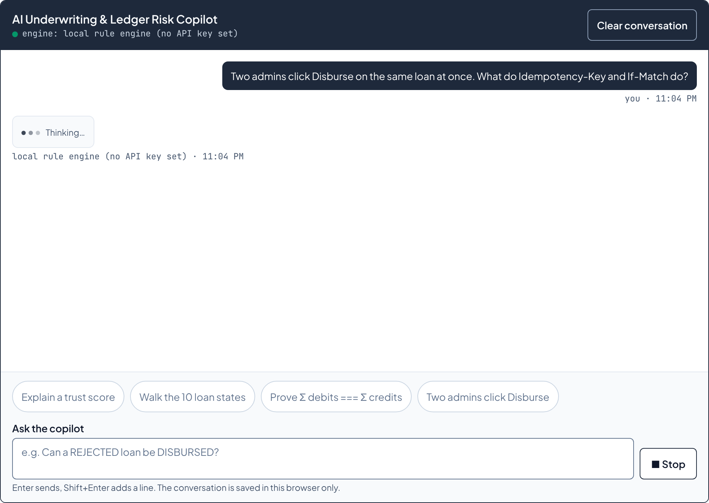
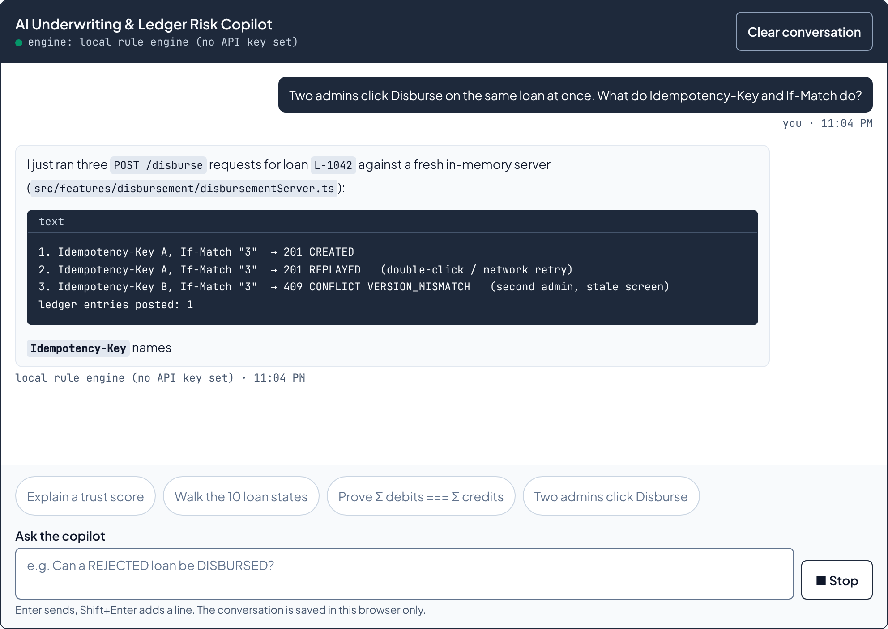
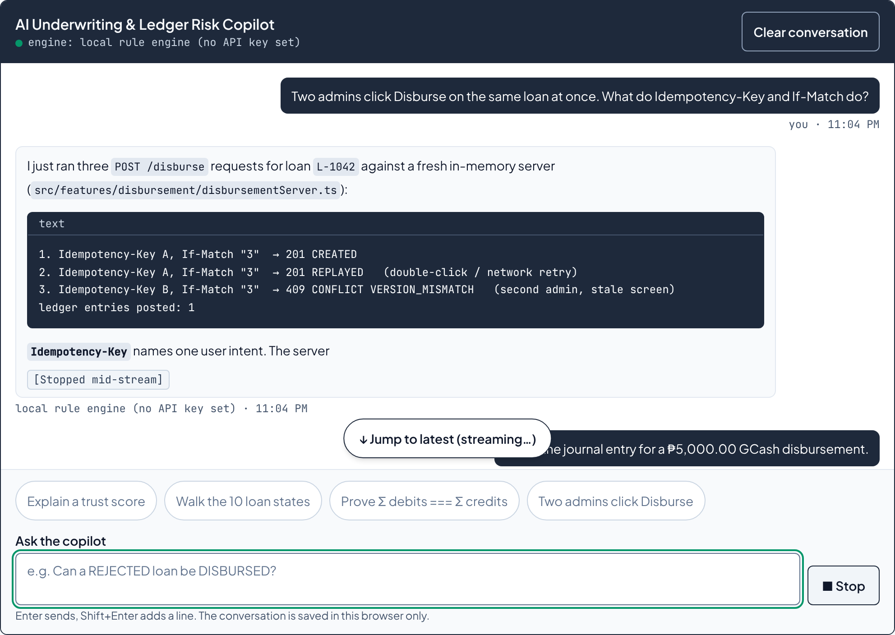
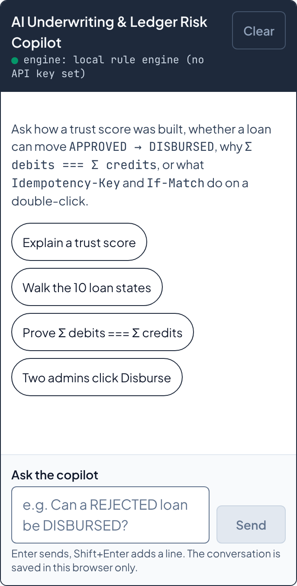

# FE-06 · Streaming AI Chat Interface

> Week 4 · Frontend AI Engineering · Lenon D. Adriano · 2026-11-10
> Live: <https://microcredit-api-beta.vercel.app/underwriting#copilot>

The **AI Underwriting & Ledger Risk Copilot** is a multi-turn streaming chat on `/underwriting`. It
answers questions about trust scores, the 10 loan states, the `Σ debits === Σ credits` invariant, and
what `Idempotency-Key` and `If-Match` do when **Disburse** is clicked twice.

## The three files a reviewer asked for

| What | File | GitHub |
| --- | --- | --- |
| Route handler | [`src/app/api/chat/route.ts`](../src/app/api/chat/route.ts) | <https://github.com/l3n8n-ocd/microcredit-api/blob/main/src/app/api/chat/route.ts> |
| Chat component | [`src/features/ai-copilot/StreamingUnderwritingChat.tsx`](../src/features/ai-copilot/StreamingUnderwritingChat.tsx) | <https://github.com/l3n8n-ocd/microcredit-api/blob/main/src/features/ai-copilot/StreamingUnderwritingChat.tsx> |
| Model config + system prompt | [`src/lib/ai/underwriting-model.ts`](../src/lib/ai/underwriting-model.ts) | <https://github.com/l3n8n-ocd/microcredit-api/blob/main/src/lib/ai/underwriting-model.ts> |

## 1 · What is real and what is not

Read this first. It is the honest scope of the deliverable (`CLAUDE.md` §9.2 rule 4).

| Claim | Evidence | Status |
| --- | --- | --- |
| Tokens stream one by one over SSE from `/api/chat` | `npm run test:e2e`: 12 distinct text lengths in 12 samples, in Chromium, at 375px and 1280px | ✅ Verified |
| Stop aborts the HTTP request and keeps the partial reply | e2e: `net::ERR_ABORTED` on `/api/chat`, text length unchanged 400 ms later | ✅ Verified |
| "Stop, then send again" works for any number of turns | Component test loops stop → send 5 times; e2e sends a follow-up right after Stop | ✅ Verified |
| Multi-turn context is sent and used | Component test asserts the full history on request 2; e2e: "and for Liza?" resolves to Liza's score | ✅ Verified |
| The hosted-model path calls the AI SDK's `streamText` | Route test drives the real `streamText` with the SDK's `MockLanguageModelV4` | ✅ Verified against a mock |
| A real Claude or Gemini model answers on the live URL | No API key is set in this repo's CI or, as of this commit, on Vercel | ⏳ **TODO:** set a key, confirm the engine label shows a model ID |
| Server-side cancellation on Vercel stops the model call | Unit test proves the abort signal reaches the model call; Vercel's own disconnect behaviour was not measured | ⏳ **TODO** |
| Rate limiting on `/api/chat` | None. Per-request caps only (§6) | ❌ Not built |

**With no key set, the reply does not come from a language model.** It comes from a local rule engine,
[`src/lib/ai/local-engine.ts`](../src/lib/ai/local-engine.ts), and the UI says so under every reply:
`local rule engine (no API key set)`. The streaming, cancellation and rendering are the same code either
way. That is the part FE-06 grades.

## 2 · Architecture

```text
Browser ('use client')                              Server (Node runtime)
──────────────────────────────────────────          ─────────────────────────────────────────────
StreamingUnderwritingChat.tsx
  chatReducer.ts      state machine                 src/app/api/chat/route.ts
  chatTransport.ts    fetch + AbortController  ───▶   1. parseChatRequest(unknown)  → 400 or messages
  chatProtocol.ts     SSE parser               ◀───   2. resolveChatEngine()        reads the API keys
  StreamingMarkdown.tsx                               3. streamText(...)  or  streamLocalReply(...)
  conversationStore.ts  localStorage                  4. SSE frames: meta → token × N → done | error

                                                    src/lib/ai/underwriting-model.ts   (server-only)
                                                      MODEL_CONFIG · STARTER_PROMPTS
                                                      buildSystemPrompt() · resolveChatEngine()
                                                    src/lib/ai/local-engine.ts
                                                      rule engine over the app's own pure functions
```

**One wire format for two engines.** Both the hosted model and the local engine are turned into the same
four SSE frames, defined once in [`chatProtocol.ts`](../src/features/ai-copilot/chatProtocol.ts):

```text
data: {"type":"meta","engine":{"kind":"local","label":"local rule engine (no API key set)"}}
data: {"type":"token","text":"Σ debits "}
data: {"type":"done","finishReason":"stop"}
data: {"type":"error","message":"..."}
```

The client has one code path and never knows which engine ran, except for the label it prints.

**Why a hand-written SSE protocol instead of the AI SDK's `useChat`.** `useChat` would hide the four
things this assignment asks to be engineered: the abort, the scroll pin, the thinking handoff and the
Markdown repair. The server still uses `streamText`. The trade-off is about 150 lines of protocol and
reducer code that the SDK would otherwise own.

**Keys stay on the server.** `underwriting-model.ts` starts with `import 'server-only'`, so `next build`
fails if a Client Component imports it. `ANTHROPIC_API_KEY` and `GOOGLE_GENERATIVE_AI_API_KEY` are read
from `process.env` in that file and nowhere else, and neither has a `NEXT_PUBLIC_` prefix. The server
page passes two plain props to the chat: the starter prompts and the engine **label**.

**The system prompt is generated, not typed.** `buildSystemPrompt()` computes the applicant list with
`scoreApplicant` and the transition table by running `transitionLoan` over every state. A test asserts
each applicant's score in the prompt equals what the engine computes, so the prompt cannot drift from
the code.

## 3 · The four Mentor Tips

### Tip 1 · Smart auto-scroll

*Problem.* A chat that scrolls to the bottom on every token drags the reader down while they read
something above. A chat that never scrolls makes them chase the reply.

*What I built.* The log follows the stream only while the reader is within **48 px** of the bottom.

```ts
const gapBefore = previous.scrollHeight - element.scrollTop
const distanceBefore = Math.min(gapBefore - previous.clientHeight, gapBefore - element.clientHeight)
if (forceFollowRef.current || distanceBefore <= PIN_THRESHOLD_PX) element.scrollTop = element.scrollHeight
```

- It runs in `useLayoutEffect`, so the token and the new scroll position paint in the same frame.
- Scrolling up more than 48 px releases the pin. A floating **↓ Jump to latest (streaming…)** pill appears.
- Sending a message or pressing the pill pins again.

*The bug the browser test caught.* My first version kept an `isPinned` flag set by `onScroll`. All 29
jsdom tests passed. In Chromium the pill never appeared. The browser delivers a scroll event one frame
after the scroll, and tokens land every ~22 ms: a token committed in that gap read the stale flag and
snapped the view back down. The fix reads the live `scrollTop` against the height recorded at the
previous commit, so there is no flag to go stale. The regression test sets `scrollTop` **without**
firing a scroll event and asserts the view does not move.

### Tip 2 · Stop as a state machine

*Problem.* Two booleans (`isLoading`, `isStreaming`) can disagree, and a token from an aborted request
can land in the next reply.

*What I built.* One reducer, [`chatReducer.ts`](../src/features/ai-copilot/chatReducer.ts), with five
states:

```text
idle ──send──▶ submitted ──first token──▶ streaming ──done──▶ idle
                   │                          │
                   └────────── stop ──────────┴──▶ stopped ──send──▶ submitted
                   └────────── fail ──────────┴──▶ error   ──send──▶ submitted
```

Stop does three things, in this order, with no waiting on the network:

1. `abortRef.current.abort()` cancels the `fetch`. Each request gets its own `AbortController`.
2. `dispatch({ type: 'STOP' })` moves to `stopped`. The partial text stays and gets a
   `[Stopped mid-stream]` badge. Send is back in the same render.
3. Focus returns to the input.

Every stream event carries the ID of the assistant message it belongs to. After Stop the reducer's
`activeId` is `null`, so a late token is dropped. After "send again" `activeId` is the new message, so a
late token from run 1 still cannot reach run 2.

Send and Stop are **one** `<button type="submit">`. Its `type` never changes. Swapping a button from
`button` to `submit` inside its own click handler lets the same click submit the form a moment later.

The input stays editable while a reply streams, so a follow-up can be typed ahead. Enter does not send
until the reply is done or stopped.

### Tip 3 · Flicker-free thinking → first token

*Problem.* A separate "typing…" row that is removed when the first token arrives makes the list jump by
one row.

*What I built.* The assistant bubble is created on send, empty. Its body is one container:

```tsx
<div className="min-h-6" data-testid="assistant-body">
  {text === '' && pending ? <ThinkingIndicator /> : <StreamingMarkdown text={text} streaming={...} />}
</div>
```

The thinking indicator is `h-6`, the same height as one `leading-6` line of text. The first token
replaces it inside the same DOM node, at the same height. The test keeps a reference to that node before
the first token and asserts it is the identical node after.

### Tip 4 · Streaming-safe Markdown

*Problem.* Mid-stream, Markdown is always broken: a code fence is open, `**` has no partner. A normal
renderer shows raw symbols for a few frames, then re-flows the message when the closer lands.

*What I built.* [`streamingMarkdownParser.ts`](../src/features/ai-copilot/streamingMarkdownParser.ts)
treats "not closed yet" as a normal state:

| Mid-stream text | Rendered as |
| --- | --- |
| ` ```ts ` + code, no closing fence | A code block (`open: true`) from its first line |
| `pay **onc` | "pay **onc**": bold up to the end of the text |
| ``send `If-Mat`` | Inline code up to the end of the text |
| A trailing `` ` ``, ` `` `, `*`, `#` or `-` | Held back until the next token decides what it is |
| ` ```t ` | A code block with no language tag yet, so `t` never flashes before `ts` |

Blocks are keyed by position and a stream only appends, so React patches text inside existing nodes. One
test parses **every prefix** of a reply and asserts the block count never goes down and no `**` or
backtick ever reaches the output. Output is React text nodes only. There is no
`dangerouslySetInnerHTML`, so model output cannot inject markup (`CLAUDE.md` §8).

A stopped reply keeps the tolerant parsing permanently, because it was cut mid-construct. The first
screenshot pass showed a stopped reply ending in a raw `**` and a backtick; that is now a test.

## 4 · Stretch goals

| Goal | How |
| --- | --- |
| Persistence | `localStorage` key `microcredit_ai_copilot_v1`. Read as `unknown` and rebuilt field by field; corrupt data gives an empty chat, not a crash. Saved at rest and on send, not per token. |
| Hydration | `useSyncExternalStore` reports "not in a browser" during SSR and hydration, then the session remounts once with the stored messages. No hydration warning, no `setState` in an effect. |
| Clear / Reset | **Clear conversation** aborts any request, empties the list and removes the storage key. |
| Starter chips | 4 chips from `STARTER_PROMPTS`, one per topic. Each also works on the local engine. |
| Motion | Message entry and the Send ⇄ Stop colour swap: 150 ms `ease-out` (`cubic-bezier(0, 0, 0.2, 1)`), off under `prefers-reduced-motion`. The thinking dots are the app's one looping animation (`CLAUDE.md` §12 rule 4 exception) and are static under reduced motion. |
| 375px | The composer is the last child of a fixed-height flex column, so it stays in view while the log scrolls. Targets are `min-h-11` (44 px). Code blocks scroll inside themselves: e2e measures 0 px page overflow with a journal block on screen. |
| Accessibility | The log is `role="log"` with `aria-live="off"`, so a screen reader is not read every token; a `role="status"` line announces thinking, replying, stopped and complete. The field has `<label htmlFor>`, `aria-invalid` and `aria-describedby` (`CLAUDE.md` §11 rule 1). |

## 5 · The local rule engine

When no key is set, [`local-engine.ts`](../src/lib/ai/local-engine.ts) routes the last user message to
one of four topics by keyword and builds the answer from the app's own functions:

| Topic | Numbers come from |
| --- | --- |
| Trust score | `scoreApplicant` on the seed profile |
| Lifecycle | `LEGAL_TRANSITIONS`, plus `transitionLoan` run over every state to find where each event leads |
| Ledger | `buildDisbursementJournal`, `splitRepayment`, `journalTotals`; amounts through `parsePesosToCentavos` only |
| Concurrency | Three real requests against a fresh `createDisbursementServer`: `201 CREATED`, `201 REPLAYED`, `409 CONFLICT VERSION_MISMATCH`, ledger entries posted: 1 |

A follow-up with no topic keyword inherits the earlier topic ("and for Liza?", "what about ₱12,500?").
`₱10.005` is refused, not rounded. Anything it cannot route gets a reply that says it is a rule engine
and lists what it can answer. If a hosted model fails before its first token (bad key, rate limit), the
route falls back to this engine and relabels the reply `local rule engine (model call failed)`.

## 6 · Before setting an API key on the public URL

`/api/chat` has no authentication and no rate limit. With a paid key on Vercel, anyone who finds the URL
can spend it. What bounds one request today:

- at most 24 messages, 2,000 characters per user message (`CHAT_LIMITS`, enforced on both sides);
- `maxOutputTokens: 4096` per reply;
- `maxRetries: 1`.

**TODO before adding a key:** a per-IP limit on the route, and a spend cap on the provider account. For a
public demo, set `ANTHROPIC_MODEL=claude-haiku-5-5`; the default is `claude-opus-5-5`.

## 7 · How to run and verify

```bash
npm run dev            # http://localhost:3000/underwriting#copilot — local engine, no key needed
npm run typecheck && npm run lint && npm test && npm run build && npm run test:e2e
```

To use a hosted model, copy `.env.example` to `.env.local` and set **one** real key. The placeholder
values are treated as "no key".

| Check | Result on this commit |
| --- | --- |
| `npm run typecheck` | 0 errors |
| `npm run lint` | 0 warnings |
| `npm test` | 308 passed in 12 files (248 before FE-06; 60 new) |
| `npm run build` | `/api/chat` and `/underwriting` are dynamic (`ƒ`) |
| `npm run test:e2e` | 44 checks passed: the 18 existing fold and overflow checks, plus 13 Copilot checks at each of 375px and 1280px |

New tests:
[`StreamingUnderwritingChat.test.tsx`](../src/features/ai-copilot/__tests__/StreamingUnderwritingChat.test.tsx)
(11, component),
[`chatCore.test.ts`](../src/features/ai-copilot/__tests__/chatCore.test.ts) (18: reducer, SSE parser,
Markdown parser) and [`chatRoute.test.ts`](../src/lib/ai/__tests__/chatRoute.test.ts) (31: route,
engine resolution, system prompt, local engine).

**Mutation checks.** Each of these one-line changes was applied, the suite was run, and at least one
test failed: always auto-scroll; threshold 48 → 60 and 48 → 30; pin decided by the scroll-event flag;
Stop without `abort()`; reducer accepting late events; Stop discarding the partial text; thinking
indicator outside the body container; no `localStorage` write; local generator ignoring the abort
signal; `abortSignal` not passed to `streamText`; history truncated to the last message.

## 8 · Screenshots

Real captures from `next start` (local engine), 2× scale.

| Thinking, inside the bubble (1280px) | Streaming (1280px) |
| --- | --- |
|  |  |

| Scrolled up mid-stream: "Jump to latest" (1280px) | Stopped mid-stream, follow-up typed (375px) | Empty state with starter chips (375px) |
| --- | --- | --- |
|  | ![A partial reply ends with a "[Stopped mid-stream]" badge; the input holds the next question and Send is available](./assets/fe-06/fe-06-stopped-mobile-375.png) |  |

## 9 · Does this serve the One Claim?

The claim is "I build loan disbursement flows that cannot pay a borrower twice." A chat is not that
claim, so it is kept out of its way:

- It sits on `/underwriting`. On `/` it is a nav pill and a card **below** the demo. Nothing was added
  above **Disburse**: the fold check still reads 712 px of 740 px at 360px wide.
- The line it does draw: an Engineering Manager double-clicks **Disburse**, watches the second request
  bounce, and can ask why. The answer runs the same three requests on a fresh server and prints
  `201 CREATED`, `201 REPLAYED`, `409` and "ledger entries posted: 1".

What FE-06 adds to the proof is narrower than "AI": request cancellation, a state machine that cannot
leak a stale token, and a race found by a browser test that unit tests missed.

## 10 · Ready for FE-07 (tools)

- `ChatMessage.parts` is a typed list. FE-07 adds `tool-call` and `tool-result` parts beside `text`.
- `ChatStreamEvent` is a discriminated union. A `tool` frame is one more member.
- `buildSystemPrompt()` hands the model a static snapshot of all five applicants. A `score_applicant`
  tool replaces it, so the model asks for one borrower at call time.
- `route.ts` marks where `tools` and `stopWhen` go in the `streamText` call.
