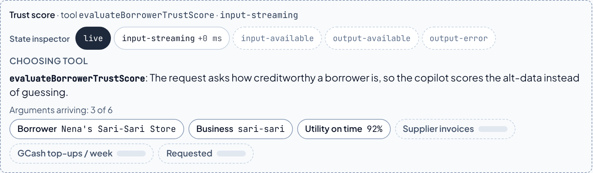
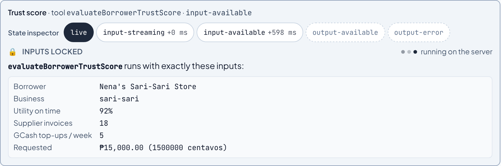
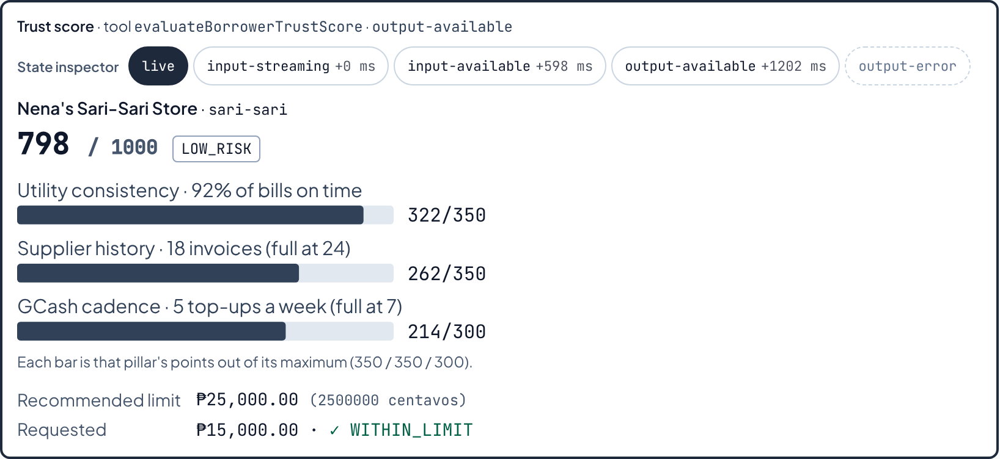
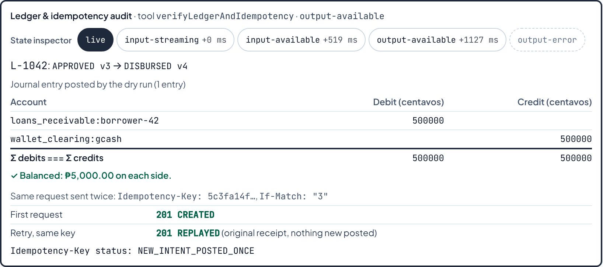
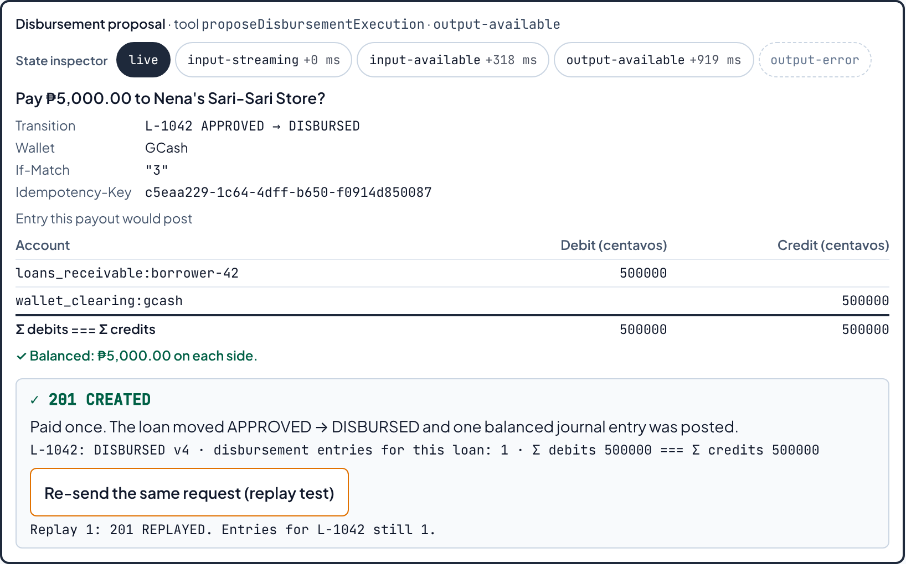
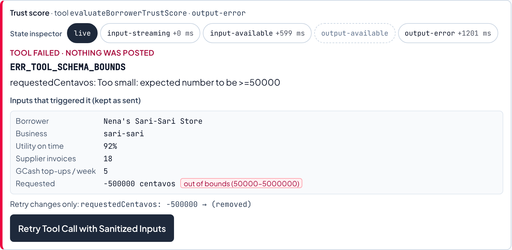

# FE-07 · Tool Results and Structured Output in the UI

The underwriting copilot now calls three typed tools. Each call is drawn as a 4-state card, not as JSON.
One of the tools moves money only after a human presses a button. That press sends `Idempotency-Key` and
`If-Match`, so a double-click still pays once.

- **Try it live:** https://microcredit-api-beta.vercel.app/underwriting. Use the "Or call a tool…" chips
  under the copilot's first-run card.
- **Contracts:** [`src/lib/ai/tools.ts`](../src/lib/ai/tools.ts) (Zod input and output schemas, metadata,
  deterministic `execute`).
- **Card:** [`src/features/ai-copilot/ToolInvocationCard.tsx`](../src/features/ai-copilot/ToolInvocationCard.tsx)
  (the state machine is drawn at the top of the file).
- **Streaming:** [`src/app/api/chat/route.ts`](../src/app/api/chat/route.ts) (hosted model, AI SDK `streamText` with
  `tools`) and [`src/lib/ai/tool-runner.ts`](../src/lib/ai/tool-runner.ts) (deterministic runner, no key needed).
- **Proof:** [`ToolInvocationCard.test.tsx`](../src/features/ai-copilot/__tests__/ToolInvocationCard.test.tsx) (25 tests),
  [`toolRoute.test.ts`](../src/lib/ai/__tests__/toolRoute.test.ts) (7 tests on the real route handler), and
  [`e2e/fe07.mjs`](../e2e/fe07.mjs) (14 browser checks).

---

## 1 · Tool contracts

Every input field has a `.describe()`, because that text is what the model reads when it fills the field.
Every result is checked against its Zod **output** schema in the browser before anything is drawn. A
result that doesn't match shows `ERR_TOOL_OUTPUT_SHAPE` instead of a chart.

### `evaluateBorrowerTrustScore`

| Field | Zod | When it is missing |
| --- | --- | --- |
| `borrowerName` | `string`, 2–80 chars | required |
| `businessType` | `'sari-sari' \| 'market-vendor' \| 'tricycle-operator' \| 'carinderia'` | required |
| `monthlyUtilityOnTimeRatio` | `int`, 0–100 (whole percent) | required |
| `supplierInvoiceCount` | `int`, 0–50 | required |
| `gcashLoadWeeklyCadence` | `int`, 0–30 | required |
| `requestedCentavos` | `int`, 50000–5000000, **optional** | `requested: null`. The card shows the badge "Fallback: no amount requested, showing the recommended limit only". |

**Returns** `{ borrowerName, businessType, score (0–1000), maxScore, riskTier: LOW_RISK | MODERATE_RISK | HIGH_RISK,
pillars[3] { id, label, points, maxPoints, basis }, recommendedLimitCentavos, requested: { centavos, decision:
WITHIN_LIMIT | ABOVE_LIMIT | NO_OFFER } | null, reasonCodes[] }`.

The three pillars have the same maxima as `scoreEngine.ts`: utility 350, supplier 350 (full at 24 invoices),
GCash 300 (full at 7 top-ups a week). All points are floored integers. The limit comes from the same
`recommendLimit()` table the workbench uses, so the copilot and the workbench can never offer different
limits for the same score. Tiers: `LOW_RISK` from 700, `MODERATE_RISK` from 550.

### `verifyLedgerAndIdempotency`

| Field | Zod |
| --- | --- |
| `loanId` | `/^L-\d{4}$/` |
| `disbursementCentavos` | `int`, 50000–5000000 |
| `walletProvider` | `'GCash' \| 'Maya'` |
| `idempotencyKey` | UUID v4 |
| `expectedVersion` | `int`, 1–1000, sent as `If-Match` |

**Does** a dry run on a fresh copy of the seed ledger, using the same `disbursementServer.ts` as the demo. It
sends the payout **twice** with the same key, as a network retry would.
**Returns** `{ stateBefore/After, versionBefore/After, firstAttempt { status, kind }, retrySameKey { status, kind },
ledgerEntriesPosted, linesSource: POSTED | PREVIEW | NONE, journalLines[] { account, side, centavos },
debitsCentavos, creditsCentavos, balanced, idempotencyStatus }`.

### `proposeDisbursementExecution`

| Field | Zod |
| --- | --- |
| `loanId` | `/^L-\d{4}$/`, must be `APPROVED` |
| `disbursementCentavos` | `int`, 50000–5000000 |
| `walletProvider` | `'GCash' \| 'Maya'` |
| `expectedVersion` | `int`, must equal the loan's version |

**Returns** `{ status: 'AWAITING_CONFIRMATION', loanId, borrowerName, amountCentavos, walletProvider,
fromState: 'APPROVED', toState: 'DISBURSED', ifMatch, idempotencyKey, journalPreview[], debitsCentavos,
creditsCentavos, balanced }`. **It posts nothing.** See section 4.

---

## 2 · The 4-state card

```text
tool-input-start ─▶ input-streaming ─(tool-input-available)─▶ input-available ─┬─▶ output-available
                    (deltas arrive)                                             └─▶ output-error
```

| State | The question it answers | What renders | Frame |
| --- | --- | --- | --- |
| `input-streaming` | What is the model calling, and why? | "Choosing tool", the rationale, one pill per argument: done, being written (`▍`) or pending (blank bar) | dashed, canvas |
| `input-available` | With what exact inputs? | "Inputs locked", every argument in plain words (`₱15,000.00 (1500000 centavos)`, `92%`); an out-of-bounds value flagged; running dots | solid slate, grey fill |
| `output-available` | What came back? | Trust score card + hand-rolled SVG bar chart · double-entry findings table · confirm-payout widget | 2 px slate |
| `output-error` | What broke, and how do I recover? | Error code and message, the inputs exactly as sent, the exact change Retry will make, **Retry Tool Call with Sanitized Inputs** | rose left edge |

A test renders all four and asserts four different frames. It caught one real problem:
`input-available` and `output-available` had shipped with the same frame.

Each state's view mounts fresh and fades in over **150 ms** (`starting:opacity-0`), with no motion under
`prefers-reduced-motion`. The brief asked for 200 ms, but CLAUDE.md §12 caps motion at 150 ms. Height
is not animated.

**State inspector.** Every card has a "Tool Lifecycle State Inspector" bar: `live` plus the 4 states, each
with the time it was reached (`input-available +606 ms`). Clicking a state pins its view, so a reviewer
can step through them. A call reaches only one of the two terminal states, so the other is disabled with
the note "This call never reached this state." To see `output-error`, use the drill button below.

| `input-streaming` (caught mid-stream: 2 of 6 arguments) | `input-available` |
| --- | --- |
|  |  |

| `output-available`: trust score + SVG chart | `output-available`: ledger findings table |
| --- | --- |
|  |  |

| `output-available`: confirm payout, after Approve and the replay test | `output-error` |
| --- | --- |
|  |  |

---

## 3 · How the four states reach the browser

`/api/chat` streams five extra SSE frame types, named after the AI SDK's UI chunks:
`tool-input-start`, `tool-input-delta`, `tool-input-available`, `tool-output-available` and
`tool-output-error`. Every path emits them in that order for one `toolCallId`:

| Path | Where | What emits the frames |
| --- | --- | --- |
| Hosted model (a key is set) | `route.ts` | `streamText({ tools: UNDERWRITING_TOOLS, stopWhen: stepCountIs(3) })`. The SDK's `tool-input-start/delta`, `tool-call`, `tool-result` and `tool-error` parts are mapped one to one. |
| No key | `tool-runner.ts` | `planLocalTool` picks the tool from the request's wording and the numbers it states. It streams the input in 12-character deltas 40 ms apart, holds `input-available` for 600 ms, then emits the result and a short summary. |
| `tool-error` drill | `sabotage.ts` | The runner, with `requestedCentavos: -500000`. |
| Sanitized retry | `route.ts` (`body.toolCall`) | The runner for exactly that tool, re-validated by Zod. No model call. |

**One SDK detail found by probing.** In AI SDK v7, a `tool-error` for schema-invalid input carries a
**string** (`"AI_InvalidToolInputError: … [ { path: [...], message: ... } ]"`), not an `Error`. A thrown
`ToolFailure` arrives as the object, with `code` intact. `toolErrorCode()` and `toolErrorText()` handle
both. The card shows `monthlyUtilityOnTimeRatio: Too big: expected number to be <=100`, not the dump.

---

## 4 · Human in the loop: `proposeDisbursementExecution`

1. The tool checks the loan in the seed ledger (`APPROVED`, version matches) and returns a proposal. It
   mints one `Idempotency-Key` for this intent.
2. The card shows the transition `APPROVED → DISBURSED`, the wallet, `If-Match`, the key, and the journal
   entry it would post (`Σ debits === Σ credits`).
3. **Approve & Execute Payout** sends the proposal from the browser to an in-memory disbursement server
   ([`copilotLedger.ts`](../src/features/ai-copilot/copilotLedger.ts)), with both headers. A ref locks the
   button before the first `await`, so a double-click sends one request.
4. The receipt shows `201 CREATED`, the loan's new version, and "disbursement entries for this loan: 1".
   **Re-send the same request (replay test)** sends the identical request again. It gets `201 REPLAYED`,
   and the entries are still 1. That is the One Claim, inside the copilot.
5. **Cancel Action** records the cancellation and sends nothing. Both decisions are stored in the message,
   so they survive a reload.

---

## 5 · Error recovery contract

| Code | Cause | What **Retry Tool Call with Sanitized Inputs** changes |
| --- | --- | --- |
| `ERR_TOOL_SCHEMA_BOUNDS` | Input fails the Zod schema | An optional field out of bounds is removed (`requestedCentavos: -500000 → (removed)`). A required number is clamped to its bounds (`140 → 100`). |
| `ERR_LEDGER_LOAN_NOT_FOUND` | No such loan in the seed ledger | `loanId` → the first `APPROVED` seed loan, and its version |
| `ERR_ILLEGAL_TRANSITION` | Proposal for a loan that is not `APPROVED` | Same as above |
| `ERR_STALE_IF_MATCH` | `expectedVersion` ≠ the loan's version | `expectedVersion` → the loan's version |
| `ERR_TOOL_EXECUTION` | Anything else | Nothing. The button is disabled with "No automatic fix". |

The sanitizer never invents a borrower or an amount. The retry is a new turn, and the failed card above it
keeps its inputs.

---

## 6 · Verification

| Check | Result |
| --- | --- |
| `npm test` | 461/461 (32 new: 25 card, 7 route) |
| `npm run test:e2e:fe07` | 14/14: state order for all 4 chips, 3 SVG bars, `201 CREATED` → `201 REPLAYED`, double-click paid once, replay still 1 entry, error → sanitized retry → `output-available`, 0 console errors |
| `npm run test:e2e` / `test:e2e:fe08` | 63/63 and 32/32, unchanged |

Mutation check on the card suite. Each break was put in by hand, run, then reverted:

| Break | Result |
| --- | --- |
| Confirm lock removed | double-click test fails |
| Sanitizer keeps the bad optional field | 3 tests fail |
| Output schema not enforced before drawing | shape test fails |
| Text merged in before the tool card | stream-order test fails |

---

## 7 · Where this differs from the brief

- **`REPLAY_BLOCKED_409` is not used.** It would misdescribe this API. A retry with the same key gets the
  original `201` back (`REPLAYED`); only a stale `If-Match` gets `409`. The tool reports
  `NEW_INTENT_POSTED_ONCE`, `STALE_IF_MATCH_409`, `ILLEGAL_STATE_409` or `REJECTED_422`, plus what the
  retry got.
- **The payout runs in the browser, not on the server.** The server is stateless between requests. The
  confirmed payout goes to an in-memory server in this page, which is not the Disburse form's server:
  a payout here doesn't appear there.
- **150 ms, not 200 ms**, and no height animation (CLAUDE.md §12).
- **`monthlyUtilityOnTimeRatio` is a whole percent** (`int`), not any number.
- **The hosted-model path is tested with a mock model**, which drives the real `streamText` and the real
  tool `execute`. It has not run against a live model from here: there is no key in this environment.
- **The proposal's `Idempotency-Key` is random**, minted once per proposal. Everything else a tool returns
  is deterministic for the same input.
