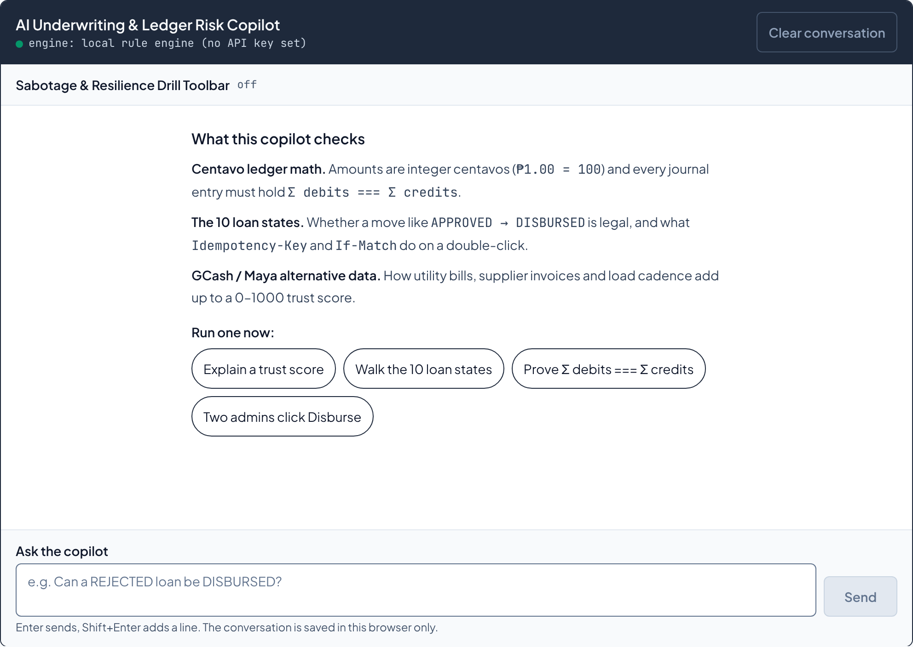
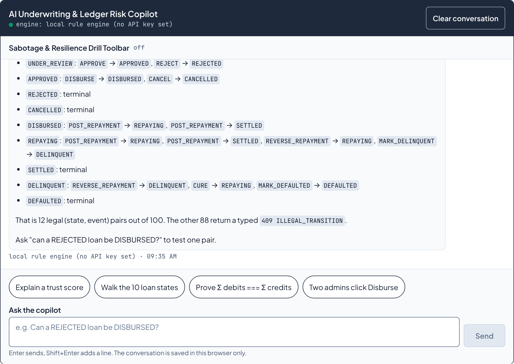
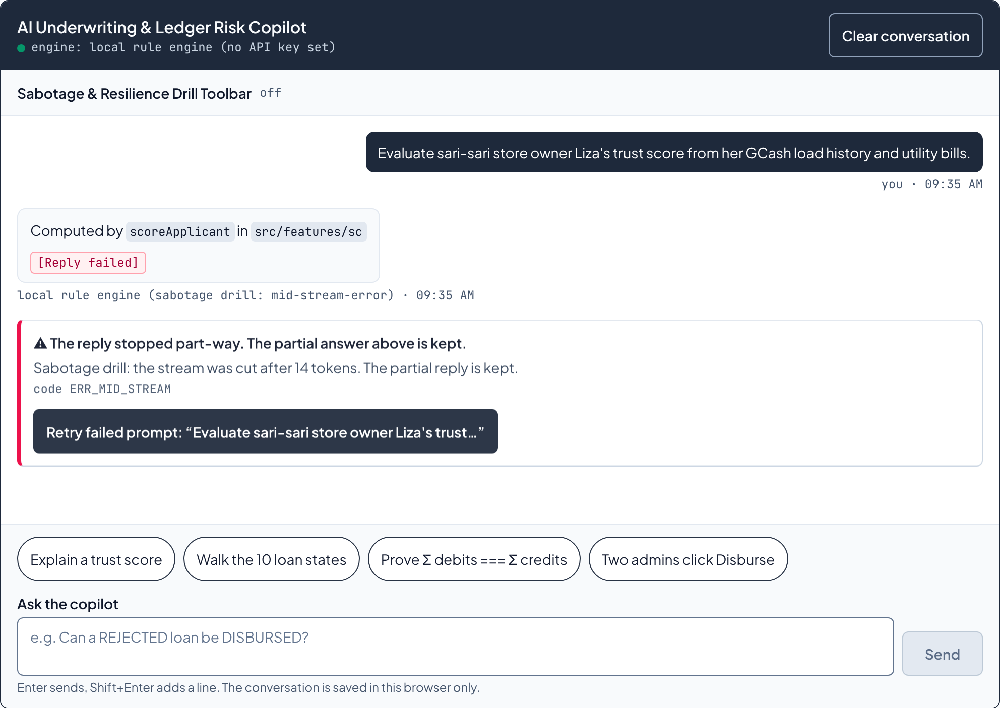
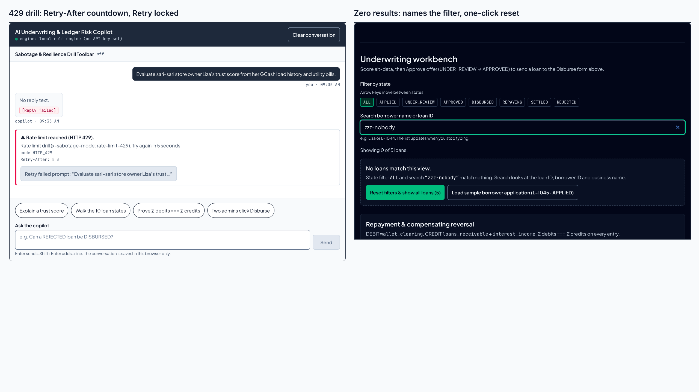

# FE-08 · Error States, Empty States, Edge Cases (Checkpoint 1)

Every failure in the underwriting copilot and the queue now has a designed state and one next action.
Each state can be triggered on purpose, from the page, with no DevTools.

- **Try it live:** https://microcredit-api-beta.vercel.app/underwriting. Open **Sabotage & Resilience Drill
  Toolbar** in the copilot, pick a mode, and send any question.
- **Code:** [`src/features/ai-copilot/StreamingUnderwritingChat.tsx`](../src/features/ai-copilot/StreamingUnderwritingChat.tsx),
  [`src/lib/ai/sabotage.ts`](../src/lib/ai/sabotage.ts), [`src/app/error.tsx`](../src/app/error.tsx),
  [`src/app/underwriting/error.tsx`](../src/app/underwriting/error.tsx), [`src/app/not-found.tsx`](../src/app/not-found.tsx),
  [`src/components/ui/SkeletonCard.tsx`](../src/components/ui/SkeletonCard.tsx).
- **Proof:** [`StreamingErrorSabotage.test.tsx`](../src/features/ai-copilot/__tests__/StreamingErrorSabotage.test.tsx)
  (16 tests), [`sabotageRoute.test.ts`](../src/lib/ai/__tests__/sabotageRoute.test.ts) (4 tests, the real route
  handler), and [`e2e/fe08.mjs`](../e2e/fe08.mjs) (32 browser checks against `next start`).

---

## 1 · Failure and edge-case inventory

| # | Failure mode | Trigger / sabotage method | Component / boundary | Recovery UX & next action |
| --- | --- | --- | --- | --- |
| 1 | Network offline, failure before send | Drill `network-drop`, or the browser reports `navigator.onLine === false`. A `fetch` that never gets an answer becomes the same kind. | `runRequest` in `StreamingUnderwritingChat.tsx`, before `fetch`; `fetchChatTransport` for a failed `fetch` | Banner "No connection. Nothing was sent.", code `ERR_OFFLINE`. The question stays in the transcript. **Retry** sends it. The drill sends 0 requests (counted in e2e). |
| 2 | API error mid-stream, after partial tokens | Drill `mid-stream-error`: the server streams 14 tokens, then an `error` frame, and no `done` | `chatReducer` `FAIL` with partial text → `failure.kind: 'mid-stream'`; `FailureBanner` inline under the reply | The partial reply stays, marked `[Reply failed]`. Banner "The reply stopped part-way. The partial answer above is kept.", code `ERR_MID_STREAM`. **Retry failed prompt: "Evaluate sari-sari store owner Liza's trust…"** re-sends that one turn into the same slot. |
| 3 | `429 Too Many Requests` | Drill `rate-limit-429` (a `429` with `Retry-After: 5`), or the real limiter on a hosted model | `fetchChatTransport` → `ChatRequestError { kind: 'rate-limit', retryAfterSeconds }` | Banner "Rate limit reached (HTTP 429).", code `HTTP_429`, a live `Retry-After: N s` countdown. Retry stays `disabled` until it reaches 0, then works. |
| 4 | Malformed JSON / tool payload | Drill `malformed-tool-json`: 10 tokens, then `data: {"type":"tool-call",…"borrowerId":"borrower-0` cut mid-string | `createSseParser(onEvent, onMalformed)` → the transport cancels the reader and throws `kind: 'malformed'` | Reading stops at the broken frame instead of guessing. The partial text stays. Banner "A reply frame was not valid JSON.", code `ERR_MALFORMED_FRAME`, and Retry. |
| 5 | Empty / whitespace-only input; out-of-bounds pesos | Enter on `"   \n "`; amounts `499`, `50,000.01`, `5000.005`, `1e3`, `99999999999999.99`, over the daily cap | Chat textarea (`emptyError`); `parsePesosToCentavos` + `src/features/disbursement/validation.ts` | Chat: nothing is sent, `aria-invalid="true"`, and the alert says "Type a question first." Pesos: the field error names the range (`₱500.00 to ₱50,000.00`), the step, or the 2-decimal limit. These parser and form tests predate FE-08 (`money.test.ts`, `DisbursementForm.test.tsx`); FE-08 adds the chat case. |
| 6 | No results on queue search / filter | Search `zzz-nobody`, or filter `SETTLED` (no loan is settled yet) | `NoResults` in `UnderwritingWorkbench.tsx`; `resetFilters()` in `useUnderwritingQueue.ts` | Names the active filter and query. **Reset filters & show all loans (5)** clears both at once (no 250 ms debounce wait) and puts focus back in search. **Load sample borrower application (L-1045 · APPLIED)** opens that loan's review panel. |
| 7 | First-run empty chat; slow response over 1.5 s | Fresh browser / Clear conversation; drill `slow-3s` (3 s before the first token) | `OnboardingCard`; `AssistantMessage` 1.5 s timer → `SkeletonCard variant="chat-turn"` | First run: what the copilot checks (centavo math, the 10 states, GCash/Maya data) plus 4 prompts that run in one click. Slow: after 1.5 s, "thinking" becomes a 4-line skeleton, and the reply fills the same box. |

Also handled, outside the 7:

| Failure | Where | What the user sees |
| --- | --- | --- |
| Render error inside the copilot | Toolbar button **Throw a render error** → `src/app/underwriting/error.tsx` | The boundary panel takes focus. It shows code `ERR_ROUTE_ERROR` (or `DIGEST_<id>` for a server error) and **Retry this page**, which calls `retry()`. The saved conversation survives (it is in `localStorage`). |
| Render error on any other page | `src/app/error.tsx` | Same panel, boundary `root`. The navbar stays. |
| Unknown address | `src/app/not-found.tsx` | `HTTP 404`, code `HTTP_404`, and links back to Disburse and Underwriting. |
| Connection ends with no `done` | `kind: 'closed'` | "The connection closed before the reply finished.", code `ERR_STREAM_CLOSED`, Retry. |
| `done` with no text | `kind: 'empty'` | "The copilot returned an empty reply.", code `ERR_EMPTY_REPLY`, Retry. |

---

## 2 · How each Mentor Tip was engineered

### Ordered sabotage checklist

Run these in order on `/underwriting`. Each drill is one shot: it breaks the next Send only, then the
toolbar flips back to `off (normal)`, so Retry always goes out clean. Drills answer from the local rule
engine, never a paid model. The reply is labelled `local rule engine (sabotage drill: <mode>)`.

1. **Happy path.** Click a first-run prompt. Expect a complete reply and zero console errors.
2. **`mid-stream-error`.** Expect a partial reply, a banner, and a Retry that names your prompt. Double-click Retry: one request goes out.
3. **`rate-limit-429`.** Expect a banner with `Retry-After: 5 s` counting down. Retry is locked until 0.
4. **`malformed-tool-json`.** Expect the malformed-frame banner, with the partial reply kept.
5. **`slow-3s`.** Expect "thinking", then the skeleton at 1.5 s, then the reply fills the skeleton's box.
6. **`network-drop`.** Expect the offline banner. The Network tab shows no `/api/chat` request.
7. **Throw a render error.** Expect `underwriting/error.tsx`. Click **Retry this page** to get the copilot back.
8. **Workbench search `zzz`.** Expect the zero-results card. Click **Reset filters & show all loans (5)**.

The same modes work without the page:

```bash
curl -si -X POST https://microcredit-api-beta.vercel.app/api/chat -H 'Content-Type: application/json' -H 'x-sabotage-mode: rate-limit-429' -d '{"messages":[{"role":"user","content":"hi"}]}'
```

```bash
curl -sN -X POST https://microcredit-api-beta.vercel.app/api/chat -H 'Content-Type: application/json' -d '{"messages":[{"role":"user","content":"hi"}],"sabotage":"mid-stream-error"}'
```

An unknown mode gets `400`. `network-drop` sent to the server also gets `400`, because a dropped
network never reaches a server; the browser simulates it before `fetch`.

### A Retry that names what it retries, and never runs twice

- **What it retries.** `chatReducer` records the failure as `{ kind, userId, assistantId, partial, retryAfterSeconds, retrying }`.
  `RETRY` swaps a fresh pending reply into the failed reply's slot (`assistantId`). It sends the history up to and
  including the user turn `userId`. Nothing else in the conversation is touched or re-sent.
- **The label.** `Retry failed prompt: "<first 48 characters, cut at a word>"`. The full prompt is in `title`.
- **The double-click lock.** `abortRef` holds the in-flight `AbortController`. It is set synchronously, before the first
  `await`, so a second click in the same frame, before React has rendered `disabled`, sees it and returns.
  After that render the button is `disabled` and `aria-busy="true"`, and shows the copilot's own thinking dots with
  "Retrying…". The banner leaves on the retried reply's **first token**, not when it finishes.
- **Evidence.** Test 2 fires two clicks inside one `act()` and asserts 2 transport calls in total (the send plus one retry).
  In the browser, `dblclick` on Retry produced exactly 1 new `POST /api/chat`.

### Zero-CLS skeletons

`SkeletonCard` has three variants. The real content imports the same class constants, so each skeleton and
its real box come from the same strings, not from two copies tuned by eye:

| Variant | Stands in for | Shared constant | Measured (e2e, client navigation with the RSC payload held back) |
| --- | --- | --- | --- |
| `chat-turn` | a reply with no token after 1.5 s | `CHAT_TURN_RESERVE` (`min-h-24`) | layout shift within 250 ms of the first token: **0** |
| `score-card` | the 4 stat cards on `/underwriting` (`underwriting/loading.tsx`) | `STAT_CARD_CLASS` | skeleton **82 px**, real card **82 px** |
| `ledger-row` | the invariant rows on `/health` (`health/loading.tsx`) | `LEDGER_ROW_CLASS`, `LEDGER_CELL_CLASS` | skeleton **29 px**, real row **29 px** |

`/ledger` has no loading state on purpose: it is prerendered static, so a skeleton there would never show.

**What measuring found.** The first run reported a layout shift of 0.0000125 at the first token on the
*happy* path, a path FE-06 had called flicker-free. The shift came from the line under the bubble moving up
3 px (453 → 450). The "thinking" row was `inline-flex h-6`. An inline box sits on the text baseline, so its
line was about 27 px, against 24 px for the first line of text. It is now block-level `flex`, and the shift
at the first token measures 0 on both paths.

**What is not zero.** As a reply grows line by line, the engine/time line under the bubble moves down until
the log starts to scroll. Measured layout-shift score for a whole reply, not counting shifts caused by input:
**0.00162** (normal) and **0.00019** (slow). That is far under the 0.1 "good" CLS threshold, but it is not 0,
so this doc does not claim it is.

### Empty states as onboarding, not apology

- **First run.** The copilot says what it checks, with the real invariants: `₱1.00 = 100`,
  `Σ debits === Σ credits`, `APPROVED → DISBURSED`, `Idempotency-Key` / `If-Match`, GCash/Maya data. Four
  prompts run in one click.
- **Zero results.** The card names the filter and the query. Its two buttons are next actions (reset, open a
  sample), not "no data" copy.

### Mobile Safari, 375 px to 1280 px

| Fix | Status | Evidence |
| --- | --- | --- |
| `100dvh` instead of `100vh` | Already in place since FE-06: the copilot is `h-[min(44rem,calc(100dvh-4rem))]`, and `body` is `min-h-dvh`. No `100vh`, `h-screen` or `min-h-screen` exists in `src/`. | At 375×667 the copilot is 603 px and fits. |
| Fields ≥ 16 px (no zoom on focus) | Already true for all fields, measured before any change; the workbench search now sets `text-base` explicitly instead of inheriting it | e2e: 5 visible text fields on `/underwriting` at 375 px, 0 under 16 px |
| `overscroll-contain` on the transcript | **New** | e2e: `overscroll-behavior-y` = `contain` |
| `env(safe-area-inset-bottom)` padding | **New**: the input bar uses `pb-[max(0.75rem,env(safe-area-inset-bottom))]` | Honest limit: `env()` is 0 unless the page sets `viewport-fit=cover`, which this app does not. Today it is a guard, not a visible change. |

---

## 3 · Checkpoint 1 screenshots

Captured by `e2e/fe08.mjs` at 1280×900, device scale factor 2, against the production build.

**1. First-run designed empty state with one-click prompts**



**2. Completed happy path, zero console errors**



**3. Mid-stream failure: partial reply kept, designed error card, Retry naming the prompt**



**4. `429` with the `Retry-After` countdown, and the zero-results queue**

This one is a side-by-side composite of two captures from the same run, assembled in the browser by the script.



---

## 4 · Verification

| Check | Result |
| --- | --- |
| `npm run typecheck` | 0 errors |
| `npm run lint` | 0 warnings |
| `npm test` | 429/429 (20 new: 16 sabotage UI/transport, 4 route) |
| `npm run build` | exit 0, no warnings |
| `npm run test:e2e` | 63/63 (FE-06 streaming, Stop and scroll checks unchanged) |
| `npm run test:e2e:fe08` | 32/32 |
| CLAUDE.md §11 money grep, §12 colour grep | both print nothing |

Mutation check on the sabotage suite. Each break was put in by hand, run, and reverted:

| Break | Result |
| --- | --- |
| Retry without the `abortRef` lock | test 2 fails |
| `TOKEN` no longer clears the failure | test 2 fails (banner still up while the retry streams). This break passed at first, so the test was tightened. |
| Drill not one-shot | toolbar test fails |
| Reply drops the reserved height on its first token | skeleton test fails |
| `network-drop` not simulated | network-drop test fails |
| Retry appends a reply instead of replacing the failed one | test 2 fails |

---

## 5 · Where this differs from the brief

- **150 ms, not 180 ms.** CLAUDE.md §12 caps motion at 150 ms. The banner uses the same 150 ms fade and rise as
  a new message, and is static under `prefers-reduced-motion`.
- **`retry()`, not `reset()`.** Next 16.4.5's `error.tsx` receives both. `reset()` only clears the boundary.
  `retry()` calls `router.refresh()` and then `reset()`, so a Server Component error gets fresh data too.
- **"(5)", not "(4)".** There are 5 seed loans, and the button prints the real count.
- **"Load sample borrower application" opens one; it does not create one.** The in-memory server has no "create
  application" command. Adding one would change the loan state machine, which is out of scope for FE-08. The button
  opens the existing `APPLIED` loan, L-1045, and its label says so.
- **No spinner.** CLAUDE.md §12 allows one looping animation, the copilot's thinking dots. Retry reuses those dots.
- **`network-drop` is browser-side.** See the checklist above.
