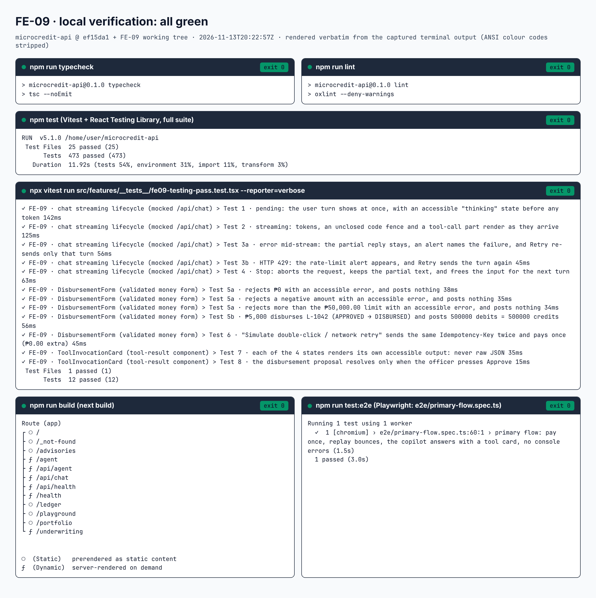

# FE-09 · Testing Pass: Vitest + RTL + Playwright + CI

Three UIs carry the most risk in this app: the streaming chat, the money form, and the tool card. They are
now tested the way a person meets them, by role, label and text. The AI route is mocked in every test.
One Playwright test walks the primary flow, from `Idempotency-Key` replay on `/` to a tool card on
`/underwriting`. CI runs all of it on every push and pull request.

| File | What it is |
| --- | --- |
| [`src/features/__tests__/fe09-testing-pass.test.tsx`](../src/features/__tests__/fe09-testing-pass.test.tsx) | 12 component tests, `fetch` mocked |
| [`e2e/primary-flow.spec.ts`](../e2e/primary-flow.spec.ts) + [`playwright.config.ts`](../playwright.config.ts) | the primary-flow E2E test, `npm run test:e2e` |
| [`.github/workflows/ci.yml`](../.github/workflows/ci.yml) | typecheck → lint → Vitest → build → Playwright, on every push and pull request to `main` |
| [`docs/assets/curated/fe-09-test-suite-green.png`](./assets/curated/fe-09-test-suite-green.png) | the local green run, rendered from its terminal output |



---

## 1 · Test architecture and the semantic query policy

**Queries are roles, labels and visible text. Never test ids, never class names.** A test that finds the
Retry button by `getByRole('button', { name: /retry/i })` fails only when the button stops being a button
named Retry, which is a real regression. A test that finds it by `data-testid` or `.bg-main` fails when
someone renames a Tailwind class, which isn't a regression at all. Querying by role also tests the
accessibility tree: if a screen reader can't find it, the test can't either.

This pass made that true for the whole repo, not only the new file:

- **Every `data-testid` is gone** from the components (34 of them) and from all Vitest files (49 queries in 6 files).
  The drill scripts don't use them either. This prints nothing:

  ```bash
  grep -rnE "ByTestId|data-testid" src playground agents e2e
  ```

- **Converting the tests needed real semantics in the components.** Most of these also help screen readers:
  - Each assistant reply is a `group` named "Copilot reply".
  - The first-run card and the "No loans match" state are regions named by their headings.
  - An open code fence reports `aria-busy="true"` instead of a `data-code-open` attribute.
  - The trust-score chart's bar values are its accessible description (`aria-describedby` on its `<desc>`).
  - Each streaming argument pill says "(received)", "(arriving)" or "(waiting)" to screen readers.
- **Where the tests still read `className`,** each case is a contract that no role can express, written so
  that renaming a class can't break it:
  - The chat's height reserve, compared to the exported constant `CHAT_TURN_RESERVE`. jsdom has no layout
    to measure.
  - The four tool-card frames, compared to each other ("four different frames"), not to class names.
  - `src/App.contrast.test.tsx`, a contrast audit whose job is to read the colour classes of every form control.
  - The playground test's own `my-own-class`, which it passes in to check that `asChild` forwards it.
- **One drill script still reads one `data-*` attribute.** `e2e/fe08.mjs` reads `data-skeleton` twice, to
  compare the height of a skeleton box with the real box it stands in for. Skeletons are `aria-hidden` by
  design, so they have no semantic handle. The Vitest suites, `e2e/primary-flow.spec.ts`, `e2e/fold.mjs`
  and `e2e/fe07.mjs` read none.

**How `/api/chat` is mocked.** The chat under test uses its real `fetchChatTransport` and SSE parser.
`fetch` is replaced with `vi.spyOn(globalThis, 'fetch')`:

- Each `POST /api/chat` gets a `ReadableStream` that the test pushes frames into, one at a time.
- Aborting the request errors that stream, the way a real network abort does.
- A `DELETE /api/chat?requestId=…` (sent by Stop) is recorded.
- **Any other request throws**, and an `afterEach` asserts that every call went to `/api/chat`, so nothing
  can reach the network.

In Playwright, `page.route('**/api/chat', …)` answers with a fixed SSE body: the same frames the real
route streams, including a full tool lifecycle. No model is called.

---

## 2 · Component test matrix

All in `src/features/__tests__/fe09-testing-pass.test.tsx`.

| # | Test | Rubric item | What it proves | Main queries |
| --- | --- | --- | --- | --- |
| 1 | pending | Chat · pending/thinking | The user turn renders at once. `role="status"` says "Copilot is thinking." and "Thinking…" shows before any token. The request body carries the prompt. | `getByLabelText('Ask the copilot')`, `getByRole('status')`, `getByRole('group', { name: 'Copilot reply' })` |
| 2 | streaming | Chat · streaming, all part types | Tokens append. An **unclosed code fence** shows as code, with `aria-busy="true"` and no ``` visible, then closes. A **tool-call part** goes from `input-available` to `output-available`, with its SVG chart. `**bold**` renders as `strong`. Status ends at "Reply complete." | `getByRole('region', { name: 'Tool call …: output-available' })`, `getByRole('img')`, `getByRole('strong')` |
| 3a | error mid-stream | Chat · error + retry | The partial reply stays. The alert names `ERR_MID_STREAM`. `getByRole('button', { name: /retry/i })` sends a second request whose history is **only** the failed prompt. Recovery leaves one reply. | `getByRole('alert')`, `getByRole('button', { name: /retry/i })` |
| 3b | HTTP 429 | Chat · error + retry | A `429` response shows "Rate limit reached (HTTP 429)" and code `HTTP_429`. Retry recovers. | `findByRole('alert')` |
| 4 | Stop | Chat · stop state machine | `getByRole('button', { name: /stop/i })` aborts the fetch signal and sends `DELETE /api/chat?requestId=<same id>`. The partial text stays, marked `[Stopped mid-stream]`. The input is enabled and focused, and the next turn goes through. | `getByRole('button', { name: /stop/i })` |
| 5a ×3 | out-of-bounds amounts | Form · validation | `₱0`, `-500` and `60,000.00` each get `aria-invalid="true"`, an error the field points at (`aria-describedby`), one `role="alert"` summary, focus on the field, and **no ledger entry**. | `getByLabelText('Principal amount (PHP)')`, `getByRole('alert')` |
| 5b | `₱5,000` happy path | Form · submit | L-1042 moves `APPROVED → DISBURSED`. The ledger's Σ row shows ₱5,000.00 on each side, and the ledger itself holds `500000` debits = `500000` credits. | `getByRole('region', { name: 'Loans' })`, `getByRole('row', { name: /^Σ \(balanced\)/ })` |
| 6 | double-click / retry | Form · idempotency | `getByRole('button', { name: /simulate double-click/i })` sends one `Idempotency-Key` twice: `201 Created`, then `201 Idempotent replay`. **One** entry is posted, and the receivable stays `500000` (₱0.00 extra). | `getByRole('region', { name: 'Request log' })` |
| 7 | 4 states | Tool card · lifecycle | `input-streaming` ("Choosing tool", argument pills), `input-available` ("Inputs locked", `92%`), `output-available` (SVG chart; and a findings `table` with `Account / Debit (centavos) / Credit (centavos)` and a `Σ debits === Σ credits` row), and `output-error` (the code and a Retry button that sends the sanitized input). | `getByRole('region' / 'img' / 'table' / 'columnheader' / 'row' / 'button')` |
| 8 | human in the loop | Tool card · confirmation | The proposal resolves **only** on click. Before the click: no decision, no ledger entry, no receipt. After `getByRole('button', { name: /confirm\|approve/i })`: one `201 CREATED` decision and one entry. | `getByRole('button', { name: /confirm\|approve/i })` |

**Do these tests catch real regressions?** Two app behaviours were broken by hand, each run against the
suite, then reverted:

| Break in the app | Result |
| --- | --- |
| Stop no longer calls `abort()` | Test 4 fails |
| Retry sends the whole history instead of the failed turn | Test 3a fails |

The rest of the repo's suites still pass after the semantic rewrite: **473/473** across 25 files.

---

## 3 · Playwright end-to-end: `e2e/primary-flow.spec.ts`

`npm run test:e2e` runs `playwright test` against `next start` (port 4310), on Chromium at 1280×800.
Every locator is a role, a label or text.

1. **`/` loads.** "Disburse" and "Simulate double-click / network retry" are fully in the viewport
   (`toBeInViewport({ ratio: 1 })`). The "Ledger (append-only)" region's `Σ (balanced)` row reads ₱0.00.
2. **Pay once, replay once.** Clicking Simulate leaves exactly 2 items in the "Request log" region:
   `201 Created · posted JE-0001`, then `201 Idempotent replay of JE-0001 · no new ledger entry`. The Σ row
   reads `₱5,000.00 | ₱5,000.00`, and the "Loans" region shows L-1042 `DISBURSED`.
3. **`/underwriting`.** It fills "Ask the copilot" and clicks Send. The mocked route answers with a tool
   lifecycle and tokens. The test expects:
   - the region "Tool call evaluateBorrowerTrustScore: output-available", with its chart image and
     ₱25,000.00;
   - the last "Copilot reply" group reading "Liza scores 798 / 1000, LOW_RISK.";
   - the status line "Reply complete.";
   - exactly one request, carrying the prompt.
4. **No errors.** Zero `console.error` calls and zero uncaught page errors over the whole flow.

The older checks are kept, not replaced. `npm run test:e2e:fold` (formerly `test:e2e`) is the 63-check
fold, 8-route responsiveness and copilot-streaming script, and it still runs in CI. `test:e2e:fe07` and
`test:e2e:fe08` are local drills.

---

## 4 · Brief 5: an AI fixing a failing test by running the suite itself

There are two records here. The first is a failure that happened for real while writing this suite. The
second is the drill the brief asks for: a realistic wrong assertion, planted on purpose.

### 4a · A real failure while writing Test 2

The first run of the new file, `npx vitest run src/features/__tests__/fe09-testing-pass.test.tsx`:

```text
 FAIL  src/features/__tests__/fe09-testing-pass.test.tsx > FE-09 · chat streaming lifecycle (mocked /api/chat) > Test 2 · streaming: tokens, an unclosed code fence and a tool-call part render as they arrive
TestingLibraryElementError: Unable to find an element with the text: DEBIT loans_receivable 500000 (normalized from 'DEBIT  loans_receivable 500000'). This could be because the text is broken up by multiple elements. In this case, you can provide a function for your text matcher to make your matcher more flexible.

 ❯ src/features/__tests__/fe09-testing-pass.test.tsx:184:34
    184|     const code = within(reply()).getByText('DEBIT  loans_receivable 50…

 Test Files  1 failed (1)
      Tests  1 failed | 11 passed (12)
```

**Diagnosis.** A dump of the reply's DOM at that line showed the code block was right:
`<div aria-busy="true">…<pre><code>DEBIT  loans_receivable 500000</code></pre></div>`.

So the query was wrong. A probe showed that `getByText` collapses runs of whitespace in the page text
before comparing, but a string matcher with two spaces is compared as written. `'a  b'` never matches,
even on a plain `<p>`.

**Fix.** Match the normalized text, then assert the raw `textContent`, so the double space is still checked
(ledger columns line up on it):

```diff
-    const code = within(reply()).getByText('DEBIT  loans_receivable 500000')
+    // getByText collapses runs of spaces in the page text, so the matcher uses one space…
+    const code = within(reply()).getByText('DEBIT loans_receivable 500000')
+    // …while the code block itself keeps both, because ledger columns line up on them.
+    expect(code.textContent).toBe('DEBIT  loans_receivable 500000')
```

Re-run: `Tests  12 passed (12)`.

### 4b · The planted regression: a wrong mental model of idempotency

**The break.** Test 6 was changed to expect what many people assume a duplicate payout gets: a `409`.

```diff
-    expect(second?.textContent).toContain('201 Idempotent replay of JE-0001 · no new ledger entry')
+    expect(second?.textContent).toContain('409 Conflict')
```

**Red.** The full suite, `npx vitest run`:

```text
 ❯ src/features/__tests__/fe09-testing-pass.test.tsx (12 tests | 1 failed) 770ms
   ❯ FE-09 · DisbursementForm (validated money form) (5)
     × Test 6 · "Simulate double-click / network retry" sends the same Idempotency-Key twice and pays once (₱0.00 extra) 55ms

 FAIL  src/features/__tests__/fe09-testing-pass.test.tsx > FE-09 · DisbursementForm (validated money form) > Test 6 · "Simulate double-click / network retry" sends the same Idempotency-Key twice and pays once (₱0.00 extra)
AssertionError: expected 'Network retry #2: POST /loans/L-1042/…' to contain '409 Conflict'

Expected: "409 Conflict"
Received: "Network retry #2: POST /loans/L-1042/disbursementsIdempotency-Key: 00000005-0000-4000-8000-000000000000If-Match: "3"₱5,000.00 → gcash 0917•••4567→ 201 Idempotent replay of JE-0001 · no new ledger entry"

 ❯ src/features/__tests__/fe09-testing-pass.test.tsx:365:33
    365|     expect(second?.textContent).toContain('409 Conflict')

 Test Files  1 failed | 24 passed (25)
      Tests  1 failed | 472 passed (473)
```

**Diagnosis from the output alone.** The "Received" line is the request log entry for the retry. It has the
**same** `Idempotency-Key` (`00000005-…`) and the same `If-Match: "3"`, and the server answered
`201 Idempotent replay of JE-0001 · no new ledger entry`.

That is the designed behaviour in `src/features/disbursement/disbursementServer.ts`: it checks for a stored
key **before** comparing versions, so the same key with the same payload gets the original `201` receipt
back. A `409` only comes from a **new** key with a stale `If-Match` (a second admin), which is a different
test. The next assertions in Test 6 would have passed (one ledger entry, receivable `500000`), so the app
was right and the test was wrong.

**Fix.** Restore the assertion. The file is byte-identical to before the drill (checked with `cmp`):

```diff
-    expect(second?.textContent).toContain('409 Conflict')
+    expect(second?.textContent).toContain('201 Idempotent replay of JE-0001 · no new ledger entry')
```

**Green.** The full suite again, `npx vitest run`:

```text
 RUN  v5.1.0 /home/user/microcredit-api
 Test Files  25 passed (25)
      Tests  473 passed (473)
   Duration  11.62s (tests 55%, environment 32%, import 11%, transform 1%)
```

---

## 5 · CI pipeline

[`.github/workflows/ci.yml`](../.github/workflows/ci.yml) runs one job, "Typecheck · Lint · Test · Build · E2E",
on every push to `main` and every pull request to `main`:

| Step | Command |
| --- | --- |
| Install | `npm ci` |
| Typecheck | `npm run typecheck` (`tsc --noEmit`, strict) |
| Lint | `npm run lint` (oxlint, warnings fail) |
| Unit + component | `npm test` (Vitest + RTL, `/api/chat` mocked) |
| Build | `npm run build` (`next build`) |
| Browsers | `npx playwright install --with-deps chromium` (+ Roboto, the font Android phones render) |
| E2E primary flow | `npm run test:e2e` (`e2e/primary-flow.spec.ts`) |
| Fold and responsiveness | `npm run test:e2e:fold` (`e2e/fold.mjs`, 63 checks) |

Any failing step fails the run. Runs: https://github.com/l3n8n-ocd/microcredit-api/actions/workflows/ci.yml

**TODO:** a failing run only **blocks a merge** if the `main` branch protection rule requires this
check. That setting lives in the GitHub repository settings, not in the workflow file, and this
change does not show it is on.
