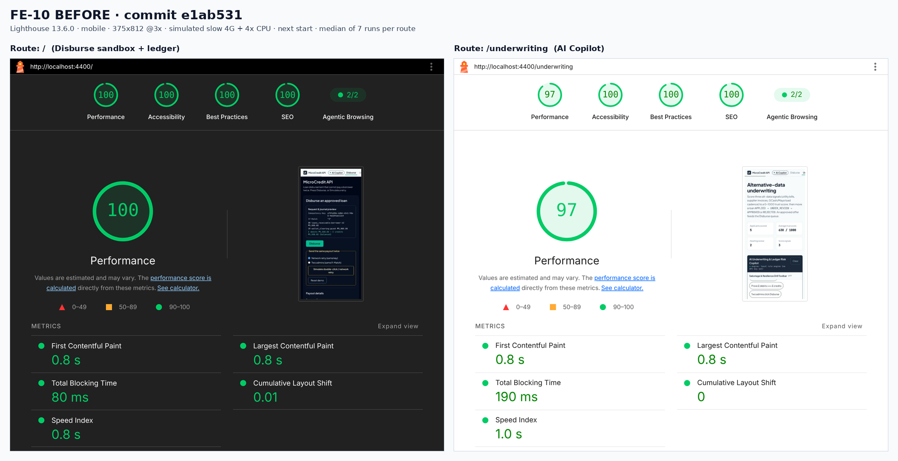
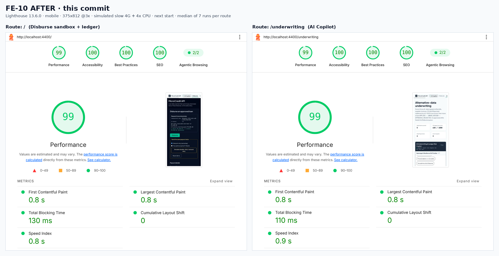
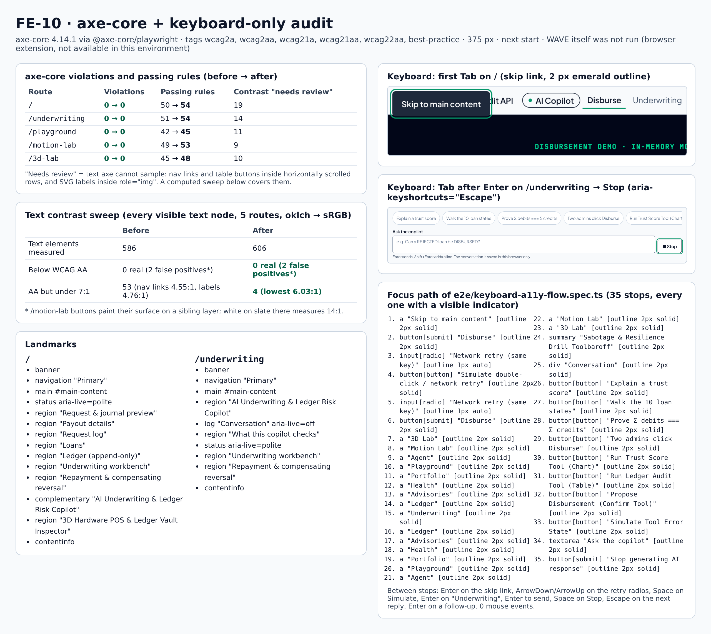

# FE-10 · Accessibility and Performance Audit

> Mirror of [`AUDIT.md`](../AUDIT.md) at the repository root (the FE-10 deliverable). Edit the root file first, then copy it here.

Routes audited: `/` (the Disburse sandbox and ledger) and `/underwriting` (the AI Copilot).
`/playground`, `/motion-lab` and `/3d-lab` were also checked for axe violations and contrast.

**How it was measured:**
- **Builds:** `npm run build` + `next start` on the build container. **Before** is commit `e1ab531`; **after** is
  this commit. The same machine and settings were used for both.
- **Lighthouse:** 13.6.0, mobile form factor, 375×812 at 3x, default simulated throttling (slow 4G, 4× CPU).
  **7 runs per route per build**; the tables report medians and ranges.
- **axe-core 4.14.1** (`@axe-core/playwright`), tags `wcag2a`, `wcag2aa`, `wcag21a`, `wcag21aa`,
  `wcag22aa` and `best-practice`, at 375 px.
- **A computed contrast sweep** of every visible text node. Tailwind's `oklch()` colours are converted to
  sRGB through a canvas pixel, and each node is blended over its nearest opaque background.
- **The keyboard-only primary flow:** [`e2e/keyboard-a11y-flow.spec.ts`](../e2e/keyboard-a11y-flow.spec.ts).
- **WAVE was not run.** It is a browser extension (or a keyed API) and is not available here. The axe-core
  rule set covers the same error classes WAVE reports: missing labels, empty buttons and links, contrast,
  landmarks and ARIA misuse. Running the WAVE extension on the live site is a TODO for a person with a
  desktop browser.

---

## Section 1 · Executive summary and score deltas

**The baseline was already strong.** Accessibility, Best Practices and SEO scored 100 on every run, and
performance was 97–100.

The brief expected a baseline of 78–82 performance and 86–89 accessibility. That is not what this app
measured, so the deltas below are smaller than the brief's target table.

What actually moved:
- `/underwriting`'s LCP no longer lands at ~3.2 s in about half the runs.
- `/underwriting` loads 130 KB less JavaScript before the `load` event.
- The one layout shift on `/` is gone.
- 49 borderline text elements now pass 7:1.
- The keyboard and screen-reader path through the AI chat is complete and tested.

### Lighthouse mobile (median of 7 runs, [range])

| Metric | `/` before | `/` after | `/underwriting` before | `/underwriting` after |
| --- | --- | --- | --- | --- |
| Performance | 100 [98–100] | 99 [98–99] | 97 [90–99] | **99 [98–100]** |
| Accessibility | 100 (7/7) | 100 (7/7) | 100 (7/7) | 100 (7/7) |
| Best Practices | 100 (7/7) | 100 (7/7) | 100 (7/7) | 100 (7/7) |
| SEO | 100 (7/7) | 100 (7/7) | 100 (7/7) | 100 (7/7) |
| First Contentful Paint | 0.76 s | 0.76 s | 0.76 s | 0.76 s |
| Largest Contentful Paint | 0.76 s [0.76–0.77] | 0.76 s [0.76–0.76] | 0.77 s **[0.76–3.29]** | **0.76 s [0.76–0.76]** |
| Runs with LCP over 1.8 s | 0 / 7 | 0 / 7 | **3 / 7** | **0 / 7** |
| Total Blocking Time | 81 ms [46–166] | 127 ms [102–166] | 171 ms [107–186] | **108 ms [90–156]** |
| Cumulative Layout Shift (worst run) | **0.010** | **0.000** | 0.000 | 0.000 |
| INP | not measured | not measured | not measured | not measured |

### JavaScript and audits

| Metric | `/` before | `/` after | `/underwriting` before | `/underwriting` after |
| --- | --- | --- | --- | --- |
| JS before the `load` event (decoded, Playwright) | 529.2 KB | 529.9 KB | **677.7 KB** (incl. Zod + tool card) | **547.3 KB** (−130.4 KB, −19%) |
| JS in the Lighthouse trace (transfer) | 163.9 KB | 182.6 KB¹ | 215.6 KB | 221.2 KB² |
| axe-core violations | 0 | 0 | 0 | 0 |
| axe-core passing rules | 50 | 54 | 51 | 54 |
| Text under 7:1 (5 routes) | 53 elements | **4 elements** (lowest 6.03:1) | (in the 53) | (in the 4) |
| Text under WCAG AA 4.5:1 | 0 | 0 | 0 | 0 |

How to read these numbers:
- **The `/` TBT range moved up but its sources didn't change.** Lighthouse's `long-tasks` audit lists the
  same tasks in both builds: React hydrating the framework chunk, and the document parse. No new task
  appeared. I read the range as run-to-run variance, not a change in either direction.
- **The `/` performance median (100 → 99) is within that variance.**
- **INP is not reported.** Lighthouse's navigation mode measures TBT, not INP. A real INP needs field data
  or a Lighthouse timespan run with interactions. **TODO.**
- ¹ **`/` downloads 18.7 KB more after `load`.** `/underwriting` is now static, so Next.js prefetches it in
  full from the nav and the copilot card once `/` has loaded. It is not in the critical path, and it makes
  the click to `/underwriting` instant.
- ² **`/underwriting`'s trace includes the tool-card chunk.** It is fetched when the browser is idle after
  load (§6), so it sits inside Lighthouse's trace window but not before `load`.

### Live Vercel (same Lighthouse settings, run from the build container)

| Route | Before (`e1ab531`, 3 runs) | After (`dde0f89`, 7 runs) |
| --- | --- | --- |
| `/` performance | 99 [95–99] | 99 [98–100] |
| `/` LCP | 0.93 s [0.91–0.96] | 0.94 s [0.91–0.98] |
| `/underwriting` performance | 96 [96–99] | **99 [96–100]** |
| `/underwriting` LCP | 0.98 s **[0.93–2.42]** | **0.93 s [0.91–0.96]** |
| `/underwriting` TBT | 158 ms [134–221] | 114 ms [76–237] |
| CLS (worst run, both routes) | 0 | 0 |

- Accessibility, Best Practices and SEO were 100 on every live run, before and after.
- Vercel now serves `/underwriting` as a prerendered page (`x-vercel-cache: PRERENDER`).
- The live "before" set is only 3 runs, so its range is less certain than the local 7-run comparison above.

---

## Section 2 · Lighthouse mobile screenshots

Each image shows the median run of the 7 for each route (the Lighthouse HTML report, score and metrics
sections).

---

## Section 3 · WAVE-class evaluation: landmarks, contrast, labels

| Check | Result |
| --- | --- |
| Errors (axe violations: labels, names, ARIA, landmarks, contrast) | **0** on `/`, `/underwriting`, `/playground`, `/motion-lab`, `/3d-lab`, before and after. The new browser check keeps it at 0. |
| Contrast errors | **0** below AA in 606 measured text nodes. The sweep also flags 2 false positives on `/motion-lab` (a button whose surface is a sibling layer; white on slate there is 14:1). |
| Contrast "needs review" (axe) | 9–19 per route, unchanged. These are text axe cannot sample: nav links and the "Review L-104x" buttons inside horizontally scrolled rows, and SVG labels inside `role="img"`. The computed sweep covers them: all pass AA, and the nav links are now 7:1+. |
| Borderline text fixed | Inactive nav links `text-slate-500` (4.55:1) → `text-slate-600`; stat labels on `/underwriting` (4.76:1) → `text-slate-600`. Under-7:1 elements: 53 → 4. |
| Landmarks | Every route: `banner`, `navigation "Primary"`, `main#main-content`, `contentinfo` (new footer), and labelled `region`s. `/underwriting` adds `log "Conversation"` (aria-live off) and one `status` (aria-live polite). |
| Skip link | "Skip to main content" is the first Tab stop on every route and lands focus in `<main id="main-content" tabindex="-1">`. |
| Form labels | axe `label`, `button-name` and `link-name` pass on all 5 routes. Every form control has `<label htmlFor>`, `aria-invalid` and `aria-describedby` (CLAUDE.md §11 rule 1, unchanged). |
| Reviewed and accepted | On `/` the Disburse and Simulate buttons come before the pre-filled payout fields, so they sit above the fold on a 360 px phone (`e2e/fold.mjs`). The DOM order matches the visual order, so the focus order follows the layout (WCAG 2.4.3). |

---

## Section 4 · AI-specific accessibility: streamed output and Stop

**Polite announcements, no token spam.** A reply streams at up to ~45 tokens a second.

- **The transcript does not announce tokens.** It is `role="log"` with `aria-live="off"`. A polite live log
  would queue an announcement for every token. NVDA and JAWS hold announcements while `aria-busy` is
  true, but VoiceOver does not, so `aria-busy` alone does not prevent the flood.
- **One `role="status"` line speaks for the chat** (`aria-live="polite"`, `aria-atomic="false"`, in
  [`StreamingUnderwritingChat.tsx`](../src/features/ai-copilot/StreamingUnderwritingChat.tsx)). It changes
  only at milestones:
  1. "Copilot is thinking."
  2. "Copilot is replying."
  3. "Reply complete. <first sentence>". FE-10 adds the summary.
  4. Or "Stopped. The partial reply is kept."
- **The summary is built by `settledSummary()`** (`chatTypes.ts`):
  - the reply's first sentence, with Markdown symbols and code blocks dropped;
  - capped at 160 characters;
  - for a tool-only reply, "1 tool result below." instead.
- **The live reply bubble** (`group "Copilot reply"`) carries `aria-busy="true"` until the reply settles.

**Stop: keyboard-reachable, with an Escape shortcut.**
- **Stop is the next Tab stop after the prompt, always.** Send and Stop are the same `<button>` directly
  after the `<textarea>`, so Stop is never removed from the tab order while a reply is in flight.
- **While busy, the button is named "Stop generating AI response"** and carries
  `aria-keyshortcuts="Escape"`. Its visible text is "■ Stop", and the accessible name starts with "Stop",
  so it satisfies WCAG 2.5.3 (label in name).
- **Escape stops the reply** from anywhere inside the copilot region. It does the same as the button: it
  aborts the request, keeps the partial text, and puts focus back in the prompt. Escape does nothing
  when no reply is running.
- **Tested both ways:**
  - Vitest ([`fe10-a11y-audit.test.tsx`](../src/features/__tests__/fe10-a11y-audit.test.tsx)): the
    attributes, the announcements, Escape and focus return. Mutation check: disabling the Escape handler
    fails 1 test.
  - Playwright: Tab → Space on Stop, and Escape on the next reply, both by keyboard only.

---

## Section 5 · Keyboard-only primary flow (`e2e/keyboard-a11y-flow.spec.ts`)

No `click()` and no `fill()`. Every one of the 35 focus stops showed a visible indicator: a 2 px solid
outline, or the browser's own outline on the two radios.

| # | Key pressed | Focused element | Announcement / visible state |
| --- | --- | --- | --- |
| 1 | Tab | link "Skip to main content" | Slides in at top left with a 2 px emerald outline |
| 2 | Enter | `main#main-content` | Focus moves past the nav |
| 3 | Tab ×2 | radio "Network retry (same key)" | Native focus ring |
| 4 | ArrowDown, ArrowUp | radio "Two admins (same If-Match)", then back | Checked state moves with the arrows |
| 5 | Tab | button "Simulate double-click / network retry" | 2 px outline |
| 6 | Space | (same) | Request log: "201 Created · posted JE-0001", then "201 Idempotent replay of JE-0001 · no new ledger entry" |
| 7 | Shift+Tab ×11 | link "Underwriting" in `navigation "Primary"` | 2 px outline on each stop on the way |
| 8 | Enter | (route changes to `/underwriting`; focus stays on the nav link, which persists in the layout) | Next.js route announcer |
| 9 | Tab ×19 | textarea "Ask the copilot" | Passes the rest of the nav, the drill toolbar, the log and 8 prompt chips |
| 10 | type + Enter | textarea | Status: "Copilot is thinking." → "Copilot is replying." |
| 11 | Tab | button "Stop generating AI response" (`aria-keyshortcuts="Escape"`) | 2 px outline |
| 12 | Space | textarea (focus returned) | Status: "Stopped. The partial reply is kept." |
| 13 | type + Enter, then Escape | textarea | Status: "Copilot is replying." → "Stopped. The partial reply is kept." |
| 14 | type + Enter | textarea | Status: "Reply complete. <first sentence of the reply>" |

The full 35-stop focus path is printed in the image in Section 3.

---

## Section 6 · Fix log

| File | Change | Measured effect |
| --- | --- | --- |
| `src/components/ui/IdempotencyKeyText.tsx` (new), `src/features/disbursement/DisbursementForm.tsx` | The server's HTML shows `pending` until hydration swaps in a 36-character UUID. At 375 px the UUID wraps to 2 lines and `pending` used 1, so the swap pushed the form down 16 px. The placeholder now renders `pending` + an `aria-hidden` mask to 36 monospace characters. | CLS on `/`: **0.010 → 0.000** (Lighthouse 7/7 runs; layout-shift observer at 4× CPU: 0.0100 → 0) |
| `src/app/underwriting/page.tsx`, `src/app/underwriting/loading.tsx` (deleted) | The page was `force-dynamic` with a `loading.tsx` skeleton. Next.js sent the skeleton first and swapped the page in from 28 KB further down the HTML; on a throttled phone the LCP paragraph painted ~300–480 ms after first paint. Now static, with no route skeleton. | `/underwriting` LCP over 1.8 s: **3/7 → 0/7** runs. Observed late LCP paints: 3/7 → 0/7. Performance median 97 → 99. |
| `src/features/ai-copilot/toolCardLoader.ts` (new), `StreamingUnderwritingChat.tsx` | `ToolInvocationCard` (with the Zod schemas and ledger proposal code) is its own chunk. It is preloaded when the browser is idle and rendered at once if already loaded (React 19 `use()` with a module cache, so there is no one-frame suspend). A placeholder holds the place if a tool call arrives first. | JS before `load` on `/underwriting`: **677.7 → 547.3 KB** decoded. Zod is no longer in the first load. |
| `StreamingUnderwritingChat.tsx`, `chatTypes.ts` | `settledSummary()` in the status line; `aria-live="polite"` / `aria-atomic="false"` on it; `aria-busy` on the live reply; Escape handler on the region; Stop's `aria-label` and `aria-keyshortcuts` while busy. | New tests: 8 in Vitest, 6 in Playwright. Mutation checks fail as expected. |
| `src/app/layout.tsx` | A skip link (first Tab stop, off-screen until focused) and a `<footer>` (`contentinfo` landmark) with the source and audit links. | Lighthouse a11y stays 100; axe passing rules 50 → 54 on `/`. |
| 13 files (route `page.tsx` files, `health/loading.tsx`, `not-found.tsx`, `RouteErrorPanel.tsx`, `App.tsx`) | Every `<main>` gets `id="main-content" tabIndex={-1}`. | The skip link works on every route (browser-checked on `/`). |
| `src/components/Navbar.tsx` | Inactive links `text-slate-500` → `text-slate-600`; an explicit `outline-accent` focus ring on every nav link. | Nav contrast **4.55:1 → 7:1+** (45 elements across the 5 routes). |
| `src/app/underwriting/page.tsx` | Stat labels `text-slate-500` → `text-slate-600`. | 4.76:1 → 7:1+. |
| `e2e/keyboard-a11y-flow.spec.ts` (new), `package.json` | The keyboard-only flow plus axe on 5 routes; `@axe-core/playwright` 4.14.0 as a dev dependency. | Runs in CI with `npm run test:e2e`. |
| `src/features/__tests__/fe10-a11y-audit.test.tsx` (new); 3 existing test files | 8 tests. The existing tests now look for "Stop generating AI response" and accept the summary after "Reply complete." | `npm test` 516 → 524. |
| `e2e/fe08.mjs`, `docs/FE-08_ERROR_AND_EDGE_CASES.md` | The `/underwriting` skeleton check is removed with the skeleton (see the static-page row above). | FE-08 drill 32 → 31 checks, 31/31 passing. |

### Tried and rejected

| Change | Why it was not kept |
| --- | --- |
| `experimental.inlineCss` | It removed Lighthouse's "render-blocking request" finding but made FCP/LCP on `/underwriting` worse (0.8 → 1.0 s). Each HTML response grew ~30 KB, and the CSS could no longer be cached across pages. Reverted. |
| `next/font/google` | The fonts are already self-hosted with `next/font/local` and `display: 'swap'`. There is no external stylesheet, and CLAUDE.md §12 requires self-hosting. Blocking every font file did not change LCP timing, so fonts were not the bottleneck. |
| `optimizePackageImports` | Nothing in `src/` imports a barrel package (no `lucide-react`, no icon or utility barrels in client code); Next already optimises `lucide-react` by default. |
| `aria-live="polite"` on the transcript | It would queue an announcement for every streamed token. VoiceOver ignores `aria-busy`, so it would not stop the flood. The single status line speaks instead (Section 4). |
| A "Primary navigation" label | Screen readers add the role, so it would be read as "Primary navigation navigation". It stays `aria-label="Primary"`. |

### Checks for this commit

`npm run typecheck` 0 · `npm run lint` 0 · `npm test` 524/524 · `npm run build` 0 · `npm run test:e2e` 18/18 ·
`npm run test:e2e:fold` 67/67 · `npm run test:e2e:fe08` 31/31.
