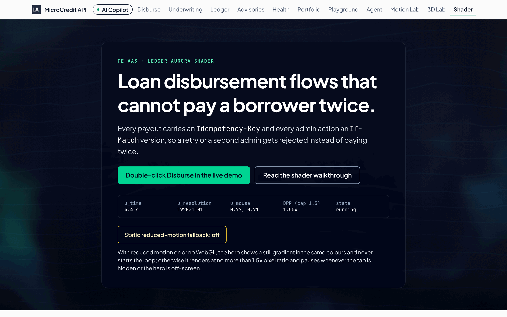

# FE-AA3 · Signature Hero: A Fullscreen Shader

- **Live:** https://microcredit-api-beta.vercel.app/shader-hero, plus a link card on
  https://microcredit-api-beta.vercel.app/ (the card is static; the shader runs only on `/shader-hero`)
- **Code:** [`src/features/shader-hero/`](../src/features/shader-hero/):
  - [`LedgerAuroraShader.ts`](../src/features/shader-hero/LedgerAuroraShader.ts): the GLSL source, WebGL setup,
    the DPR cap and the static fallback;
  - [`FullscreenShaderHero.tsx`](../src/features/shader-hero/FullscreenShaderHero.tsx): the hero, the loop, the
    pause logic and the live uniform readout;
  - [`src/app/shader-hero/page.tsx`](../src/app/shader-hero/page.tsx): the route.
- **Tests:**
  - [`FullscreenShaderHero.test.tsx`](../src/features/shader-hero/__tests__/FullscreenShaderHero.test.tsx) (9, Vitest);
  - [`e2e/shader-hero.spec.ts`](../e2e/shader-hero.spec.ts) (4 browser checks), plus `/shader-hero` in the axe-core
    loop of [`e2e/keyboard-a11y-flow.spec.ts`](../e2e/keyboard-a11y-flow.spec.ts) and in
    [`e2e/fold.mjs`](../e2e/fold.mjs).
- **Screenshot:** [`docs/assets/curated/fe-aa3-shader-hero.png`](./assets/curated/fe-aa3-shader-hero.png)
  (1280×800 at 2x, state `running`, DPR readout `1.50x`)



## The one-liner (reduced motion and performance fallback)

> With reduced motion on or no WebGL, the hero shows a still gradient in the same colours and never starts the loop;
> otherwise it renders at no more than 1.5x pixel ratio and pauses whenever the tab is hidden or the hero is
> off-screen.

It is the `FALLBACK_ONE_LINER` constant in `LedgerAuroraShader.ts`, so the page and this doc quote the same string.
The toggle button on the hero points at it with `aria-describedby`.

**How it ties to the One Claim.** The headline over the shader is the One Claim word for word. The primary button
sends the reader to `/`, where **Disburse** fires twice and the second request comes back as a replay. The shader
proves nothing about duplicate payouts. It is coursework, like `/motion-lab` and `/3d-lab`, and it stays off `/`
so the sandbox keeps the first screen.

---

## 1 · What I built

| Requirement | Where | What it does |
| --- | --- | --- |
| An original fragment shader | `FRAGMENT_SHADER_SOURCE` | "Ledger Aurora": slate ribbons from domain-warped fBm, a faint sky and emerald glow where they fold, and about 18 ruled ledger lines that bend with the flow. WebGL 1 / GLSL ES 1.00, no textures, 0 network requests. |
| `u_time`, `u_resolution`, `u_mouse` | `createLedgerAuroraRenderer()` | Set every frame from JavaScript. `u_time` only advances while the loop runs. `u_mouse` is eased toward the pointer (`1 − e^(−6·dt)` per frame). |
| One draw per frame | `VERTEX_SHADER_SOURCE` | A single triangle at `(−1,−1)`, `(3,−1)`, `(−1,3)` covers the screen. The GPU clips it, so each pixel is shaded once. |
| Compile diagnostics | `compile()` | A failed compile or link returns the driver's log as a reason. The hero shows it as "WebGL did not start (…)" and switches to the static gradient. |
| Fullscreen hero | `FullscreenShaderHero.tsx` | `min-h-[85vh]`, the canvas behind a `bg-slate-950/65 backdrop-blur-[2px]` scrim, the headline, the proof line, two CTAs and a live `<dl>` of the uniforms, DPR and state. |
| Pause rules | the effect in `FullscreenShaderHero.tsx` | `visibilitychange` and an `IntersectionObserver` both feed one `sync()`. The `requestAnimationFrame` loop exists only while the tab is visible and the hero is on screen. |
| Reduced motion | `usePrefersReducedMotion()` + the toggle | The OS setting is read live (no reload). Under `reduce`, or with the toggle on, there is no `<canvas>` and no WebGL context, only `STATIC_FALLBACK_BACKGROUND`. |
| Clean teardown | effect cleanup + `dispose()` | Cancels the frame, removes 3 listeners, disconnects both observers, deletes the buffer and program, and calls `WEBGL_lose_context`. |

## 2 · The shader, block by block, in my own words

The fragment shader answers one question for every pixel: what colour are you right now? It gets three numbers
from JavaScript to work with.

- **`u_time`** is seconds since the hero started. It is not the wall clock. When the tab is hidden or the hero
  scrolls away, I stop adding to it, so the picture picks up exactly where it froze. A frame gap is capped at
  0.1 s, so a debugger pause never makes the ribbons jump.
- **`u_resolution`** is the drawing buffer in device pixels, after the 1.5 cap. On a 1280×734 hero at 2x it reads
  `1920×1101`, not `2560×1468`.
- **`u_mouse`** is the pointer from 0 to 1 on both axes, with y flipped because GL counts from the bottom. It eases
  toward the real pointer instead of snapping, and goes back to the centre when the pointer leaves.

**Block 1 · Coordinates.** `gl_FragCoord` is the pixel's position in device pixels. I divide it by
`u_resolution` to get `uv`, which runs 0 to 1 and drives the slow vertical fade. Then I make `p`: centred on the
screen and divided by the height only. That keeps circles round on a wide monitor and on a tall phone.

**Block 2 · Value noise and the fBm flow field.** `hash()` turns a grid cell into a repeatable random number,
so a cell gets the same value every frame and nothing flickers. `valueNoise()` gives each grid corner a height
and blends the four corners with a smooth S-curve. `fbm()` stacks 4 layers of that noise. Each layer is twice
as fine, half as strong, and turned about 37°, so the layers never line up into a grid. Then comes domain
warping: one fBm call (`q`) decides where to read a second one (`ribbons`). That is what makes the shapes swirl
like ink in water instead of sliding sideways. The same `q` bends about 18 horizontal rules, the ledger sheet.

**Block 3 · The cursor pull.** I put the pointer into the same centred space as `p` and measure how far this
pixel is from it. `pull = exp(−dist² · 6)` is 1 under the cursor and fades to almost 0 about a third of the screen
away. Each pixel then reads the flow from a point up to 8% closer to the cursor, so the ribbons lean toward it.
A small tilt of `(u_mouse − 0.5) · 0.06` shifts the whole sheet, like looking at paper from a new angle.

**Block 4 · Palette and grain.** The base fades from slate-950 `#020617` at the bottom to slate-900 `#0F172A` at
the top. Slate-800 `#1E293B` fills where the ribbons gather, and sky-600 `#0284C7` tints the thicker folds at 22%.
Emerald-600 `#059669` to emerald-500 `#10B981` appears only where the folds overlap most, at 30%. The ruled lines
add sky-400 `#38BDF8` at 3.5%. Last, film grain: a ±1% per-pixel flicker that re-seeds every frame. It breaks
up the colour banding that dark gradients show on 8-bit screens.

**Block 5 · Vignette, the contrast cap and output.** The edges darken to 55%, so the eye stays on the centred
text. Then `color = min(color, vec3(0.36))`: no channel can pass 0.36, whatever the noise does. That cap is the
promise the text relies on. `gl_FragColor = vec4(color, 1.0)` writes the pixel, fully opaque.

**The scrim.** The words never sit on the raw shader. A `bg-slate-950/65` panel with a 2 px backdrop blur sits
under all of them, and the readout adds another `bg-slate-950/70` layer. The blur softens the ruled lines behind
the letters; the 65% slate-950 does the contrast work. Section 4 has the measured result.

## 3 · Responsible shipping checklist

| Check | Status | Evidence |
| --- | --- | --- |
| DPR capped at 1.5 | ✅ | `clampDpr()` in `LedgerAuroraShader.ts`; a 3x screen gets a 1.5x drawing buffer (`e2e/shader-hero.spec.ts`, "capped at 1.5x"). Bad readings (`0`, `NaN`, `Infinity`) count as 1 (Vitest). Mutation check: setting `MAX_DPR = 3` fails 1 test. |
| Pause when the tab is hidden | ✅ | `visibilitychange` cancels the frame and freezes `u_time` (Vitest, and the browser check). Mutation check: removing the listener fails 1 test. |
| Pause when the hero is off-screen | ✅ | `IntersectionObserver`; the browser check scrolls the hero out of view and sees `u_time` hold still for 1.5 s, then resume from the same value. |
| Reduced motion | ✅ | `prefers-reduced-motion: reduce` renders 0 `<canvas>` elements and no loop; turning it off starts the shader without a reload (browser check). |
| Manual fallback toggle | ✅ | "Static reduced-motion fallback" (`aria-pressed`) disposes the renderer and removes the canvas (Vitest). Disabled while the OS asks for reduced motion or WebGL failed, with the reason in text. |
| WebGL failure | ✅ | A failed context, compile or link shows the still gradient and "WebGL did not start (…)" (Vitest). |
| Teardown | ✅ | Unmount deletes the buffer and program and loses the context. Mutation check: removing `renderer.dispose()` fails 2 tests. |
| Text contrast ≥ 7:1 | ✅ | Measured on pixels, section 4. |
| One draw call, no assets | ✅ | 1 triangle, 3 vertices, no textures, 0 network requests for the shader. |
| Keyboard and screen readers | ✅ | The canvas is `aria-hidden`; a polite `role="status"` line says "Shader running." / "paused" / "static…". axe-core: 0 violations on `/shader-hero` at 375 px. |
| Frame time on real phones | **TODO** | Not measured. Headless Chromium uses SwiftShader (a CPU renderer), so its frame times say nothing about a phone GPU. |
| Lighthouse on `/shader-hero` | **TODO** | Not run for this route yet. |

## 4 · Measured evidence

All on `next build` + `next start`, headless Chromium (Playwright 1.63), 2026-11-19.

**Contrast, text over the running shader.** `e2e/shader-hero.spec.ts` reads each text colour, makes every word on
the hero transparent, and screenshots the page 4 times, 400 ms apart. For each line of text it keeps the worst
ratio against any single pixel behind that line (WCAG relative luminance), in any of the 4 frames.

| Text | Colour | Worst pixel ratio |
| --- | --- | --- |
| Headline | white | 19.35:1 |
| Proof line | slate-200 | 15.68:1 |
| `Idempotency-Key`, `If-Match` | white, mono | 19.33:1 |
| Primary CTA "Double-click Disburse in the live demo" | slate-950 on emerald-400 | 10.40:1 |
| Secondary CTA "Read the shader walkthrough" | white | 19.57:1 |
| Eyebrow "FE-AA3 · Ledger Aurora shader" | emerald-300, mono | 12.79:1 |
| Readout labels (`u_time` … `state`) | slate-400, mono | **7.66:1** (the lowest) |
| Readout values | white, mono | 20.18:1 |
| Toggle "Static reduced-motion fallback: off" | amber-100 | 17.88:1 |
| The one-liner | slate-200 | 16.07:1 |

The test fails if any line drops under 7:1. The static gradient (OS reduced motion) is measured the same way
on one frame: lowest 7.60:1 (the `state` label, slate-400), headline 18.98:1, the "Your system asks for reduced
motion…" note 13.21:1. The disabled toggle is skipped, since WCAG 1.4.3 exempts inactive controls.

**Other browser checks** (`e2e/shader-hero.spec.ts`):
- The shader compiles in Chromium: state `running`, 0 console errors, and two screenshots of a corner 1 s apart
  differ.
- `deviceScaleFactor: 3` at 390×844: `canvas.width / clientWidth` is 1.50 on both axes; the readout says `1.50x`.
- Scrolled off-screen: "Shader paused (tab hidden or hero off-screen).", `u_time` unchanged after 1.5 s, and
  0.7 s after scrolling back it is above the paused value by less than 1.5 s.
- 0 px horizontal overflow at 375 px and 1280 px (`e2e/fold.mjs`).

## 5 · Where I changed the brief, and why

| Brief | What shipped | Why |
| --- | --- | --- |
| Background `#060B14` | slate-950 `#020617` | `#060B14` is outside the hues CLAUDE.md §12 rule 1 allows. Slate-950 is the nearest allowed shade. Every other brief colour mapped to an allowed Tailwind shade (slate, sky, emerald). |
| A shader hero for the site | `/shader-hero` only; a static link card on `/` | §12 rule 4 bans gradients, abstract art and looping motion in the hero. The shader runs under a scoped exception (CLAUDE.md §12 rule 4, `docs/PORTFOLIO_DESIGN_SYSTEM.md` "Motion: shader hero"), like the FE-AA2 3D canvas. `/` keeps the Disburse sandbox as its first screen. |
| `document.hidden = true` pauses | `document.visibilityState === 'hidden'` | Same signal (`document.hidden` is derived from it). The tests set `visibilityState` and fire `visibilitychange`, since jsdom and Playwright cannot background a tab. |
| "Text contrast ≥ 7:1" | the 0.36 channel cap + a 65% scrim, measured on pixels | A computed-style check cannot see a canvas. Sampling the real pixels is the only honest test. |

## 6 · How to check it yourself

```bash
npx vitest run src/features/shader-hero
npm run build
npx playwright test e2e/shader-hero.spec.ts --trace off
```

Then open `/shader-hero`, move the pointer and watch `u_mouse`, switch tabs and come back (`u_time` resumes where
it stopped), and press **Static reduced-motion fallback**.
