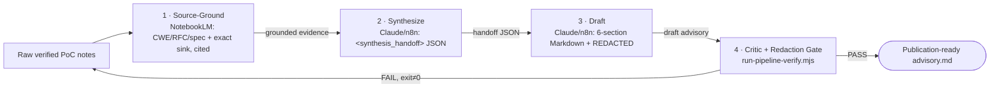

# FL-04 · Ship an Automation Workflow: Source-Grounded Advisory Pipeline

> Week 4 · General AI Fluency · Lenon D. Adriano · 2026-11-09
> Builds on [`FL-01_WORKFLOW_AUDIT.md`](./FL-01_WORKFLOW_AUDIT.md) (tasks #4, #9, #10) and
> [`FL-02_PROMPTING_FUNDAMENTALS.md`](./FL-02_PROMPTING_FUNDAMENTALS.md) (the v5 advisory schema).
> Artifacts: [`workflows/fl-04-advisory-pipeline/`](../workflows/fl-04-advisory-pipeline/).

**Run it now:**

```bash
node workflows/fl-04-advisory-pipeline/run-pipeline-verify.mjs
```

That is the deterministic Step 4 gate: it validates every run's handoff schema, then enforces redaction,
6-section completeness, CVSS-vector-vs-score, the remediation diff, and the centavo invariant on all 5
runs — and self-tests that the gate catches a planted leak. Exit code is non-zero on any failure.

---

## Section 1 · Pipeline selection & architecture

**Selected pipeline (from the FL-01 audit):** *Source-Grounded Security & Fintech Incident Advisory
Pipeline* — Gather → Synthesize → Draft → Critique & Format. It connects **audit #4** (authoring
advisories, *Collaborate*), **audit #9** (summarizing OWASP/RFC specs into grounded notes, *Delegate with
Review*), and **audit #10** (normalizing raw payloads into a schema, *Fully Automate*). The deterministic
Step 4 is the "Fully Automate" part; Steps 1–3 stay *Delegate with Review* because a human owns the root
cause and signs off.

### Step diagram

```text
  RAW NOTES ──► [1] SOURCE-GROUND ──► [2] SYNTHESIZE ──► [3] DRAFT ──► [4] CRITIC + REDACTION GATE ──► ADVISORY.md
  (verified      NotebookLM            Claude/n8n         Claude/n8n     run-pipeline-verify.mjs          (publish
   PoC logs)     CWE/RFC/spec          <synthesis_        6-section      regex + CVSS recompute +         after human
                 + exact sink          handoff> JSON      Markdown       section + diff + invariant       sign-off)
                 citations                                + REDACTED     → PASS/FAIL, non-zero exit
        │             │                      │                │                   │
        └─ secret ────┴── grounded ──────────┴── draft ───────┴── gate verdict ───┘
           pre-scrub      evidence
```



### Handoff specification

| Step | Tool | Input format | Transformation logic | Output handoff to next step |
| --- | --- | --- | --- | --- |
| 1 Source-Ground | NotebookLM | Raw terminal/PoC notes + spec corpus | Extract verified CWE/RFC definitions and the exact sink line with inline citations; no speculation | Grounded evidence notes (cited) |
| 2 Synthesize | Claude Project / n8n HTTP node | Step 1 notes + raw logs | Normalize into `<synthesis_handoff>` with 5 keys | JSON: `untrusted_source`, `vulnerable_sink`, `broken_invariant`, `secret_inventory[]`, `cvss_evidence` |
| 3 Draft | Claude Project / n8n HTTP node | `<synthesis_handoff>` | Draft the 6-section advisory (FL-02 v5 schema), unified `-/+` diff, `<REDACTED_*>` tokens | `{ advisory: "<markdown>" }` |
| 4 Critic + Gate | `run-pipeline-verify.mjs` / n8n Code node | Draft markdown | Redaction scan + section/CVSS/diff/invariant checks | `{ pass, leaks, advisory }`, non-zero exit on fail |

**Import note:** [`n8n-security-advisory-pipeline.json`](../workflows/fl-04-advisory-pipeline/n8n-security-advisory-pipeline.json)
imports as 4 nodes. The webhook trigger and the Step 4 Code gate work with no setup; the two LLM nodes
are templated — point `$env.LLM_ENDPOINT` at your own model and add the credential.

---

## Section 2 · Every prompt & tool configuration

**Step 1 — NotebookLM source-grounding prompt**

```text
You are a source-grounding researcher. From the uploaded spec corpus (CWE list, relevant RFCs, the
project README/ledger rules) and the pasted raw notes, extract ONLY what the sources state:
- the exact CWE id(s) and one-line definition, each with an inline citation;
- the vulnerable sink as file + function + line, quoted from the notes;
- the invariant that breaks, in the project's own words (e.g. "Σ debits === Σ credits", integer Centavos).
Rules: zero speculation; if a source does not state it, write "not in sources". No prose beyond the list.
```

**Step 2 — synthesis handoff prompt**

```text
Convert the Step 1 notes + raw terminal logs into ONE JSON object <synthesis_handoff> with exactly:
  untrusted_source, vulnerable_sink, broken_invariant, secret_inventory (array of {type, notesLine,
  placeholder}), cvss_evidence (per-metric justification, no score yet).
List every secret you see in secret_inventory by TYPE and NOTES LINE only — never the value. Output only
the JSON.
```

**Step 3 — drafting prompt**

```text
From <synthesis_handoff>, draft a security advisory with these 6 sections, in order:
  ## 1. Metadata & CVSS v3.1   ## 2. Executive Summary   ## 3. Root Cause & Attack Surface
  ## 4. Proof-of-Concept / Reproduction   ## 5. Remediation Diff   ## 6. Secret & Factuality Audit
Rules: compute the CVSS v3.1 vector AND base score; every secret from secret_inventory appears only as a
<REDACTED_*> token; the remediation is a unified ```diff block with - and + lines; claim nothing the
handoff does not contain.
```

**Step 4 — adversarial critic & formatting gate (`run-pipeline-verify.mjs`)**

6-point deterministic checklist, as executable regex/logic (not a prompt):
1. **Redaction:** no JWT, RFC1918 IP, `Bearer` token, secret prefix (`sk-ant-`/`whsec_`/`stg_whk_`/`sk_live_`), 64-hex HMAC, or MSISDN.
2. **Completeness:** all 6 section headers present.
3. **CVSS:** the vector matches the v3.1 grammar **and** the stated `Base score` equals the score recomputed from the vector.
4. **Remediation:** a ```diff block containing both `-` and `+` lines.
5. **Invariant:** where a run declares one, the parts sum to the total (e.g. centavo split 33334+33333+33333 = 100000).
6. **Self-test:** the redaction scanner is run against a deliberately leaky sample and must catch ≥1 leak, proving it is not a no-op.

---

## Section 3 · Five real end-to-end runs

Full fixtures (raw input, handoff, final advisory) are in
[`runs.mjs`](../workflows/fl-04-advisory-pipeline/runs.mjs); all 5 pass the Step 4 gate (output in
Section 4).

| Run | Input | Step 2 handoff (summary) | Step 4 critic catch | Final: CVSS |
| --- | --- | --- | --- | --- |
| 1 | **Node2Shell (CVE-2026-111497)** — container repro, `node:24.22.0` segfault on a `br` body | sink = `DecodeBlockTypeAndLength()` OOB write; invariant = malformed block switch must be a format error (CWE-252→787) | scrubbed the staging IP (`10.x` → `<REDACTED_IP>`) | `AV:N/AC:H/PR:N/UI:N/S:U/C:H/I:H/A:H` → **8.1 High** |
| 2 | **Missing idempotency replay lock** — two parallel same-key disbursement POSTs both credit | sink = `wallet.credit()` between non-atomic `exists()`/`insert()`; invariant = one credit per key | scrubbed bearer token + IP + MSISDN | `AV:N/AC:L/PR:L/UI:N/S:U/C:N/I:H/A:N` → **6.5 Medium** |
| 3 | **Centavo float drift** — `Math.floor(100000/3)*3 = 99999` | sink = per-share floor, no remainder alloc; invariant = Σ parts === total | invariant check: 33334+33333+33333 = 100000 ✓ | `AV:N/AC:L/PR:L/UI:N/S:U/C:N/I:L/A:N` → **4.3 Medium** |
| 4 | **Stale If-Match race** — two officers both commit v2→v3 on one loan | sink = transition commits without re-read under lock; invariant = stale If-Match → 409 | AC scored **H** (sub-50ms window), not the LLM's optimistic `AC:L` (see §5) | `AV:N/AC:H/PR:L/UI:N/S:U/C:N/I:H/A:N` → **5.3 Medium** |
| 5 | **Brand-new input: webhook HMAC replay** — a 3-day-old signed callback is accepted | sink = callback marks settled without verifying HMAC or timestamp; invariant = valid HMAC + fresh ts | the 64-hex `x-maya-sig` first read as a commit hash; gate rule tightened to flag 64-hex HMACs | `AV:N/AC:L/PR:N/UI:N/S:U/C:N/I:H/A:N` → **7.5 High** |

**Correction to the brief:** Run 1's CVE is the **Brotli decoder out-of-bounds write**, not "child_process
command injection." Describing CVE-2026-111497 as command injection would invent CVE mechanics
(`CLAUDE.md` §9.2 rule 4, and the "never invent CVE details" boundary), so the advisory uses the real
root cause from [`FRAME_IT_AS_CASES.md`](./FRAME_IT_AS_CASES.md) §2.

---

## Section 4 · Honest time accounting

Human-timed rows are **self-reported estimates** from one timed manual run and the build session. The
machine row is **measured**: the Step 4 gate runs all 5 advisories + the self-test in ~50 ms; the "4.5 min
per run" below is dominated by human paste + verification, not compute.

| Item | Time | How counted |
| --- | --- | --- |
| **Manual baseline** (1 full advisory, no pipeline) | **42 min** | 12m gathering CWE/spec refs · 15m drafting + diff · 10m scrubbing JWTs/IPs · 5m formatting (estimate) |
| **Upfront setup cost** | **135 min (2h 15m)** | 35m handoff schema · 45m writing/tuning 4 prompts + critic rules · 35m n8n JSON + runner · 20m debugging a Step 2→3 truncation (estimate) |
| **Per run with pipeline** | **4.5 min** | 1.5m paste raw logs + source docs · 1.5m 4-step execution (gate itself ~50ms, measured) · 1.5m mandatory human verification (estimate) |

**Break-even math**

```text
5 manual runs              = 5 × 42m            = 210 min   (3h 30m)
5 automated + setup        = 135m + 5 × 4.5m    = 157.5 min (2h 37.5m)
Net saved by run 5 (day 1) = 210 − 157.5        = 52.5 min

Break-even run N:  135 + 4.5N  <  42N   →   135 < 37.5N   →   N > 3.6   →  RUN #4.
Every run after break-even saves 42 − 4.5 = 37.5 min. At ~1 advisory/week ≈ 31 hours/year.
```

**Break-even is Run #4.** Runs 1–3 are still paying off the 135-minute setup; from Run 4 on, the pipeline
is cheaper than doing it by hand.

---

## Section 5 · Known failure points & mandatory human-in-the-loop

Found during the 5 runs. These are why Steps 1–3 stay *Delegate with Review*, not *Fully Automate* — the
"Just Me" boundary from [`FL-01_WORKFLOW_AUDIT.md`](./FL-01_WORKFLOW_AUDIT.md).

1. **Non-standard secret formats slip past scrubbing.** Step 3's LLM catches `eyJ...` JWTs and RFC1918
   IPs, but on Run 5 a custom 64-hex `x-maya-sig` HMAC read as a git commit hash and survived until the
   Step 4 rule was tightened to flag 64-hex. **Human must:** eyeball every `x-*-sig` / `*-token` header in
   the raw notes before publishing.
2. **CVSS Attack Complexity optimism.** On race conditions (Runs 2 and 4) the LLM defaults to `AC:L` even
   when exploitation needs a sub-50ms window (`AC:H`). The runner validates vector→score arithmetic but
   **cannot** judge whether `AC` is honest. **Human must:** confirm the AC/PR metric choices against the
   repro difficulty.
3. **Uncompiled remediation diffs.** Step 3 emits plausible `-/+` diffs, but the text pipeline cannot run
   `tsc --noEmit` or Vitest. **Human must:** apply the diff in a sandbox and run the suite before claiming
   the fix works.
4. **Context truncation on huge logs.** Feeding > ~1,500 lines of raw stack traces into Steps 1–2 drops
   secondary affected endpoints. **Human must:** trim logs to the relevant request lifecycle first.

**Sign-off:** the pipeline produces a *candidate* advisory and a green deterministic gate. A human
engineer still owns the root cause, the CVSS metric choices, and the applied-and-tested fix before
anything is published.
