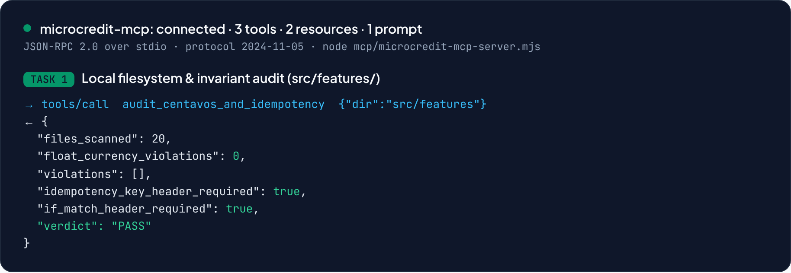
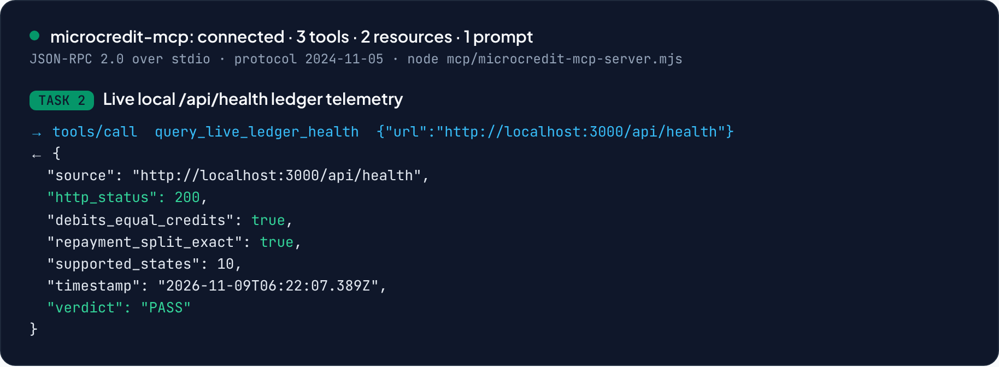
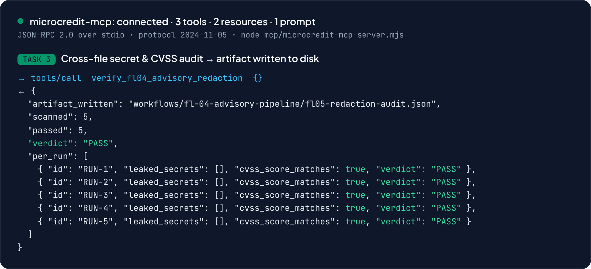

# FL-05 · Agent Concepts and MCP Basics

> Week 4 · General AI Fluency · Lenon D. Adriano · 2026-11-09
> Builds on [`FL-04_AUTOMATION_WORKFLOW.md`](./FL-04_AUTOMATION_WORKFLOW.md) and the pipeline in
> [`workflows/fl-04-advisory-pipeline/`](../workflows/fl-04-advisory-pipeline/).

## Section 1 · The explainer

> **Word count: 707** (target 650–850), measured by `wc -w` on the explainer prose (between this badge and the Section 2 header).

### Workflows vs. agents, and why FL-04 is a workflow

Anthropic's *Building Effective Agents* draws one line that matters: in a **workflow**, human code
defines the control flow; in an **agent**, the model defines its own. A workflow runs the steps I wired,
in the order I wired them, every time. An agent is given a goal and a set of tools, and it decides which
tool to call, reads what comes back, and keeps going until it judges the goal met or gives up.

My FL-04 advisory pipeline is a **workflow** — specifically **prompt chaining with an evaluator gate**.
The control flow is fixed in my code and my prompts: Step 1 Gather → Step 2 Synthesize → Step 3 Draft →
Step 4 Critique. Each step hands the next a defined artifact: Step 2 emits a `<synthesis_handoff>` JSON,
Step 3 emits a 6-section Markdown draft, Step 4 runs a deterministic gate. The model never chooses the
order, never decides to loop, and never picks a tool. Step 4 is the evaluator: a plain Node script that
scans for leaked secrets, recomputes the CVSS score from the vector, and checks the six sections — then
exits non-zero on a fail. Nothing in that path is autonomous. That is a feature, not a limitation: for
turning verified notes into a redacted advisory, a fixed pipeline is faster, cheaper, and far easier to
audit than letting a model improvise. I know exactly what runs and in what order.

### What MCP is, and its three primitives

The **Model Context Protocol** is a standard for connecting an AI host to local or remote systems — the
"USB-C port for AI applications." Instead of every tool inventing its own glue, a host (Claude Code,
Claude Desktop) speaks JSON-RPC 2.0 to any MCP **server**, and the server exposes its capabilities in
three primitives. My repo's server, `mcp/microcredit-mcp-server.mjs`, exposes all three:

- **Tools** are model-controlled functions with side effects or computation. The model decides to call
  them. Mine: `audit_centavos_and_idempotency` (scans `src/features/` for floating-point money math),
  `verify_fl04_advisory_redaction` (runs the FL-04 critic and writes an audit artifact to disk), and
  `query_live_ledger_health` (calls `/api/health` and checks `Σ debits === Σ credits`).
- **Resources** are application-controlled, read-only context the host can load — file contents, rows,
  config. Mine: `microcredit://spec/invariants` (the integer-centavo and idempotency rules from
  `CLAUDE.md` §4/§11 and `SPEC.md`) and `microcredit://workflows/fl04-runs` (the five real advisory runs).
  A resource computes nothing and changes nothing; it is data the model may read.
- **Prompts** are user-controlled, reusable templates — the slash commands a person triggers. Mine:
  `fl04-security-advisory-audit`, parameterized by a target file, which expands into the full 6-point
  audit instruction.

The split is the point: the user picks prompts, the app offers resources, and the model invokes tools.
Each primitive has a different owner, so a reviewer can reason about who can cause what.

### What FL-04 would need to become an agent

One concrete, high-value upgrade turns the chain into an agent: an **Autonomous Sandbox PoC & Patch
Verification Loop** that replaces Step 3's one-shot diff. Today Step 3 emits a plausible unified diff and
stops — it cannot compile. The agent version would be handed a goal ("make this remediation diff pass the
tests") and three tools: apply a diff to a fresh git worktree, run `npm run typecheck`, and run `vitest`.
It would apply its own diff, read the compiler and test output, and **decide** what to do next: inspect
an adjacent file, rewrite the patch, or declare success. It loops until the suite is green or a hard
**3-iteration circuit breaker** trips, so a wrong patch can't burn tokens forever.

That is a real agent: the model directs its own control flow, chooses tools in an order I did not script,
and uses environmental feedback (red tests) to decide when it is done. It is worth building because it
closes FL-04's biggest gap — the pipeline can draft a fix but can't prove it works. Crucially, the final
**disclosure sign-off stays human-owned**, per my FL-01 "Just Me" boundary: the agent may iterate a patch
until tests pass, but I still own the root cause and the decision to publish. An agent that verifies its
own code is powerful; an agent that publishes a security advisory with no human in the loop is a liability
I will not ship.

## Section 2 · Evidence: a working MCP server and 3 tasks chat alone could not do

### `.mcp.json`

```json
{
  "mcpServers": {
    "microcredit-mcp": { "command": "node", "args": ["mcp/microcredit-mcp-server.mjs"] },
    "filesystem": { "command": "npx", "args": ["-y", "@modelcontextprotocol/server-filesystem", "."] }
  }
}
```

Connection on start: `microcredit-mcp: connected · 3 tools · 2 resources · 1 prompt` (JSON-RPC 2.0 over
stdio, protocol `2024-11-05`). The official `@modelcontextprotocol/server-filesystem` connector is also
configured, scoped read-only to the repo root.

### The 3 executed tool calls

| Task | MCP tool call | Real result | Why plain browser chat can't do it |
| --- | --- | --- | --- |
| 1 · Local filesystem & invariant audit | `audit_centavos_and_idempotency {dir:"src/features"}` | 20 files scanned, **0** float-currency violations, `Idempotency-Key` + `If-Match` required → **PASS** | Chat can't read my unshared local repo from disk or walk `src/features/`. |
| 2 · Live local ledger telemetry | `query_live_ledger_health {url:"http://localhost:3000/api/health"}` | HTTP 200, `debits_equal_credits: true`, `supported_states: 10` → **PASS** | Chat can't reach a service on my machine's `localhost:3000`. |
| 3 · Cross-file secret & CVSS audit → artifact | `verify_fl04_advisory_redaction {}` | scanned **5** fixtures, 5 passed, wrote `workflows/fl-04-advisory-pipeline/fl05-redaction-audit.json` to disk → **PASS** | Chat can't run my FL-04 critic across local files or write an artifact back to disk. |





Each call is a real JSON-RPC exchange against `mcp/microcredit-mcp-server.mjs`. Resources
(`microcredit://workflows/fl04-runs`) and the prompt (`fl04-security-advisory-audit`) were also exercised
in the same session. None of the three tasks is possible in a browser chat box: they need disk access, a
local port, and the ability to write files — exactly the client-to-system boundary MCP standardizes.
