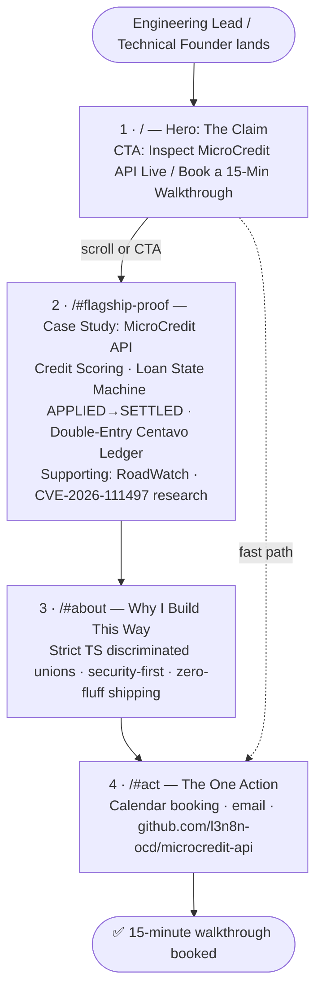
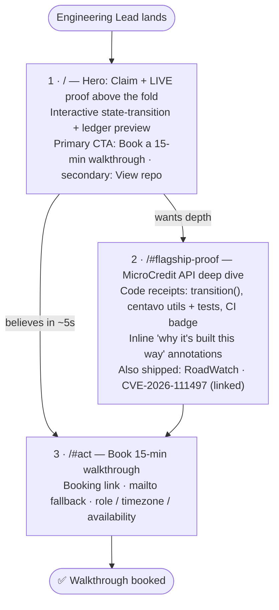

# Portfolio Path — Lenon D. Adriano

> Week 1 · General AI Fluency — *"What Are You Proving?"* & *"Draw the Path: Portfolio Sitemap + Toolkit"*
> Flagship proof: [`l3n8n-ocd/microcredit-api`](https://github.com/l3n8n-ocd/microcredit-api)

---

## Proof Statement

I take complex, high-integrity frontend and full-stack workflows — double-entry
centavo ledgers, finite-state loan lifecycles (`APPLIED` → `SETTLED`), and
idempotent payment mutations — from rough concept to a working tool in
production. I build for the Engineering Lead or Technical Founder at a
fast-moving fintech or SaaS team who needs an engineer that ships reliable,
race-condition-safe interfaces, not brittle demos. My flagship proof is
**MicroCredit API**, an alternative credit-scoring and micro-lending portal where
every peso is an integer, every loan transition is enforced by a state machine,
and every disbursement carries an idempotency key. Inspect the live MicroCredit
API architecture demo and repo, then book a 15-minute technical walkthrough with
me.

| Element        | Definition                                                                                                                                                              |
| -------------- | ----------------------------------------------------------------------------------------------------------------------------------------------------------------------- |
| **One Claim**  | I take complex, high-integrity workflows (double-entry centavo ledgers, `APPLIED` → `SETTLED` loan state machines, idempotent payment mutations) from rough concept to a working tool in production. |
| **One Person** | An Engineering Lead or Technical Founder at a fast-moving fintech/SaaS team who needs reliable, race-condition-safe interfaces, not brittle demos.                       |
| **One Action** | Inspect the live `MicroCredit API` architecture demo/repo → **book a 15-minute technical walkthrough call.**                                                            |

## One-Line Why

A static CV or LinkedIn profile only lists "React and TypeScript," whereas an
interactive portfolio anchored by `MicroCredit API` proves I can enforce strict
state machines, integer-centavo accounting, and idempotency keys in real code.

---

## Portfolio Sitemap (v1 — Lean, 4 Sections)

**Goal:** walk the One Person (an Engineering Lead or Technical Founder) from
landing → believing → acting in **under 30 seconds**. It is a single-page site
with 4 anchored sections and nothing else.

### ASCII Sketch

```text
                  ┌────────────────────────────────────────────┐
  Engineering ──▶ │ 1. /  HERO — THE CLAIM                     │
  Lead lands      │  "I take high-integrity workflows from     │
  (0s)            │   rough concept to a working tool."        │
                  │  [ Inspect MicroCredit API Live /          │
                  │    Book a 15-Min Walkthrough ]  ◀── CTA    │
                  └───────────────────┬────────────────────────┘
                                      │ scroll / click (≈5s)
                                      ▼
                  ┌────────────────────────────────────────────┐
                  │ 2. /#flagship-proof  CASE STUDY            │
                  │ MicroCredit API (l3n8n-ocd/microcredit-api) │
                  │  ├─ Alternative Credit Scoring portal      │
                  │  ├─ Loan State Machine APPLIED → SETTLED   │
                  │  └─ Double-Entry Centavo Ledger            │
                  │  Supporting: RoadWatch · CVE-2026-111497   │
                  └───────────────────┬────────────────────────┘
                                      │ (≈15s)
                                      ▼
                  ┌────────────────────────────────────────────┐
                  │ 3. /#about  WHY I BUILD THIS WAY           │
                  │  Strict TS discriminated unions ·          │
                  │  security-first · zero-fluff shipping      │
                  └───────────────────┬────────────────────────┘
                                      │ (≈5s)
                                      ▼
                  ┌────────────────────────────────────────────┐
                  │ 4. /#act  THE ONE ACTION                   │
                  │  [ Book 15-min call ]  [ Email ]           │
                  │  github.com/l3n8n-ocd/microcredit-api      │
                  └────────────────────────────────────────────┘
                                      │
                                      ▼
                          ✅ Walkthrough booked (<30s)
```

### Mermaid Flowchart



---

## Sitemap Pressure-Test & Revisions

**Prompt (official Week 1 criteria):**
> "Does this sitemap walk my one person from landing, to believing me, to taking
> my one action, and does it actually prove my claim? Tell me which pages earn
> their place, which are wasted, and what is missing. Be specific, not
> encouraging."

### Verdict

**Partially.** v1 walks the Engineering Lead from landing to action, but
the *believing* step depends on a live demo that does not exist yet. Right
now this repository contains documentation only (`README.md`, `CLAUDE.md`,
`LICENSE`): no running app, no tests, no deployment. A Lead who clicks
"Inspect MicroCredit API Live" today lands on a README. That breaks the claim
"from rough concept to a working tool **in production**." No change to the
sitemap fixes that. Only shipping does.

### Page-by-Page

| # | Section | Earns its place? | Why, specifically |
| - | ------- | :--------------: | ----------------- |
| 1 | `/` Hero | ✅ **Yes, needs a fix** | States the claim in the first 2 seconds. But the CTA **packs two actions into one button** ("Inspect … / Book …"), which splits the click. And a claim with no evidence next to it is just an assertion. The Lead has to scroll before seeing any proof. |
| 2 | `/#flagship-proof` | ✅ **Yes, the only section that actually proves the claim** | Problems: (a) it describes the ledger and state machine instead of **letting the Lead operate them**, which is a text wall; (b) three sub-features plus two supporting projects is too much for ~15 seconds; (c) **RoadWatch and CVE-2026-111497 prove security skill, not the One Claim** (high-integrity workflows), so they compete with the flagship for attention. And an unlinked CVE ID is an unverified claim to a Lead. |
| 3 | `/#about` | ❌ **Wasted as its own section** | "Strict TS, security-first, zero-fluff" is **told, not shown**. A Lead skimming for 30 seconds will not read a philosophy section. Every point in it is better shown as a one-line annotation next to the code it describes in Section 2 (e.g., the `LoanState` union next to the state-machine demo). |
| 4 | `/#act` | ✅ **Yes, but cleaner** | Needed. But (a) a **calendar embed** is heavy on slow networks and low-end devices, so a booking link plus a `mailto:` fallback is faster; (b) the **GitHub link here pulls the Lead away from the action**, so it belongs in Section 2, not next to "Book." |

### What's Missing

1. **A deployed, working demo URL.** This is the highest priority. Without it the
   "in production" claim is unproven.
2. **Proof above the fold.** The Lead should see a state transition or a balanced
   ledger entry *before* scrolling.
3. **Code receipts.** These are direct links to the exact `transition(loan, event)`
   function, the `formatPHP` and centavo utilities **with their rounding tests**,
   and a CI status badge. "Race-condition-safe" needs a visible double-submit or
   idempotency replay demo, not a sentence.
4. **Hireability context.** The Lead's real question is "Can I hire this
   person?" Add one line in Section 4 covering role, timezone, and availability
   (full-time or contract).
5. **Verifiable supporting proof.** RoadWatch and CVE-2026-111497 each need one
   public link (repo, advisory, or write-up), or they should be left off.

### ✏️ Revisions Applied (v1 → v2)

| # | Change | Reason |
| - | ------ | ------ |
| **1** | **Embed an interactive loan state-transition + double-entry ledger preview directly in the Hero, above the fold.** The Lead clicks `Disburse` and sees the state move `APPROVED → DISBURSED`, a balanced debit/credit pair post in centavos, and a **second click get blocked by the idempotency key**. | Proof comes before the scroll. The Lead believes the claim in about 5 seconds instead of reading a text wall first. |
| 2 | **Split the Hero CTA.** The primary button is **"Book a 15-min walkthrough."** The secondary text link is "View the repo." | One button, one action. |
| 3 | **Merge `/#about` into `/#flagship-proof`** as inline "Why it's built this way" annotations (discriminated unions, integer centavos, idempotency) next to the code receipts. | Show, don't tell. It also removes a section the Lead would skip. |
| 4 | **Demote RoadWatch and CVE-2026-111497 to a compact "Also shipped" strip** (one line plus one link each) at the end of the case study. | Keeps the flagship focused on the One Claim. Security proof backs it up but doesn't compete with it. |
| 5 | **Simplify `/#act`.** Use a booking link instead of an embed, add a `mailto:` fallback and a hireability line, and move the GitHub link to Section 2. | Faster on low-end devices, and nothing on the page pulls attention from the action. |

**Remaining blocker (not a sitemap change):** build and deploy the interactive
state-machine and ledger demo. Until then, the Hero preview and the claim
"in production" are TODOs, not proof.

### Revised Sitemap (v2 — 3 Sections)


