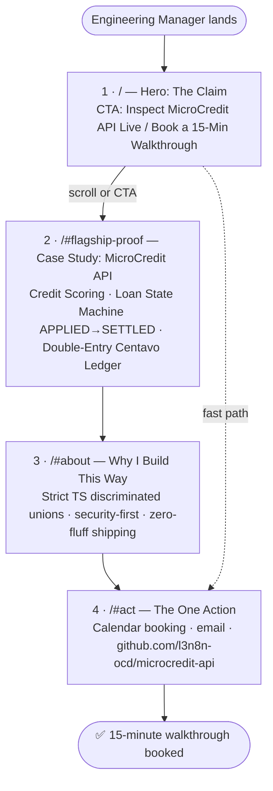
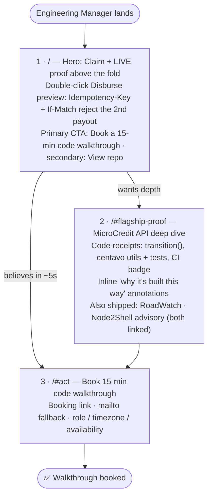

# Portfolio Path — Lenon D. Adriano

> Week 1 · General AI Fluency — *"What Are You Proving?"* & *"Draw the Path: Portfolio Sitemap + Toolkit"*
> Flagship proof: [`l3n8n-ocd/microcredit-api`](https://github.com/l3n8n-ocd/microcredit-api)

---

## Proof Statement

I build loan disbursement flows that cannot pay a borrower twice. In MicroCredit
API, every payout carries an `Idempotency-Key` and every admin action sends an
`If-Match` version, so a retry or two admins clicking at once gets rejected
instead of double-paying. I built it for Engineering Managers at seed-to-Series A
lending startups who cannot afford a duplicate payout. Double-click **Disburse**
in the demo, watch the second request bounce, then book a 15-minute code
walkthrough.

| Element        | Final answer                                                                                         |
| -------------- | ---------------------------------------------------------------------------------------------------- |
| **One Claim**  | I build loan disbursement flows that cannot pay a borrower twice.                                     |
| **One Person** | An Engineering Manager at a seed-to-Series A lending startup who cannot afford a duplicate payout. |
| **One Action** | Double-click **Disburse** in the demo, watch the second request bounce, then book a 15-minute code walkthrough. |

## One-Line Why

A CV or LinkedIn profile can list "React and TypeScript" but cannot show what
happens when a disbursement request fires twice, whereas MicroCredit API lets an
Engineering Manager trigger that exact race and watch the second payout get
rejected.

> Canonical source and sharpening log:
> [`WHAT_ARE_YOU_PROVING.md`](./WHAT_ARE_YOU_PROVING.md). The earlier statement
> ("I take complex, high-integrity … workflows …") was replaced because it fell
> into the "and" trap: three skills in one claim.

---

## Portfolio Sitemap (v1 — Lean, 4 Sections)

**Goal:** walk the One Person (an Engineering Manager at a seed-to-Series A
lending startup) from
landing → believing → acting in **under 30 seconds**. It is a single-page site
with 4 anchored sections and nothing else.

### ASCII Sketch

```text
                  ┌────────────────────────────────────────────┐
  Engineering ──▶ │ 1. /  HERO — THE CLAIM                     │
  Manager lands   │  "I build loan disbursement flows that     │
  (0s)            │   cannot pay a borrower twice."            │
                  │  [ Inspect MicroCredit API Live /          │
                  │    Book a 15-Min Walkthrough ]  ◀── CTA    │
                  └───────────────────┬────────────────────────┘
                                      │ scroll / click (≈5s)
                                      ▼
                  ┌────────────────────────────────────────────┐
                  │ 2. /#flagship-proof  CASE STUDY            │
                  │ MicroCredit API (l3n8n-ocd/microcredit-api)│
                  │  ├─ Alternative Credit Scoring portal      │
                  │  ├─ Loan State Machine APPLIED → SETTLED   │
                  │  └─ Double-Entry Centavo Ledger            │
                  └───────────────────┬────────────────────────┘
                                      │ (≈15s)
                                      ▼
                  ┌────────────────────────────────────────────┐
                  │ 3. /#about  WHY I BUILD THIS WAY           │
                  │  Strict TS discriminated unions ·          │
                  │  security-first · zero-fluff shipping      │
                  └───────────────────┬────────────────────────┘
                                      │ (≈5s)
                                      ▼
                  ┌────────────────────────────────────────────┐
                  │ 4. /#act  THE ONE ACTION                   │
                  │  [ Book 15-min call ]  [ Email ]           │
                  │  github.com/l3n8n-ocd/microcredit-api      │
                  └────────────────────────────────────────────┘
                                      │
                                      ▼
                          ✅ Walkthrough booked (<30s)
```

### Mermaid Flowchart



---

## Sitemap Pressure-Test & Revisions

**Prompt (official Week 1 criteria):**
> "Does this sitemap walk my one person from landing, to believing me, to taking
> my one action, and does it actually prove my claim? Tell me which pages earn
> their place, which are wasted, and what is missing. Be specific, not
> encouraging."

### Verdict

**Partially.** v1 walks the Engineering Manager from landing to action, but
the *believing* step depends on a live demo that does not exist yet. Right
now this repository contains documentation only (`README.md`, `CLAUDE.md`,
`LICENSE`, `docs/`): no running app, no tests, no deployment. A manager who
clicks "Inspect MicroCredit API Live" today lands on a README, so the One Action
("Double-click **Disburse** in the demo") can't be taken yet. No change to the
sitemap fixes that. Only shipping does.

### Page-by-Page

| # | Section | Earns its place? | Why, specifically |
| - | ------- | :--------------: | ----------------- |
| 1 | `/` Hero | ✅ **Yes, needs a fix** | States the claim in the first 2 seconds. But the CTA **packs two actions into one button** ("Inspect … / Book …"), which splits the click. And a claim with no evidence next to it is just an assertion. The manager has to scroll before seeing any proof. |
| 2 | `/#flagship-proof` | ✅ **Yes, the only section that actually proves the claim** | Problems: (a) it describes the ledger and state machine instead of **letting the manager operate them**, which is a text wall; (b) three sub-features is a lot to take in within ~15 seconds. |
| 3 | `/#about` | ❌ **Wasted as its own section** | "Strict TS, security-first, zero-fluff" is **told, not shown**. A manager skimming for 30 seconds will not read a philosophy section. Every point in it is better shown as a one-line annotation next to the code it describes in Section 2 (e.g., the `LoanState` union next to the state-machine demo). |
| 4 | `/#act` | ✅ **Yes, but cleaner** | Needed. But (a) a **calendar embed** is heavy on slow networks and low-end devices, so a booking link plus a `mailto:` fallback is faster; (b) the **GitHub link here pulls the manager away from the action**, so it belongs in Section 2, not next to "Book." |

### What's Missing

1. **A deployed, working demo URL.** This is the highest priority. Without it the
   One Action (double-click **Disburse**) can't be taken.
2. **Proof above the fold.** The manager should see a state transition or a balanced
   ledger entry *before* scrolling.
3. **Code receipts.** These are direct links to the exact `transition(loan, event)`
   function, the `formatPHP` and centavo utilities **with their rounding tests**,
   and a CI status badge. "Race-condition-safe" needs a visible double-submit or
   idempotency replay demo, not a sentence.
4. **Hireability context.** The manager's real question is "Can I hire this
   person?" Add one line in Section 4 covering role, timezone, and availability
   (full-time or contract).

### ✏️ Revisions Applied (v1 → v2)

| # | Change | Reason |
| - | ------ | ------ |
| **1** | **Embed an interactive loan state-transition + double-entry ledger preview directly in the Hero, above the fold.** The manager double-clicks `Disburse` (the One Action) and sees the state move `APPROVED → DISBURSED`, a balanced debit/credit pair post in centavos, and a **second click get blocked by the idempotency key**. | Proof comes before the scroll. The manager believes the claim in about 5 seconds instead of reading a text wall first. |
| 2 | **Split the Hero CTA.** The primary button is **"Book a 15-min code walkthrough."** The secondary text link is "View the repo." | One button, one action. |
| 3 | **Merge `/#about` into `/#flagship-proof`** as inline "Why it's built this way" annotations (discriminated unions, integer centavos, idempotency) next to the code receipts. | Show, don't tell. It also removes a section the manager would skip. |
| 4 | **Simplify `/#act`.** Use a booking link instead of an embed, add a `mailto:` fallback and a hireability line, and move the GitHub link to Section 2. | Faster on low-end devices, and nothing on the page pulls attention from the action. |

**Remaining blocker (not a sitemap change):** build and deploy the interactive
state-machine and ledger demo. Until then, the Hero preview and the One Action
are TODOs, not proof.

> **Status update (2026-11-05):** the FE-01 toolchain now ships: strict TypeScript,
> Vite, Tailwind, Vitest, oxlint, git hooks, and green CI
> ([`74c36fb`](https://github.com/l3n8n-ocd/microcredit-api/commit/74c36fb) → [`be34d64`](https://github.com/l3n8n-ocd/microcredit-api/commit/be34d64)). The verdict above still
> holds: the `Disburse` demo and its deployment are not built yet.

### Revised Sitemap (v2 — 3 Sections)



> **Update (2026-11-06): supporting proof is back, with public links.** It was removed on 2026-11-05
> because it had no public evidence. Both pieces now have it, so the flagship ends with a one-line
> "Also shipped" strip:
> - [RoadWatch](https://github.com/l3n8n-ocd/roadwatch): public repo, deployed and demoed.
> - The [Node2Shell (CVE-2026-111497) advisory](https://docs.google.com/document/d/1tzEqUoyXrR5_RpeszSFKZX4LhVh_PnoSsjsf9wpNtJo/view).
>
> Framed copy for every section is in [`FRAME_IT_AS_CASES.md`](./FRAME_IT_AS_CASES.md).
