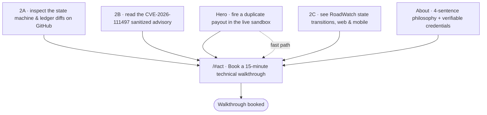

# The Through-Line: Map Content & CTAs

> Week 3 · General AI Fluency · Lenon D. Adriano · 2026-11-09
> Claim: [`WHAT_ARE_YOU_PROVING.md`](./WHAT_ARE_YOU_PROVING.md) · Sitemap: [`PORTFOLIO_PATH.md` v2](./PORTFOLIO_PATH.md#revised-sitemap-v2--3-sections)
> · Cases: [`FRAME_IT_AS_CASES.md`](./FRAME_IT_AS_CASES.md) · Images: [`CURATE_YOUR_IMAGES.md`](./CURATE_YOUR_IMAGES.md)
> · Look: [`IDENTITY_KIT.md`](./IDENTITY_KIT.md)

One claim, one person, one action. Every section and every button on the portfolio funnels to the same
place: **test the live double-click sandbox, then book a 15-minute walkthrough**.

---

## Section 1 · The One-Line Claim (10 candidates → sharpened winner)

> ## ✅ Winner
> ### "I build loan disbursement flows that cannot pay a borrower twice."

This is the canonical One Claim from [`CLAUDE.md` §0](../CLAUDE.md#0-proof-statement--read-first). It
survives the name-swap test (no other developer's portfolio can sign it unchanged), states an outcome a
hiring manager fears (a duplicate payout is lost money), and the proof is one double-click away.

### Why not the brief's draft line

The assignment proposed **"I build frontend and full-stack payment flows that cannot pay a borrower
twice."** That line is the **near-final draft, not the winner**, and sharpening it is this section's
whole point:

- **It reopens the "and" trap** that Week 1 already closed. `WHAT_ARE_YOU_PROVING.md` cut "full-stack
  **and** frontend developer" because the two overlap and hide which one you'd stake your name on.
  "Frontend and full-stack" puts that same trap back.
- **"Full-stack" is not backed yet** (`CLAUDE.md` §9.2 rule 4). MicroCredit API is a React + TypeScript
  frontend talking to an **in-memory mock server** ([`disbursementServer.ts`](../src/features/disbursement/disbursementServer.ts)):
  no deployed backend or database. The only payment flow with a real backend is RoadWatch, whose API a
  teammate built, so it is not yours to claim. Until a backend ships, "full-stack **payment flows**"
  overstates the evidence.
- **The sharpening move:** drop "frontend and full-stack" (label + unearned), narrow "payment flows" to
  the specific "loan disbursement flows," and the winner remains — shorter, checkable, and memorable
  after a 5-second glance.

### The 10 candidates and the selection log

| # | Candidate one-liner | Angle | Verdict |
| --- | --- | --- | --- |
| 1 | I build frontend and full-stack payment flows that cannot pay a borrower twice. | Brief's draft | ❌ "and" trap (frontend + full-stack); "full-stack" unearned (frontend + mock API). The draft the winner is sharpened from. |
| 2 | **I build loan disbursement flows that cannot pay a borrower twice.** | Idempotency / outcome | ✅ **Winner.** One claim, an outcome, name-swap-proof, a 5-second double-click proves it. |
| 3 | I stop an `Idempotency-Key` replay and a stale `If-Match` from paying a borrower twice. | Header mechanism | ❌ Leads with jargon; buries the human outcome behind two header names. |
| 4 | I build fintech frontends that reject duplicate payments. | Category label | ❌ "fintech frontends" is a label, not a claim; "reject duplicate payments" is vaguer than "cannot pay a borrower twice." |
| 5 | I model loan lifecycles as types, so illegal states can't compile. | State machine (Version B) | ❌ Strong, but needs a guided demo, not one click; its pain is a bug class, not lost money. |
| 6 | Every centavo in my ledgers balances, and nothing is ever deleted. | Ledger (Version C) | ❌ Audit pain is a narrower audience; proving it means reading two rows, slower than one click. |
| 7 | I write payment code where a double-click can't double-pay. | Outcome, casual | ❌ Near-duplicate of the winner; "payment code" is weaker and broader than "loan disbursement flows." |
| 8 | I build security-first React apps for moving money. | Security label | ❌ "security-first" is an adjective you can't check (Voice Card §9.3 rule 1); a label, not an outcome. |
| 9 | I keep retries and race conditions from paying a borrower twice. | Failure modes | ❌ Wordier; "retries and race conditions" is mechanism in the headline where the outcome should lead. |
| 10 | I ship disbursement demos an Engineering Manager can try to break in 15 minutes. | The format | ❌ Describes the reader's action, not what you prove; the claim should state the proof, the CTA states the action. |

**How the winner was sharpened for a 5-second glance:** one subject the reader pictures ("loan
disbursement flows"), one twist that is a fact they can test ("cannot pay a borrower twice"), no header
names, no adjectives, no "and". Nine words.

---

## Section 2 · The Complete Content Map

Strongest work leads. The whole site is the sitemap's 3 sections (Hero · Flagship · Act); the brief's
`/about` lives inside the flagship as the "Why I build this way" strip, as
[`PORTFOLIO_PATH.md` v2](./PORTFOLIO_PATH.md#%EF%B8%8F-revisions-applied-v1--v2) decided. It is listed
below as its own block for completeness.

### Summary table

| Page | Ordered sections | Case placed here | Named CTA (every one ends at the One Action) |
| --- | --- | --- | --- |
| `/` Hero | Nav → claim headline + subhead → **live Disburse sandbox** → primary CTA | Flagship lead-in (MicroCredit API) | **Fire a duplicate payout in the live sandbox → book a 15-min walkthrough** |
| `/#flagship-proof` | 2A lead (full width) → 2B → 2C | 2A MicroCredit API · 2B Node2Shell · 2C RoadWatch | Per case, each ending at **book a 15-min walkthrough** |
| `/#about` (inside flagship) | Photo → 4-sentence philosophy → verification strip | Credibility behind all 3 cases | **Skip the resume PDF — pick a 15-minute slot** |
| `/#act` | Booking link → contact links → 1-line reassurance | Terminal destination | **Book a 15-minute technical walkthrough** |

### Section 1 — `/` Hero (claim + live proof above the fold)

| Order | Element | Note |
| --- | --- | --- |
| 1 | Top nav: `LA.` monogram ([`public/favicon.svg`](../public/favicon.svg)) + a green status pill ("CI passing · live demo") | Monogram only; nav stays quiet (`IDENTITY_KIT.md`) |
| 2 | The one-line claim as the `h1`, plus one subhead sentence for the Engineering Manager | "Press **Disburse**, or **Simulate** a double-click, and watch the second request bounce." |
| 3 | The embedded interactive MicroCredit API Disburse sandbox (the real widget, [microcredit-api-beta.vercel.app](https://microcredit-api-beta.vercel.app); [`real-01`](./assets/curated/real-01-disbursement-sandbox.png) as the static fallback) | Must stay above the fold at 360×740 (CI holds it: `e2e/fold.mjs`) |
| 4 | Primary hero CTA | see below |

- **Case here:** Flagship lead-in — the MicroCredit API idempotency trigger itself.
- **Named CTA:** **"Fire a duplicate payout in the live sandbox → then book a 15-min code walkthrough."**
  The primary button scrolls to the Simulate control; a secondary text link jumps to `/#act`.

### Section 2 — `/#flagship-proof` (cases, strongest to supporting)

**2A · Lead case (full width) — MicroCredit API: idempotent disbursement & integer-centavo ledger.**
The 10-state `LoanState` discriminated union (`APPLIED → SETTLED`), the `Idempotency-Key` + `If-Match`
`409 Conflict` guard, the `Σ debits === Σ credits` journal preview, and the Vitest + Playwright proof.
Images: [`real-02`](./assets/curated/real-02-idempotent-replay-conflict.png) (the `201` replay and `409`
over a balanced ledger) and [`real-03`](./assets/curated/real-03-scoring-and-repayment-ledger.png).
- **Named CTA:** **"Inspect the state machine & ledger diffs on GitHub → book a 15-min architecture walkthrough."**

**2B · Supporting case — Node2Shell (CVE-2026-111497): sandboxed reproduction & remediation diff
(VulnTech).** Security-first boundary validation and a deterministic, sanitized PoC. Credit for the
discovery is other researchers'; the work here is the analysis, the differential PoC, and the advisory
(`FRAME_IT_AS_CASES.md` §2). Icon: [`kit-03`](./assets/curated/kit-03-icon-sandbox-trace.svg).
- **Named CTA:** **"Read the sanitized advisory format (FL-02) → ask about security guardrails on the 15-min call."**

**2C · Supporting case — RoadWatch: geotagged incident reporting & verification workflow (BSIT
capstone).** Cross-platform Flutter + cloud state coordination for real users; your part is the Flutter
app and the repo/CI, the API is a teammate's (`FRAME_IT_AS_CASES.md` §2). Icon:
[`kit-04`](./assets/curated/kit-04-icon-geotag-dispatch.svg).
- **Named CTA:** **"See how I model state transitions across web & mobile → schedule a 15-min walkthrough."**

### Section 3 — `/#about` (why I build this way)

| Order | Element | Note |
| --- | --- | --- |
| 1 | Real photo of Lenon | [`real-photo-lenon.jpg`](./assets/curated/real-photo-lenon.jpg) is in the repo. An event-facilitation photo would be a stronger swap (see §4). |
| 2 | 4-sentence plainspoken philosophy | Why money is integer centavos only, why `any` is banned, why AI output is checked against tests before it is trusted, why the guard is tested (delete the replay lookup and 4 tests go red). |
| 3 | Compact verification strip | FlyRank AI Engineering + AI Fluency artifacts (this repo's `docs/`), the live Vitest + Playwright CI badge, BulSU MSC / AWS Student Builder Group leadership. A **RedTeamLeaders Certified LLM Security Professional** badge goes here **once a verifiable link is added** (§4). |

- **Case here:** personal credibility behind all three cases.
- **Named CTA:** **"Skip the resume PDF — pick a 15-minute slot to walk through the repo live."**

### Section 4 — `/#act` (the terminal destination = the Week 1 One Action)

| Order | Element | Note |
| --- | --- | --- |
| 1 | A 15-minute booking link (one-click scheduling) | A link, not a heavy calendar embed, so it is fast on a low-end phone (`PORTFOLIO_PATH.md` v2) |
| 2 | Fast-copy contact: [GitHub](https://github.com/l3n8n-ocd/microcredit-api) and [live demo](https://microcredit-api-beta.vercel.app) links | **GitHub profile only, no email** (`FRAME_IT_AS_CASES.md` §4). Contact runs through the GitHub profile's links. |
| 3 | One reassurance line | "In 15 minutes we walk `transitionLoan`, the `Idempotency-Key` replay-before-`If-Match` check, and the test suite — live, in the repo." |

- **Named CTA (the Week 1 One Action):** **"Book a 15-minute technical walkthrough."**

---

## Section 3 · The CTA Ladder

Every micro-CTA is a rung. None is a dead end; each climbs to the One Action.

```text
  ┌─────────────────────────────────────────────────────────────┐
  │  MICRO-CTAs (what the reader does on each section)           │
  ├─────────────────────────────────────────────────────────────┤
  │  Hero:   Fire a duplicate payout in the live sandbox ───┐    │
  │  2A:     Inspect the state machine & ledger diffs ───────┤    │
  │  2B:     Read the CVE-2026-111497 advisory format ───────┤    │
  │  2C:     See the RoadWatch web/mobile state flow ────────┤    │
  │  About:  Read the 4-sentence philosophy + credentials ──┤    │
  └──────────────────────────────────────────────────────────┼───┘
                                                              ▼
                        ┌───────────────────────────────────────┐
                        │  THE ONE ACTION (Week 1)              │
                        │  Book a 15-minute technical walkthrough│
                        └───────────────────────────────────────┘
```



No rung loops back on itself or exits the page: the GitHub and demo links open in a new tab, so the
booking action stays on screen.

---

## Section 4 · Honest "Still Need to Gather" Checklist

| # | Proof item | Target section | Status | What specifically is missing | Unblocked fallback for build week |
| --- | --- | --- | --- | --- | --- |
| 1 | Live demo, repo, Playwright captures (`real-01/02/03`) | Hero, 2A | ✅ **Ready in repo** | Nothing | — |
| 2 | Before/after engineering numbers (FE-03/FE-04 vague vs precise) | 2A stat strip | ✅ **Ready in repo** | Nothing: `WORKFLOW.md` has 5 tests → 101, and the green `TOO_LARGE` boundary fix; the suite is now 248 passing | Pull 3 stats (5→101→248 tests; 1 real money bug caught; 0 `any`) into a callout |
| 3 | Real headshot / event photo for `/about` | About | 🟡 **Mostly ready** | A head-and-shoulders headshot is already in the repo (`real-photo-lenon.jpg`). What's missing is the *stronger* option: a real photo facilitating an AWS Student Builder Group / BulSU MSC session, cropped to `~400×400` | Ship with the headshot now; swap in the event photo when cropped. Monogram `aspect-square` frame is the last-resort placeholder |
| 4 | Mentor / supervisor testimonial (VulnTech or capstone adviser) | About | 🟡 **Still need to gather** | Permission to quote a 1–2 line endorsement on PoC accuracy or leadership | Omit the quote block; show verifiable credential links + the live CI pass badge until the quote arrives |
| 5 | RoadWatch production screenshots | 2C | 🟡 **Partial** | One clean mobile + web screenshot pair with test data redacted, and attributed to your part (the Flutter app), not the teammate's dashboard (`CURATE_YOUR_IMAGES.md`) | Lead Case 3 with the state diagram + `kit-04` icon card; it ships on day 1 without the screenshots |
| 6 | RedTeamLeaders "Certified LLM Security Professional" badge | About strip | 🟡 **Still need to gather** | A verifiable public link (credential URL or badge ID). Not yet anywhere in the repo, so it can't be stated as fact (`CLAUDE.md` §9.2 rule 4) | Show only credentials that link out (the repo's own CI badge, the public advisory) until the link is in hand |
| 7 | `/#act` contact method | Act | ✅ **Decided** | None: contact stays **GitHub profile only, no email** (confirmed 2026-11-09). No personal email is published | — |
| 8 | Unfinished internship work (Weeks 4–10: FL-04 automation, capstone polish) | 2A "Shipped Engineering Log" | ⏳ **In progress (future weeks)** | Week 4+ pipelines don't exist to link yet | Build a modular "Shipped Engineering Log" row in Case 1 that lists FE-01 → Week 3 now and takes FL-04 and later milestones as single-row adds, no redesign |

**Ready now: items 1, 2, and the Case 1 content.** The build can start on the flagship with real evidence
on day one; items 3–7 have fallbacks so no slot blocks the week, and item 8 is designed to grow.

---

## Verification

| Check | Result |
| --- | --- |
| Winner vs. canon | The winner equals `CLAUDE.md` §0's One Claim, so the site and the repo state one claim, not two. |
| Brief's draft line | Kept as candidate #1 and shown being sharpened, not published as the headline (and-trap + unearned "full-stack"). |
| CTA ladder | All 5 micro-CTAs and the fast path terminate at "Book a 15-minute technical walkthrough"; no dead ends. |
| Gather list honesty | Item 3 corrected (headshot already in repo); item 6 (RedTeamLeaders badge) flagged as needing a link; item 7 decided GitHub-only, no email published. |
| Voice check | `grep` for the banned words prints nothing. |
